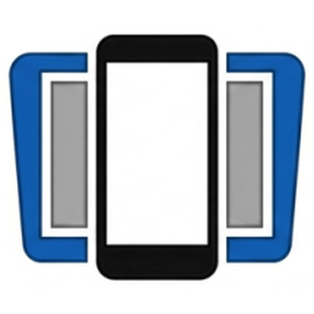
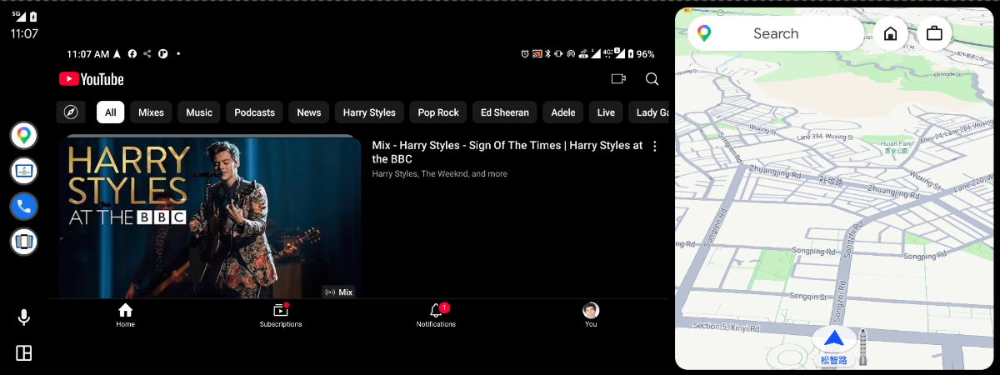
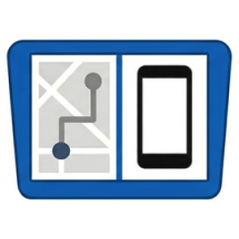

#  ScreenOnAuto

[English](../README.md) | [繁體中文](README.zh-TW.md) | [Português (Brasil)](README.pt-BR.md) | [Español](README.es.md) | [Deutsch](README.de.md) | [Français](README.fr.md) | [Italiano](README.it.md) | [Türkçe](README.tr.md) | [العربية](README.ar.md) | [한국어](README.ko.md) | [Русский](README.ru.md) | [Tiếng Việt](README.vi.md) | [日本語](README.ja.md)

*🌐 [Situs web resmi](https://screenonauto.lzn.idv.tw/id/)*

> Cerminkan layar ponsel Android Anda ke layar Android Auto, dengan dukungan kontrol tombol media.
>
> **Gratis. Tidak ada fitur yang memerlukan pembayaran tambahan.**

> [!IMPORTANT]
> **Cara instal tergantung versi Android Anda:**
> - **Android 14 ke atas** — instal **hanya melalui Google Play**: daftar di salah satu putaran (dibuka setiap setengah jam), lalu instal dalam 25 menit (aplikasi ini **tidak bisa dicari** di Play Store). [Daftar →](https://screenonauto.lzn.idv.tw/join/?lang=id)
> - **Android 13 ke bawah** — pasang APK secara manual dengan KingInstaller ([langkah-langkah di bawah](#instalasi)), atau instal melalui Google Play.

## Fitur

- **Pencerminan layar** — Merekam dan mencerminkan layar ponsel ke head unit Android Auto secara real time
- **Proksi sesi media** — Kendalikan aplikasi media apa pun di ponsel dari UI media bawaan Android Auto
- **Peredupan otomatis** — Meredupkan kecerahan layar ponsel secara otomatis saat pencerminan tidak digunakan (jeda 15/30/60/120 dtk)
- **Peredupan malam** — Meredupkan pencerminan di layar mobil pada malam hari, mengikuti mode siang/malam mobil (atau selalu), dengan kekuatan yang dapat diatur dan tombol layar opsional. Aktifkan di pengaturan Lanjutan; pada pencerminan “ScreenOnAuto”, layar ponsel juga ikut redup, kecuali pencerminan digambar aplikasi aktif
- **Mulai otomatis** — Mulai pencerminan secara otomatis saat Anda membuka ScreenOnAuto atau ScreenOnAuto (Legacy) di layar mobil
- **Kontrol eksternal** — Mulai, hentikan, atau alihkan pencerminan dengan intent, dari aplikasi otomatisasi, pintasan di layar utama, atau ADB — lihat [Kontrol Pencerminan dari Aplikasi Lain](https://github.com/slzn/ScreenOnAuto-releases/wiki/Kontrol-Pencerminan-dari-Aplikasi-Lain)
- **Cegah layar tidur** — Mencegah layar ponsel tidur selama pencerminan
- **Hentikan saat terputus** — Menghentikan pencerminan secara otomatis saat Android Auto terputus
- **Luncurkan aplikasi otomatis** — Membuka aplikasi pilihan di ponsel secara otomatis saat pencerminan dimulai dan Android Auto terhubung
- **Cerminkan aplikasi ini saja** *(Android 15+)* — Hanya mengirim aplikasi yang diluncurkan otomatis ke mobil, bukan seluruh layar, sehingga bagian lain ponsel tetap privat. Memerlukan izin Perekaman layar yang [diberikan lebih dulu lewat ADB](https://github.com/slzn/ScreenOnAuto-releases/wiki/Berikan-Izin-Pencerminan-melalui-ADB); layar mobil menjadi kosong selama Anda meninggalkan aplikasi tersebut
- **Paksa lanskap** — Memaksa ponsel ke orientasi lanskap selama pencerminan; dimulai otomatis saat terhubung, dengan sakelar di layar
- **Pintasan peluncuran** — Tambahkan hingga 4 tombol peluncur aplikasi ke layar pencerminan Android Auto
- **Tombol layar** — Tampilkan atau sembunyikan tombol di layar pencerminan satu per satu di halaman Tombol layar: Paksa lanskap, Peredupan otomatis, Peredupan malam, serta Kembali / Beranda / Aplikasi terbaru ponsel (hingga 4 sekaligus)
- **Penempatan tombol** — Pada pencerminan Legacy, ratakan tombol layar ke kiri atau hindari bilah navigasi ponsel secara otomatis
- **Penyesuaian pencerminan** — Pangkas lebar/tinggi pencerminan di pengaturan Lanjutan untuk head unit yang memotong tepinya; **Pencerminan digambar aplikasi** yang eksperimental di sana juga mencegah distorsi tampilan terpisah
- **Penerusan sentuhan** *(Eksperimental)* — Ketuk, gulir, sentak, dan cubit untuk zoom di layar Android Auto untuk mengendalikan ponsel

## Fitur istimewa

Opsional — memerlukan [Shizuku](https://shizuku.rikka.app/) atau Root. Tanpa keduanya, semua fitur lain tetap berjalan sama persis.

| Fitur | Fungsinya |
|---|---|
| **Matikan layar ponsel** | Mematikan panel ponsel saat Peredupan otomatis aktif, sementara mobil tetap menampilkan pencerminan — menghemat baterai dan mencegah ponsel menerangi kabin di malam hari |
| **Injeksi sentuh nyata** | Meneruskan gerakan jari Anda yang sebenarnya, bukan gestur buatan, sehingga **tekan lama, seret, dan multi-jari** berfungsi pada pencerminan Legacy |
| **Tombol navigasi ponsel** | Kembali / Beranda / Aplikasi terbaru berfungsi **tanpa mengaktifkan Layanan Aksesibilitas sama sekali**. Aktifkan tombolnya di **Tombol layar → Tombol fungsi** |
| **Samakan layar ponsel dengan mobil** | Mengubah bentuk layar ponsel ke rasio aspek head unit selama pencerminan, sehingga bilah hitam dan distorsi tampilan terpisah hilang dari sumbernya — layar mobil diukur secara otomatis |

Shizuku berhenti saat ponsel dicolokkan, atau layar tidak mau menyala lagi? Lihat [Pemecahan masalah](https://github.com/slzn/ScreenOnAuto-releases/wiki/Cara-Menggunakan#fitur-istimewa-shizuku--root).

## Persyaratan

- Android 7.0 (API 24) atau lebih baru
- Android Auto terinstal di ponsel
- Kendaraan yang mendukung Android Auto
- *(Opsional)* [Shizuku](https://shizuku.rikka.app/) atau Root — untuk [Fitur istimewa](#fitur-istimewa)

## Instalasi

### Android 14 ke atas — instal melalui Google Play

Android Auto hanya menjalankan aplikasi yang diinstal dari Play Store, dan Android 14+ memblokir cara KingInstaller — jadi instal melalui pengujian internal Google Play. Ini aplikasi lengkap yang sama seperti di GitHub, tetapi tidak bisa dicari di Play Store: [**daftar di halaman instal**](https://screenonauto.lzn.idv.tw/join/?lang=id). Putaran baru dibuka setiap 30 menit, dan tautan instal Anda muncul beberapa menit setelah pendaftaran putaran Anda ditutup. Langkah lengkap: [**Instal melalui Program Pengujian Google Play**](https://github.com/slzn/ScreenOnAuto-releases/wiki/Instal-melalui-Program-Pengujian-Google-Play).

### Android 13 ke bawah — pasang manual dengan KingInstaller

> **Mengapa KingInstaller?**  
> Android Auto mengharuskan aplikasi diinstal melalui Google Play Store.
> Menginstal APK secara langsung membuat sumber instalasinya tercatat sebagai browser atau
> pengelola file, yang akan ditolak oleh Android Auto. KingInstaller menginstal APK sambil
> melaporkan Google Play Store sebagai sumber instalasi.

#### Langkah 1 — Instal KingInstaller

1. Buka [KingInstaller Releases](https://github.com/fcaronte/KingInstaller/releases) dan unduh `KingInstaller.apk` terbaru
2. Izinkan browser atau pengelola file Anda untuk **menginstal aplikasi yang tidak dikenal** — Android menanyakannya saat pertama kali Anda membuka APK
3. Buka `KingInstaller.apk` lalu ketuk **Instal**

#### Langkah 2 — Instal ScreenOnAuto lewat KingInstaller

1. Unduh `ScreenOnAuto-*.apk` terbaru dari [rilis terbaru](https://github.com/slzn/ScreenOnAuto-releases/releases/latest)
2. Buka **KingInstaller**, ketuk **ikon folder**, lalu pilih APK yang sudah diunduh
3. Ketuk **Install** — KingInstaller akan menginstalnya seolah-olah berasal dari Google Play Store

### Alternatif — dengan dongle AAWireless

> **Kapan memakai cara ini:** instalasi lewat Google Play gagal — misalnya di GrapheneOS dengan Google Play dalam sandbox — dan Anda punya dongle AAWireless. Developer Mode pada dongle ini membuat Android Auto menampilkan aplikasi yang tidak diinstal dari Play Store, sehingga APK bisa diinstal langsung.

1. Unduh `ScreenOnAuto-*.apk` terbaru dari [rilis terbaru](https://github.com/slzn/ScreenOnAuto-releases/releases/latest) lalu instal
2. Hubungkan ponsel ke mobil lewat dongle. Di aplikasi **AAWireless**, matikan **Passthrough mode** dan aktifkan **Developer Mode**
3. Di setelan Android Auto pada ponsel, buka **Setelan developer**, setel **Mode aplikasi** ke **Developer**, lalu aktifkan **Sumber tidak dikenal**
   - Tidak melihat Setelan developer? Ketuk **Info versi dan izin** 10 kali, lalu buka menu ⋮
4. Mulai ulang ponsel

## Verifikasi di Android Auto

Langkah ini berlaku **bagaimanapun cara Anda menginstal** — pasang manual dengan KingInstaller, Google Play, *maupun* cara AAWireless.

Di ponsel, buka **Setelan → Perangkat terhubung → Android Auto → Sesuaikan peluncur**.
Anda seharusnya melihat **dua** entri ScreenOnAuto berikut:

| Ikon | Nama | Fungsi |
|---|---|---|
|  | **ScreenOnAuto** | Mencerminkan layar ponsel dalam layar penuh — menggantikan area peta untuk tampilan layar penuh |
|  | **ScreenOnAuto (Legacy)** | Mencerminkan layar ponsel melalui jalur proyeksi Legacy — bisa ditampilkan berdampingan dengan peta |

Android Auto versi lama juga menampilkan entri ketiga, **Pengontrol Media ScreenOnAuto**. Jika Anda tidak melihatnya, itu normal — kontrol media tetap berfungsi.
Jika salah satu dari **dua** entri di atas tidak ada, instal ulang — lewat KingInstaller untuk pemasangan manual, atau biarkan instalasi dari Play selesai — lalu buka lagi Android Auto. Untuk cara AAWireless, pastikan Developer Mode dan Sumber tidak dikenal masih aktif.

Siap? Lihat **[Cara Menggunakan](https://github.com/slzn/ScreenOnAuto-releases/wiki/Cara-Menggunakan)** untuk memulai pencerminan di mobil.

## Izin

| Izin | Diperlukan untuk |
|---|---|
| Perekaman layar (MediaProjection) | Pencerminan layar |
| Akses notifikasi | Proksi sesi media |
| Tampilkan di atas aplikasi lain | Peredupan otomatis, Paksa lanskap & Peredupan malam |
| Layanan Aksesibilitas | Penerusan sentuhan & tombol Kembali / Beranda / Aplikasi terbaru (tidak diperlukan dengan fitur istimewa) |

> **Tips:** Agar dialog izin Perekaman layar tidak muncul setiap kali aplikasi dibuka, Anda bisa memberikan izin itu lebih dulu lewat ADB — lihat [Berikan Izin Pencerminan melalui ADB](https://github.com/slzn/ScreenOnAuto-releases/wiki/Berikan-Izin-Pencerminan-melalui-ADB). Cara ini juga yang membuka fitur **Cerminkan aplikasi ini saja**.

## Keterbatasan yang diketahui

- **Layar ponsel harus tetap menyala selama pencerminan** — pencerminan menampilkan apa yang ada di layar ponsel. Pakai **Cegah layar tidur** agar layar tetap menyala dan **Peredupan otomatis** untuk menghemat baterai; dengan Shizuku atau Root, Matikan layar ponsel menghapus batasan ini.
- **Konten yang dilindungi DRM tidak bisa dicerminkan** — aplikasi seperti Netflix atau Disney+ menampilkan layar hitam pada pencerminan. Ini adalah batasan platform Android yang tidak bisa diatasi oleh aplikasi.
- **Google Maps di Android Auto bisa menjadi hitam selama pencerminan (Android 15+)** — selama ada aplikasi yang merekam layar, Android menyembunyikan aplikasi yang dianggapnya sensitif, dan Google Maps bisa masuk daftar itu. Untuk memperbaikinya, aktifkan **Opsi developer → Nonaktifkan perlindungan berbagi layar**; dengan begitu Android juga tidak lagi menyembunyikan notifikasi berisi kode sekali pakai saat Anda berbagi layar. Setelan berlaku mulai pencerminan berikutnya; lihat [Cara Menggunakan](https://github.com/slzn/ScreenOnAuto-releases/wiki/Cara-Menggunakan#google-maps-di-android-auto-menjadi-hitam-selama-pencerminan) untuk langkah lengkapnya.
- **Bilah navigasi Android Auto** di layar mobil digambar oleh Android Auto sendiri dan tidak bisa disembunyikan.

## Penafian

Selalu perhatikan jalan — jangan mengoperasikan aplikasi ini saat mengemudi.

Proyek ini tidak berafiliasi dengan, tidak didukung oleh, dan tidak disponsori oleh Google. Android Auto adalah merek dagang Google LLC.

## Terima kasih khusus

- **Jurek Harla** — mendesain ulang ikon ScreenOnAuto, ScreenOnAuto (Legacy), dan Pengontrol Media agar sesuai dengan bentuk ikon bulat Android (v1.9.2).

## Dukungan

Jika aplikasi ini bermanfaat, silakan berdonasi atau traktir saya bubble tea 🧋

