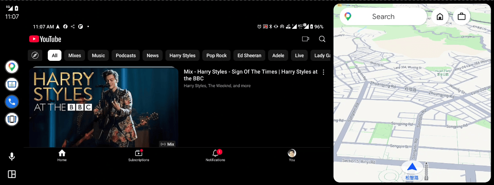

#  ScreenOnAuto

[English](../README.md) | [繁體中文](README.zh-TW.md) | [Português (Brasil)](README.pt-BR.md) | [Español](README.es.md) | [Deutsch](README.de.md) | [Français](README.fr.md) | [Italiano](README.it.md) | [Türkçe](README.tr.md) | [العربية](README.ar.md) | [한국어](README.ko.md) | [Русский](README.ru.md) | [Tiếng Việt](README.vi.md) | [Bahasa Indonesia](README.id.md) | [日本語](README.ja.md)

*🌐 [เว็บไซต์ทางการ](https://screenonauto.lzn.idv.tw/th/)*

> สะท้อนหน้าจอโทรศัพท์ Android ไปยังจอ Android Auto รองรับการควบคุมด้วยปุ่มสื่อ
>
> **ใช้ฟรี ไม่มีฟีเจอร์ใดที่ต้องจ่ายเงินเพิ่ม**

> [!IMPORTANT]
> **วิธีติดตั้ง:**
> - **แนะนำ — Google Play** ใช้ได้กับ Android ทุกเวอร์ชัน: ลงชื่อในรอบที่เปิดทุกครึ่งชั่วโมง แล้วติดตั้งภายใน 25 นาที (แอปนี้**ค้นหาใน Play Store ไม่เจอ**) Android Auto ยอมรับได้ทันทีโดยไม่ต้องตั้งค่าเพิ่ม [ลงชื่อ →](https://screenonauto.lzn.idv.tw/join/?lang=th)
> - **Android 13 และต่ำกว่า** — ไซด์โหลด APK ด้วย KingInstaller ได้ด้วย ([ดูขั้นตอนด้านล่าง](#ทางเลือก--android-13-และต่ำกว่า-ไซด์โหลดด้วย-kinginstaller))
> - **มีดองเกิล AAWireless ไหม?** — ติดตั้ง APK โดยตรงได้ด้วย ใช้ได้กับ Android ทุกเวอร์ชัน ([ดูขั้นตอนด้านล่าง](#ทางเลือก--ใช้ดองเกิล-aawireless))

## ฟีเจอร์

- **สะท้อนหน้าจอ** — จับภาพและสะท้อนหน้าจอโทรศัพท์ไปยังเครื่องเสียงรถที่รองรับ Android Auto แบบเรียลไทม์
- **พร็อกซีเซสชันสื่อ** — ควบคุมแอปสื่อใดก็ได้ในโทรศัพท์จากหน้าจอสื่อมาตรฐานของ Android Auto
- **หรี่อัตโนมัติ** — หรี่ความสว่างหน้าจอโทรศัพท์โดยอัตโนมัติเมื่อไม่ได้ใช้งานระหว่างสะท้อนหน้าจอ (หน่วงเวลา 15/30/60/120 วินาที)
- **หรี่ตอนกลางคืน** — หรี่ภาพสะท้อนบนหน้าจอรถตอนกลางคืนตามโหมดกลางวัน/กลางคืนของรถ (หรือตลอดเวลา) ปรับระดับได้ และมีปุ่มเปิด/ปิดบนหน้าจอให้เลือกใช้ เปิดได้ในการตั้งค่าขั้นสูง เมื่อใช้หน้าจอสะท้อน “ScreenOnAuto” หน้าจอโทรศัพท์จะมืดลงด้วย เว้นแต่จะเปิดวาดภาพเองไว้
- **เริ่มอัตโนมัติ** — เริ่มสะท้อนหน้าจอโดยอัตโนมัติเมื่อเปิด ScreenOnAuto หรือ ScreenOnAuto (Legacy) บนหน้าจอรถ
- **ควบคุมจากภายนอก** — เริ่ม หยุด หรือสลับการสะท้อนหน้าจอด้วย intent จากแอปทำงานอัตโนมัติ ทางลัดบนหน้าจอหลัก หรือ ADB — ดู [ควบคุมการสะท้อนหน้าจอจากแอปอื่น](https://github.com/slzn/ScreenOnAuto-releases/wiki/ควบคุมการสะท้อนหน้าจอจากแอปอื่น)
- **ไม่ให้หน้าจอดับ** — ป้องกันไม่ให้หน้าจอโทรศัพท์เข้าสู่โหมดสลีประหว่างสะท้อนหน้าจอ
- **หยุดเมื่อตัดการเชื่อมต่อ** — หยุดสะท้อนหน้าจอโดยอัตโนมัติเมื่อ Android Auto ตัดการเชื่อมต่อ
- **เปิดแอปอัตโนมัติ** — เปิดแอปที่เลือกไว้ในโทรศัพท์โดยอัตโนมัติเมื่อเริ่มสะท้อนหน้าจอและ Android Auto เชื่อมต่ออยู่
- **สะท้อนเฉพาะแอปนี้** *(Android 15+)* — ส่งเฉพาะแอปที่เปิดอัตโนมัติไปยังรถแทนทั้งหน้าจอ ส่วนอื่นของโทรศัพท์จึงยังเป็นส่วนตัว ต้องมีสิทธิ์บันทึกหน้าจอที่[ให้ไว้ล่วงหน้าผ่าน ADB](https://github.com/slzn/ScreenOnAuto-releases/wiki/ให้สิทธิ์สะท้อนหน้าจอผ่าน-ADB) หน้าจอรถจะว่างเปล่าระหว่างที่คุณออกจากแอปนั้น
- **ล็อกการวางแนว** — ล็อกโทรศัพท์เป็นแนวนอน (ด้านใดก็ได้) หรือแนวตั้งระหว่างสะท้อนหน้าจอ หรือให้ตรงกับรูปทรงหน้าจอรถ เริ่มอัตโนมัติเมื่อเชื่อมต่อ และมีปุ่มเปิด/ปิดบนหน้าจอ
- **ทางลัดเปิดแอป** — เพิ่มปุ่มเปิดแอปด่วนได้สูงสุด 4 ปุ่มบนหน้าจอสะท้อนของ Android Auto กดค้างเพื่อเปลี่ยนชื่อที่แสดงในรถ
- **ปุ่มบนหน้าจอ** — แสดงหรือซ่อนปุ่มบนหน้าจอสะท้อนแยกทีละปุ่มในหน้าปุ่มบนหน้าจอ: ล็อกการวางแนว หรี่อัตโนมัติ หรี่ตอนกลางคืน และกลับ / หน้าแรก / แอปล่าสุดของโทรศัพท์ (พร้อมกันได้สูงสุด 4 ปุ่ม)
- **ตำแหน่งปุ่ม** — บนหน้าจอสะท้อนแบบ Legacy จัดปุ่มชิดซ้าย หลบแถบนำทางของโทรศัพท์ หรือกำหนดระยะห่างจากขอบ (รวมถึงแถบทางลัด) เพื่อไม่ให้ทับปุ่มควบคุมของเครื่องเสียงรถ
- **ปรับภาพสะท้อน** — ตัดความกว้าง/ความสูงของภาพสะท้อนในการตั้งค่าขั้นสูง สำหรับเครื่องเสียงรถที่ตัดขอบภาพ ตัวเลือก**วาดภาพเอง**แบบทดลองในหน้านั้นยังป้องกันภาพผิดรูปเมื่อแยกหน้าจอได้ด้วย
- **ส่งต่อการสัมผัส** *(ทดลอง)* — แตะ เลื่อน ปัด และบีบเพื่อซูมบนจอ Android Auto เพื่อควบคุมโทรศัพท์

## ฟีเจอร์สิทธิ์พิเศษ

ไม่บังคับ — ต้องใช้ [Shizuku](https://shizuku.rikka.app/) หรือ root หากไม่มีทั้งสองอย่าง ฟีเจอร์อื่นทั้งหมดก็ยังทำงานเหมือนเดิมทุกประการ

| ฟีเจอร์ | ทำอะไร |
|---|---|
| **ปิดหน้าจอโทรศัพท์** | ปิดหน้าจอโทรศัพท์เมื่อหรี่อัตโนมัติทำงาน ขณะที่รถยังแสดงภาพสะท้อนอยู่ — ประหยัดแบตเตอรี่ และไม่ให้แสงจากโทรศัพท์รบกวนในห้องโดยสารตอนกลางคืน |
| **ส่งการสัมผัสจริง** | ส่งการเคลื่อนไหวนิ้วจริงแทนท่าทางที่สังเคราะห์ขึ้น ทำให้**กดค้าง ลาก และใช้หลายนิ้ว**ได้บนหน้าจอสะท้อนแบบ Legacy |
| **ปรับหน้าจอโทรศัพท์ให้เข้ากับรถ** | ปรับหน้าจอโทรศัพท์ให้มีอัตราส่วนเท่ากับเครื่องเสียงรถระหว่างสะท้อนหน้าจอ แถบสีดำและภาพผิดรูปเมื่อแยกหน้าจอจึงหายไปตั้งแต่ต้นทาง — วัดขนาดหน้าจอรถโดยอัตโนมัติ |

ใช้ได้เมื่อมี Shizuku หรือ root เช่นกัน:

- **ปุ่มนำทางของโทรศัพท์** — กลับ / หน้าแรก / แอปล่าสุด โดยไม่ต้องเปิดบริการการช่วยเหลือพิเศษ เปิดได้ที่ **ปุ่มบนหน้าจอ → ปุ่มควบคุม**
- **ทำตามโหมดกลางวัน/กลางคืนของรถ** *(Android 10+)* — สลับธีมสว่างหรือมืดของโทรศัพท์ตาม Android Auto ระหว่างสะท้อนหน้าจอ
- **ขนาดตัวอักษรขณะสะท้อนหน้าจอ** — ใช้ขนาดตัวอักษรต่างออกไประหว่างสะท้อนหน้าจอ
- **โหมดการนำทางขณะสะท้อนหน้าจอ** *(Android 10+)* — เปลี่ยนโทรศัพท์เป็นการนำทางด้วยท่าทางสัมผัส แบบ 2 ปุ่ม หรือ 3 ปุ่มระหว่างสะท้อนหน้าจอ
- **หน้าจอหลักขณะสะท้อนหน้าจอ** — เปลี่ยนโทรศัพท์ไปใช้ตัวเรียกใช้งานอื่นระหว่างสะท้อนหน้าจอ เช่น ตัวที่คงการจัดวางไอคอนไว้เมื่อ **ปรับหน้าจอโทรศัพท์ให้เข้ากับรถ** เปลี่ยนรูปทรงหน้าจอ

ธีม ขนาดตัวอักษร โหมดการนำทาง และตัวเรียกใช้งานเดิมของโทรศัพท์จะกลับมาเมื่อหยุดสะท้อนหน้าจอ

Shizuku หยุดทำงานเมื่อเสียบสายเข้ารถ หรือหน้าจอไม่ยอมติด? ดู[การแก้ปัญหา](https://github.com/slzn/ScreenOnAuto-releases/wiki/วิธีใช้#ฟีเจอร์สิทธิ์พิเศษ-shizuku--root)

## ความต้องการของระบบ

- Android 7.0 (API 24) ขึ้นไป
- ติดตั้ง Android Auto ในโทรศัพท์แล้ว
- รถยนต์ที่รองรับ Android Auto
- *(ไม่บังคับ)* [Shizuku](https://shizuku.rikka.app/) หรือ root — สำหรับ[ฟีเจอร์สิทธิ์พิเศษ](#ฟีเจอร์สิทธิ์พิเศษ)

## การติดตั้ง

### Google Play (แนะนำ)

ใช้ได้กับ Android ทุกเวอร์ชัน และ Android Auto ยอมรับได้ทันทีโดยไม่ต้องตั้งค่าเพิ่ม (Android Auto เรียกใช้เฉพาะแอปที่ติดตั้งจาก Play Store และ Android 14 ขึ้นไปบล็อกวิธีเลี่ยงด้วย KingInstaller) แอปนี้เผยแพร่ผ่านการทดสอบภายในของ Google Play เป็นแอปฉบับเต็มเหมือนบน GitHub แต่ค้นหาใน Play Store ไม่เจอ: [**ลงชื่อที่หน้าติดตั้ง**](https://screenonauto.lzn.idv.tw/join/?lang=th) รอบใหม่เปิดทุก 30 นาที และลิงก์ติดตั้งจะปรากฏไม่กี่นาทีหลังจากปิดรับลงชื่อในรอบของคุณ ขั้นตอนทั้งหมด: [**ติดตั้งผ่านโปรแกรมทดสอบของ Google Play**](https://github.com/slzn/ScreenOnAuto-releases/wiki/ติดตั้งผ่านโปรแกรมทดสอบของ-Google-Play)

### ทางเลือก — Android 13 และต่ำกว่า: ไซด์โหลดด้วย KingInstaller

> **ทำไมต้อง KingInstaller?**  
> Android Auto กำหนดให้ติดตั้งแอปผ่าน Google Play Store การติดตั้ง APK โดยตรงจะบันทึกตัวติดตั้งเป็นเบราว์เซอร์หรือแอปจัดการไฟล์ ซึ่ง Android Auto จะปฏิเสธ ส่วน KingInstaller จะติดตั้ง APK โดยรายงานว่าแหล่งที่มาของการติดตั้งคือ Google Play Store

#### ขั้นตอนที่ 1 — ติดตั้ง KingInstaller

1. ไปที่ [KingInstaller Releases](https://github.com/fcaronte/KingInstaller/releases/latest) แล้วดาวน์โหลด `KingInstaller-*.apk` ล่าสุด
2. อนุญาตให้เบราว์เซอร์หรือแอปจัดการไฟล์**ติดตั้งแอปที่ไม่รู้จัก** — Android จะถามเมื่อคุณเปิด APK ครั้งแรก
3. เปิด `KingInstaller-*.apk` แล้วแตะ **ติดตั้ง**

#### ขั้นตอนที่ 2 — ติดตั้ง ScreenOnAuto ผ่าน KingInstaller

1. ดาวน์โหลด `ScreenOnAuto-*.apk` ล่าสุดจาก[เวอร์ชันล่าสุด](https://github.com/slzn/ScreenOnAuto-releases/releases/latest)
2. เปิด **KingInstaller** แตะปุ่มเลือกไฟล์ แล้วเลือก APK ที่ดาวน์โหลดมา
3. แตะ **Install as king** — KingInstaller จะติดตั้งแอปเหมือนกับว่ามาจาก Google Play Store

### ทางเลือก — ใช้ดองเกิล AAWireless

> **ใช้วิธีนี้เมื่อใด:** คุณมีดองเกิล AAWireless และอยากติดตั้ง APK โดยตรงมากกว่าผ่าน Google Play — วิธีนี้ยังใช้ได้ในกรณีที่ติดตั้งจาก Play ไม่ได้ เช่น GrapheneOS ที่ใช้ Google Play แบบแซนด์บ็อกซ์ ในรถจริง Android Auto จะไม่สนใจการตั้งค่า **แหล่งที่มาที่ไม่รู้จัก** ของตัวเอง Developer Mode ของดองเกิลคือสิ่งที่ทำให้การตั้งค่านั้นมีผล ดังนั้น**วิธีนี้ใช้ไม่ได้หากไม่มีดองเกิล**

1. ดาวน์โหลด `ScreenOnAuto-*.apk` ล่าสุดจาก[เวอร์ชันล่าสุด](https://github.com/slzn/ScreenOnAuto-releases/releases/latest) แล้วติดตั้ง — หาก Android ถาม ให้อนุญาตเบราว์เซอร์หรือแอปจัดการไฟล์**ติดตั้งแอปที่ไม่รู้จัก**
2. เชื่อมต่อโทรศัพท์กับรถผ่านดองเกิล ในแอป **AAWireless** ปิด **Passthrough mode** และเปิด **Developer Mode**
3. ในการตั้งค่า Android Auto บนโทรศัพท์ เปิด **การตั้งค่าสำหรับนักพัฒนาซอฟต์แวร์** ตั้ง **โหมดแอปพลิเคชัน** เป็น **นักพัฒนาซอฟต์แวร์** แล้วเปิด **แหล่งที่มาที่ไม่รู้จัก**
   - ไม่เห็นการตั้งค่าสำหรับนักพัฒนาซอฟต์แวร์? แตะ **ข้อมูลเวอร์ชันและสิทธิ์** 10 ครั้ง แล้วเปิดเมนู ⋮
4. รีสตาร์ทโทรศัพท์

## ตรวจสอบใน Android Auto

ใช้ได้**ไม่ว่าคุณจะติดตั้งด้วยวิธีใด** — ไซด์โหลดด้วย KingInstaller, Google Play *หรือ*ผ่าน AAWireless

บนโทรศัพท์ ให้ไปที่ **การตั้งค่า → อุปกรณ์ที่เชื่อมต่อ → Android Auto → ปรับแต่ง Launcher** คุณควรเห็นรายการของ ScreenOnAuto **สองรายการ**นี้:

| ไอคอน | ชื่อ | หน้าที่ |
|---|---|---|
|  | **ScreenOnAuto** | สะท้อนหน้าจอโทรศัพท์แบบเต็มจอ — แทนที่พื้นที่แผนที่เพื่อแสดงแบบเต็มจอ |
|  | **ScreenOnAuto (Legacy)** | สะท้อนหน้าจอโทรศัพท์ผ่านเส้นทางการฉายแบบ Legacy — แสดงคู่กับแผนที่ได้ |

Android Auto เวอร์ชันเก่าจะแสดงรายการที่สามด้วย คือ **ตัวควบคุมสื่อ ScreenOnAuto** หากไม่เห็นก็เป็นเรื่องปกติ การควบคุมสื่อยังใช้งานได้ทั้งสองกรณี หากไม่เห็นรายการใดรายการหนึ่งใน**สองรายการ**ข้างต้น ให้ติดตั้งใหม่ — ผ่าน KingInstaller สำหรับการไซด์โหลด หรือรอให้การติดตั้งจาก Play เสร็จ — แล้วเปิด Android Auto อีกครั้ง หากใช้วิธี AAWireless ให้ตรวจสอบว่า Developer Mode และแหล่งที่มาที่ไม่รู้จักยังเปิดอยู่

พร้อมแล้ว? ดู **[วิธีใช้](https://github.com/slzn/ScreenOnAuto-releases/wiki/วิธีใช้)** เพื่อเริ่มสะท้อนหน้าจอในรถ

## สิทธิ์

| สิทธิ์ | ใช้สำหรับ |
|---|---|
| บันทึกหน้าจอ (MediaProjection) | สะท้อนหน้าจอ |
| การเข้าถึงการแจ้งเตือน | พร็อกซีเซสชันสื่อ |
| แสดงทับแอปอื่น | หรี่อัตโนมัติ ล็อกการวางแนว และหรี่ตอนกลางคืน |
| บริการการช่วยเหลือพิเศษ | ส่งต่อการสัมผัส และปุ่มกลับ / หน้าแรก / แอปล่าสุด (ไม่จำเป็นเมื่อใช้ฟีเจอร์สิทธิ์พิเศษ) |

> **เคล็ดลับ:** หากไม่อยากให้กล่องโต้ตอบขอสิทธิ์บันทึกหน้าจอขึ้นทุกครั้งที่เปิด คุณสามารถให้สิทธิ์นี้ล่วงหน้าผ่าน ADB — ดู [ให้สิทธิ์สะท้อนหน้าจอผ่าน ADB](https://github.com/slzn/ScreenOnAuto-releases/wiki/ให้สิทธิ์สะท้อนหน้าจอผ่าน-ADB) ขั้นตอนนี้ยังเป็นสิ่งที่ปลดล็อก **สะท้อนเฉพาะแอปนี้** ด้วย

## ความเป็นส่วนตัว

- **ScreenOnAuto ไม่มีสิทธิ์เข้าถึงอินเทอร์เน็ต** จึงส่งข้อมูลใดๆ ออกจากโทรศัพท์ไม่ได้ ภาพหน้าจอที่สะท้อน การสัมผัส และข้อมูลสื่อจะส่งระหว่างโทรศัพท์กับรถผ่านการเชื่อมต่อ Android Auto เท่านั้น
- ไม่มีโฆษณา ไม่มีการวิเคราะห์ข้อมูล ไม่ต้องมีบัญชี
- การเข้าถึงการแจ้งเตือนใช้เพื่ออ่านว่ากำลังเล่นอะไรอยู่ (เซสชันสื่อ) เท่านั้น ไม่ได้อ่านการแจ้งเตือนของคุณ บริการการช่วยเหลือพิเศษใช้ส่งการแตะและการทำงานของกลับ / หน้าแรก / แอปล่าสุดเท่านั้น ไม่ได้อ่านเนื้อหาบนหน้าจอ
- [หน้าติดตั้ง](https://screenonauto.lzn.idv.tw/join/?lang=th) ใช้เพียงอีเมลของบัญชี Google ของคุณ เพื่อเพิ่มคุณลงในรายชื่อผู้ทดสอบ Play ของรอบนั้น รายชื่อจะถูกลบเมื่อช่วงเวลาติดตั้งของรอบนั้นสิ้นสุด

รายละเอียดทั้งหมด: [นโยบายความเป็นส่วนตัว](https://screenonauto.lzn.idv.tw/docs/th/privacy-policy/)

## ข้อจำกัดที่ทราบ

- **หน้าจอโทรศัพท์ต้องเปิดอยู่ระหว่างสะท้อนหน้าจอ** — ภาพสะท้อนแสดงสิ่งที่อยู่บนหน้าจอโทรศัพท์ ใช้ **ไม่ให้หน้าจอดับ** เพื่อให้หน้าจอเปิดค้างไว้ และ **หรี่อัตโนมัติ** เพื่อประหยัดแบตเตอรี่ หากมี Shizuku หรือ root “ปิดหน้าจอโทรศัพท์” จะช่วยปลดข้อจำกัดนี้
- **สะท้อนเนื้อหาที่มีการป้องกัน DRM ไม่ได้** — แอปอย่าง Netflix หรือ Disney+ จะแสดงเป็นจอดำบนภาพสะท้อน นี่เป็นข้อจำกัดของแพลตฟอร์ม Android ที่แอปแก้ไขไม่ได้
- **Google Maps ของ Android Auto อาจเป็นสีดำขณะสะท้อนหน้าจอ (Android 15 ขึ้นไป)** — ขณะที่มีแอปใดบันทึกหน้าจอ Android จะซ่อนแอปที่ถือว่ามีข้อมูลละเอียดอ่อน และอาจนับ Google Maps เป็นหนึ่งในนั้น วิธีแก้คือเปิด **ตัวเลือกสำหรับนักพัฒนาซอฟต์แวร์ → ปิดใช้การปกป้องการแชร์หน้าจอ** ซึ่งจะทำให้ Android ไม่ซ่อนการแจ้งเตือนที่มีรหัสแบบใช้ครั้งเดียวระหว่างที่คุณแชร์หน้าจอด้วย การตั้งค่านี้มีผลเมื่อเริ่มสะท้อนหน้าจอครั้งถัดไป ดูขั้นตอนทั้งหมดใน[วิธีใช้](https://github.com/slzn/ScreenOnAuto-releases/wiki/วิธีใช้#google-maps-ของ-android-auto-เป็นสีดำขณะสะท้อนหน้าจอ)
- **แถบนำทางของ Android Auto** บนหน้าจอรถวาดโดย Android Auto เอง จึงซ่อนไม่ได้

## ข้อจำกัดความรับผิดชอบ

มองถนนอยู่เสมอ — อย่าใช้งานแอปนี้ขณะขับรถ

โปรเจกต์นี้ไม่มีส่วนเกี่ยวข้อง ไม่ได้รับการรับรอง และไม่ได้รับการสนับสนุนจาก Google ทั้งนี้ Android Auto เป็นเครื่องหมายการค้าของ Google LLC

ScreenOnAuto ให้บริการตามสภาพที่เป็นอยู่ โดยไม่มีการรับประกันใดๆ และคุณใช้งานโดยยอมรับความเสี่ยงเอง ดู[ข้อกำหนดการใช้งาน](https://screenonauto.lzn.idv.tw/docs/th/terms-of-use/)

## ขอขอบคุณเป็นพิเศษ

- **Jurek Harla** — ออกแบบไอคอนของ ScreenOnAuto, ScreenOnAuto (Legacy) และตัวควบคุมสื่อใหม่ให้เข้ากับรูปทรงไอคอนกลมของ Android (v1.9.2)

## สนับสนุน

หากแอปนี้มีประโยชน์ ยินดีรับบริจาค หรือเลี้ยงชานมไข่มุกสักแก้ว 🧋

