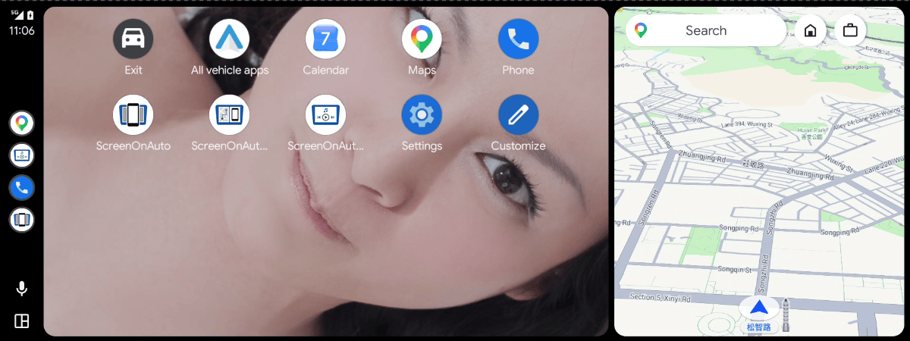
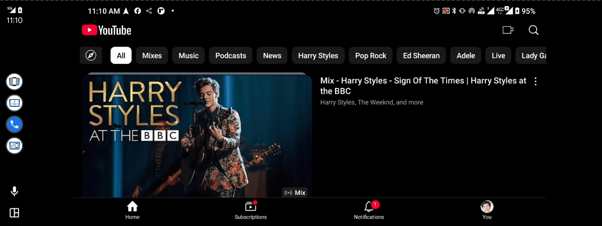
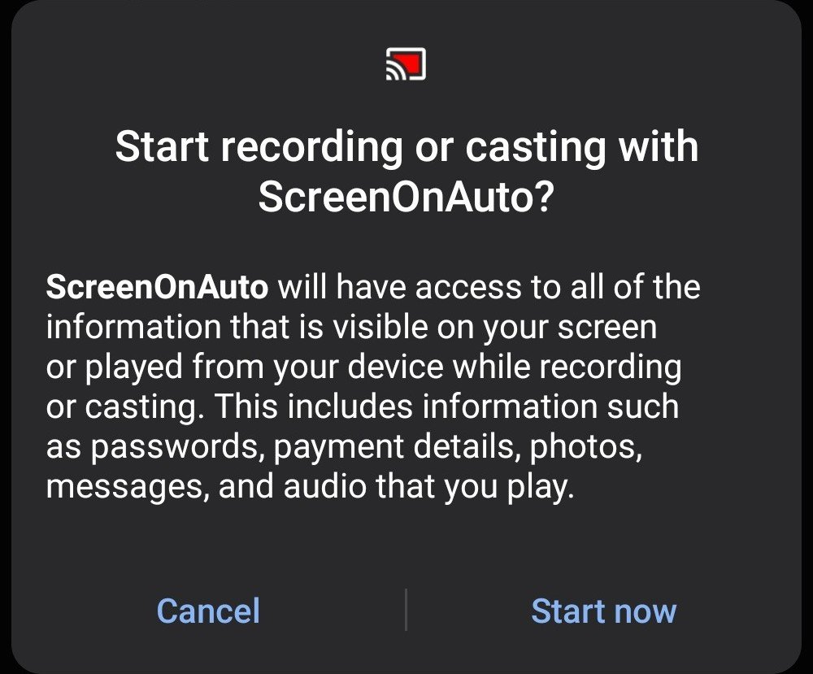
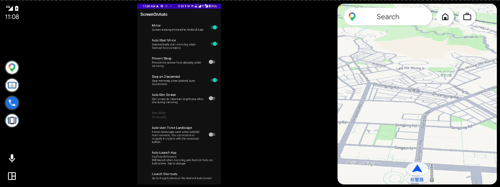

# طريقة الاستخدام

> **ℹ️ ملاحظة**
> **قبل أن تبدأ**، تأكد من:
> - أن ScreenOnAuto مثبَّت وأن إدخالاته تظهر في مشغِّل Android Auto.
> - أنك فتحت التطبيق مرة على الهاتف ومنحت الأذونات التي يطلبها.

## إدخالا النسخ المطابق

يعرض مشغِّل تطبيقات Android Auto إدخالَي نسخ مطابق **اثنين**. كلاهما ينسخ شاشة
الهاتف نفسها — ويختلفان في *طريقة* عرض النسخ على شاشة السيارة:

<table class="entry-pair" role="presentation">
<tr>
<td width="50%" valign="top">
 <b>ScreenOnAuto</b> 

ملء الشاشة — يحل محل منطقة الخريطة
</td>
<td width="50%" valign="top">
 <b>ScreenOnAuto (Legacy)</b> 

على <b>شاشة سيارة كبيرة بما يكفي</b> يمكن أن يظهر <b>جنبًا إلى جنب مع الخريطة</b> في العرض المقسّم؛ وعلى شاشة أصغر تنتقل الخريطة إلى الخلفية ويُعرض النسخ المطابق وحده (وهو <b>لا</b> يحل محل الخريطة)
</td>
</tr>
</table>

جرِّب الاثنين واستخدم الأنسب لوحدتك. كلاهما يعرض النسخ المطابق نفسه، ويمكنك
التبديل بينهما في أي وقت — ما دام النسخ المطابق يعمل، يعرضه الإدخال الآخر فورًا
دون طلب الإذن مجددًا.

> **💡 نصيحة**
> إذا فتحت  **ScreenOnAuto** (إدخال ملء الشاشة) من قبل وتريد الآن استخدام
>  **ScreenOnAuto (Legacy)**، فافتح تطبيق الخرائط (مثل «خرائط Google») على شاشة
> السيارة أولًا ثم ابدأ النسخ المطابق Legacy. هذا يعيد تعيين تطبيق الخرائط
> خريطةً افتراضية لشاشة السيارة، فلا تستولي شاشة النسخ المطابق الكاملة على
> وظائف الخرائط.

## بدء النسخ المطابق

### مع تفعيل «بدء النسخ المطابق تلقائيًا» (مستحسن)

1. في التطبيق على الهاتف، فعِّل [**بدء النسخ المطابق تلقائيًا**](/docs/ar/settings/#auto_start_mirror) (إعداد لمرة واحدة).
2. صِل الهاتف بالسيارة وانقر أحد إدخالَي ScreenOnAuto
   ( أو
   ) في مشغِّل
   Android Auto.
3. يعرض الهاتف نافذة إذن تسجيل الشاشة تلقائيًا — التقط الهاتف وانقر
   **البدء الآن**:

   

   إذا كان الهاتف في وضع السكون، تُضاء شاشته من تلقاء نفسها. وإذا كان مقفلًا برمز PIN أو نقش أو بصمة، فافتح قفله أولًا لتظهر نافذة الإذن بعدها. وإذا كنت قد منحت الإذن مسبقًا عبر ADB، فلن تظهر أي نافذة: يبدأ النسخ المطابق مباشرة، وتعرض السيارة شاشة القفل إلى أن تفتح قفل الهاتف.

4. تظهر شاشة هاتفك على وحدة السيارة:

   

> **ℹ️ ملاحظة**
> نافذة الإذن متطلب من Android — تظهر مرة عند كل بدء للنسخ المطابق، لا عند كل
> تغيير للشاشة. مع إيقاف *بدء النسخ المطابق تلقائيًا*، نقر الإدخال يفتح شاشة
> النسخ المطابق فقط؛ ولا يُلتقط شيء حتى تبدأه بنفسك.

### البدء يدويًا

إن كنت تفضل إبقاء **بدء النسخ المطابق تلقائيًا** موقوفًا:

1. افتح ScreenOnAuto على الهاتف وانقر **بدء النسخ المطابق**، ثم انقر
   **البدء الآن** في نافذة الإذن.
2. على شاشة السيارة افتح أحد إدخالَي ScreenOnAuto — النسخ المطابق يعمل بالفعل
   ويظهر فورًا.

(الترتيب غير مهم — يمكنك أيضًا فتح الإدخال أولًا ثم النقر على **بدء النسخ المطابق** بعده.)

### تجاوز نافذة الإذن

سئمت ظهور النافذة كل مرة؟ يمكنك منح الإذن مسبقًا مرة واحدة عبر ADB — راجع
[منح إذن النسخ المطابق عبر ADB](/docs/ar/grant-mirror-permission-via-adb/). وإذا فعّلت أيضًا [**بدء النسخ المطابق في الخلفية**](/docs/ar/settings/#silent_car_start)، فلن تظهر شاشة إعدادات ScreenOnAuto على الهاتف كذلك: تنقر الإدخال في السيارة، فلا يظهر شيء على الهاتف ويبدأ النسخ المطابق.

## إيقاف النسخ المطابق

أيٌّ من هذه يفي بالغرض:

- **افصل الهاتف عن السيارة** — يتوقف النسخ المطابق تلقائيًا (إعداد [*الإيقاف
  عند قطع الاتصال*](/docs/ar/settings/#stop_on_disconnect) الافتراضي).
- انقر **إيقاف النسخ المطابق** في إشعار الهاتف الدائم.
- انقر **إيقاف النسخ المطابق** في التطبيق.

## دليل الإعدادات

يشرح [دليل الإعدادات](/docs/ar/settings/) ما يفعله كل إعداد ومتى تفعّله وما حدوده، بجانب نسخة تفاعلية من شاشة الإعدادات.

## استكشاف الأخطاء

### النسخ المطابق والعرض

#### الإدخال يفتح لكن الشاشة فارغة

لم يبدأ النسخ المطابق بعد؛ تحقق من نافذة الإذن على الهاتف، أو ابدأه بالنقر على **بدء النسخ المطابق** في التطبيق.

#### أشرطة سوداء حول الصورة

نسبتا عرض شاشتَي الهاتف والسيارة مختلفتان. استخدم زر [**قفل الاتجاه**](/docs/ar/settings/#map_action_force_landscape) على شاشة النسخ
المطابق (أو [**بدء قفل الاتجاه تلقائيًا**](/docs/ar/settings/#force_landscape) في الإعدادات). ولملء المساحة القابلة للاستخدام
في شاشة السيارة بدقة، فعِّل [**مطابقة شاشة الهاتف مع شاشة السيارة**](/docs/ar/settings/#root_display_override) في الميزات ذات الامتيازات
(Shizuku أو صلاحيات الجذر). ويمكن أيضًا تكبير الصورة فوق الأشرطة باستخدام [**ضبط عرض الصورة، ضبط ارتفاع الصورة**](/docs/ar/settings/#vd_gap)، مع قصّ جزء صغير من حافتها؛ ويشرح دليل الإعدادات ذلك برسوم توضيحية.

#### الصورة تبدو ممددة أو مشوهة بعد تغيّر التخطيط

يحدث هذا عند اتساع المساحة المرئية أو تقلصها في العرض المقسّم. تدوير الهاتف حتى تتبدّل
الشاشة بين الوضعين العمودي والأفقي يعيد الصورة إلى طبيعتها (إن كان **قفل الاتجاه** مفعّلًا فألغِه أولًا من زره على الشاشة). ويمكن أيضًا لإعدادين إصلاح ذلك:

- فعِّل [**الإعدادات ← إعدادات متقدمة ← حجم صورة ثابت**](/docs/ar/settings/#nav_fixed_size). يحافظ النسخ المطابق حينها على
  حجمه بدل التشوه (قد يُحجب جزء منه). ينطبق فقط على إدخال  **ScreenOnAuto** ذي ملء الشاشة.
- فعِّل [**الإعدادات ← إعدادات متقدمة ← النسخ المطابق المرسوم داخل التطبيق (تجريبي)**](/docs/ar/settings/#self_draw).
  عندها يرسم التطبيق صورة النسخ المطابق بنفسه بدلًا من ترك التحجيم للنظام، فلا تتشوّه
  الصورة في العرض المقسّم. يستهلك بطارية أكثر قليلًا، ويسري مفعوله عند البدء التالي للنسخ
  المطابق. يعالج خيار [**مطابقة شاشة الهاتف مع شاشة السيارة**](/docs/ar/settings/#root_display_override) (الميزات ذات الامتيازات) المشكلة نفسها بطريقة مختلفة، ويمكن تفعيل الخيارين معًا.

#### خرائط Google في Android Auto تصبح سوداء أثناء النسخ المطابق

على Android 15 والإصدارات الأحدث، عندما يلتقط أي تطبيق الشاشة (وهو ما يجب على كل تطبيقات النسخ المطابق فعله)، يُخفي Android التطبيقات التي يعدّها حساسة، وقد يضع خرائط Google ضمنها. عندها تبقى خريطة Android Auto سوداء حتى يتوقف النسخ المطابق، ويحدث الأمر نفسه مع تطبيقات النسخ المطابق والخرائط الأخرى. للإصلاح فعّل **الإعدادات ← خيارات المطوّرين ← إيقاف إجراءات الحماية المطبّقة أثناء مشاركة الشاشة**. إن لم تظهر خيارات المطوّرين، فابحث في الإعدادات عن **رقم الإصدار** وانقر عليه 7 مرات. يوقف هذا أيضًا إخفاء Android للإشعارات التي تحتوي على رموز لمرة واحدة أثناء مشاركة الشاشة، فاتركه متوقفًا إن كان ذلك يهمك. بعد تفعيله، أوقف النسخ المطابق وابدأه من جديد، إذ لا يسري الإعداد إلا عند بدء النسخ المطابق.

#### شريط تنقل Android Auto يبقى ظاهرًا

**شريط تنقل Android Auto** على شاشة السيارة يرسمه Android Auto نفسه ولا يمكن للتطبيق
إخفاؤه.

### الميزات ذات الامتيازات (Shizuku / الروت)

#### يتوقف خادم Shizuku الذي بدأ عبر ADB عند توصيل الهاتف بالسيارة

يضع اتصال USB الهاتف في وضع الملحقات، ما يعيد تشغيل ADB ويُسقط Shizuku معه — وتصحيح
الأخطاء اللاسلكي يمر عبر ADB نفسه، لذا لا يفيد. ابدأ Shizuku من جديد وسيعيد ScreenOnAuto
الاتصال تلقائيًا؛ والأفضل استخدام [نسخة
Shizuku-Next](https://github.com/rushiranpise/Shizuku-Next)، التي تعيد تشغيله تلقائيًا
عبر خدمة المراقبة (watchdog). أما مستخدمو الروت واتصالات Android Auto اللاسلكية فلا
يتأثرون.

#### كيفية إيقاظ الشاشة بعد إطفائها

عند تفعيل [**إطفاء شاشة الهاتف**](/docs/ar/settings/#root_screen_off)، تنطفئ شاشة اللمس مع الشاشة نفسها، لذا لن يفيد لمس الهاتف. اضغط زر [**التعتيم التلقائي**](/docs/ar/settings/#map_action_auto_dim)
على شاشة السيارة — فتبديل التعتيم التلقائي يوقظ الشاشة (فعّل الزر أولًا من [**أزرار
الشاشة ← أزرار الوظائف**](/docs/ar/settings/#category_control_buttons)؛ فهو مُعطَّل افتراضيًا). أو اضغط زر التشغيل في الهاتف
**مرتين**، لأن الضغطة الأولى هي ما يُدخل النظام في السكون. كما يعيد إيقاف النسخ المطابق
أو فصل Android Auto تشغيل الشاشة.

