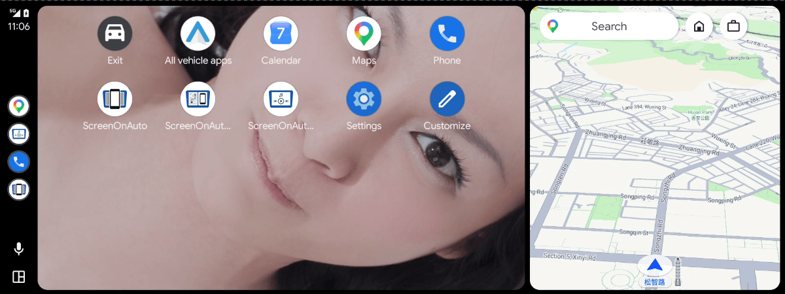
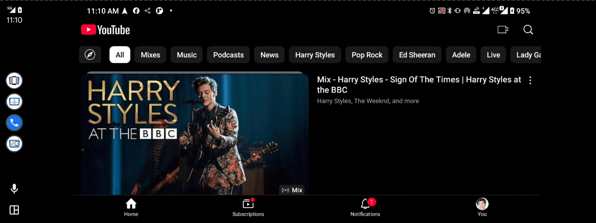
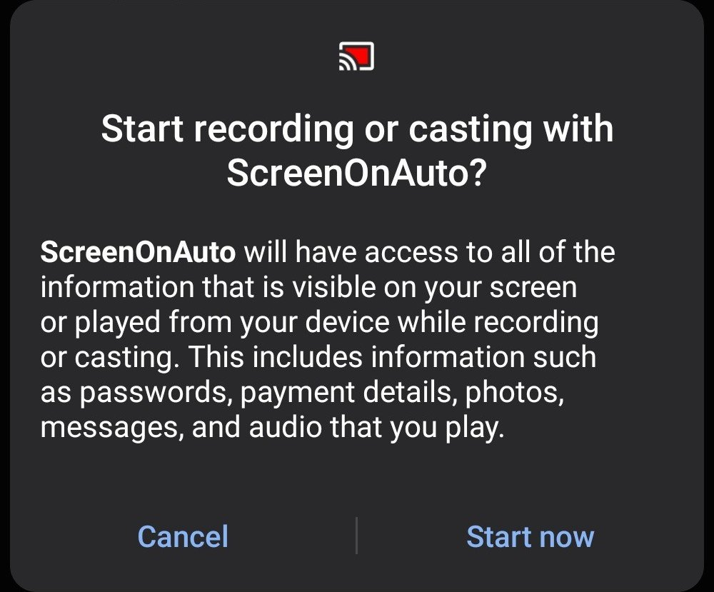
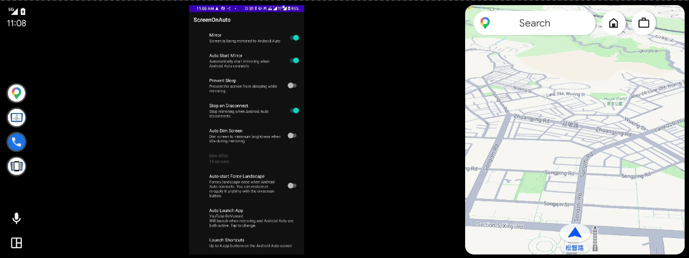

# Verwendung

> **ℹ️ Hinweis**
> **Bevor du beginnst**, stelle sicher:
> - ScreenOnAuto ist installiert und seine zwei Einträge,  **ScreenOnAuto** und  **ScreenOnAuto (Legacy)**, erscheinen im Android-Auto-Launcher.
> - Du hast die App einmal auf dem Telefon geöffnet und die angeforderten Berechtigungen erteilt.

## Die beiden Spiegelungs-Einträge

Der App-Launcher von Android Auto zeigt **zwei** Spiegelungs-Einträge:  **ScreenOnAuto** und  **ScreenOnAuto (Legacy)**. Beide spiegeln
denselben Telefonbildschirm – sie unterscheiden sich darin, *wie* die Spiegelung auf
dem Fahrzeugbildschirm dargestellt wird:

<table class="entry-pair" role="presentation">
<tr>
<td width="50%" valign="top">
 <b>ScreenOnAuto</b> 

Vollbild – belegt den Kartenbereich
</td>
<td width="50%" valign="top">
 <b>ScreenOnAuto (Legacy)</b> 

Auf einem <b>ausreichend großen Fahrzeugbildschirm</b> kann er in geteilter Ansicht <b>neben der Karte</b> stehen; auf kleineren Bildschirmen wandert die Karte in den Hintergrund und nur die Spiegelung wird angezeigt (die Karte wird <b>nicht</b> ersetzt)
</td>
</tr>
</table>

Probiere beide aus und nutze den, der auf deiner Head-Unit besser funktioniert. Beide
zeigen dieselbe Spiegelung, und du kannst jederzeit wechseln – läuft die Spiegelung
bereits, zeigt der andere Eintrag sie sofort an, ohne erneut nach der Berechtigung zu
fragen.

> **💡 Tipp**
> Wenn du zuvor  **ScreenOnAuto** (den Vollbild-Eintrag) geöffnet hast und jetzt
>  **ScreenOnAuto (Legacy)** nutzen möchtest, öffne zuerst deine Karten-App (z. B.
> Google Maps) auf dem Fahrzeugbildschirm und starte dann die Legacy-Spiegelung. So
> wird die Karten-App wieder als Standardkarte des Fahrzeugbildschirms gesetzt und die
> Kartenfunktionen bleiben nicht bei der Vollbild-Spiegelung hängen.

## Spiegelung starten

### Mit aktiviertem Automatisch starten (empfohlen)

1. Aktiviere in der App auf dem Telefon [**Automatisch starten**](/docs/de/settings/#auto_start_mirror) (einmalige Einrichtung).
2. Verbinde das Telefon mit dem Auto und tippe im Android-Auto-Launcher auf einen
   ScreenOnAuto-Eintrag
   ( oder
   ).
3. Das Telefon zeigt automatisch den Berechtigungsdialog für die Bildschirmaufnahme –
   nimm das Telefon und tippe auf **Jetzt starten** (Start now):

   

   War das Telefon im Ruhezustand, schaltet sich der Bildschirm von selbst ein. Ist es mit PIN, Muster oder Fingerabdruck gesperrt, entsperre es zuerst – danach erscheint der Dialog. Hast du die Berechtigung vorab per ADB erteilt, gibt es keinen Dialog: Die Spiegelung startet sofort, und das Auto zeigt den Sperrbildschirm, bis du das Telefon entsperrst.

4. Dein Telefonbildschirm erscheint auf der Head-Unit:

   

> **ℹ️ Hinweis**
> Der Berechtigungsdialog ist eine Android-Vorgabe – er erscheint einmal bei jedem
> Spiegelungsstart, nicht bei jedem Bildschirmwechsel. Ist *Automatisch starten*
> deaktiviert, öffnet das Antippen des Eintrags nur den Spiegelbildschirm; bis du
> selbst startest, wird nichts aufgenommen.

### Manuell starten

Wenn du **Automatisch starten** lieber deaktiviert lässt:

1. Öffne ScreenOnAuto auf dem Telefon, tippe auf **Spiegelung starten** und im Berechtigungsdialog auf **Jetzt starten** (Start now).
2. Öffne auf dem Fahrzeugbildschirm einen der ScreenOnAuto-Einträge – die Spiegelung
   läuft bereits und wird sofort angezeigt.

(Die Reihenfolge ist egal – du kannst auch zuerst den Eintrag öffnen und danach auf **Spiegelung starten** tippen.)

### Berechtigungsdialog überspringen

Genug vom Dialog bei jedem Start? Du kannst die Berechtigung einmalig per ADB erteilen
– siehe [Spiegelungsberechtigung per ADB erteilen](/docs/de/grant-mirror-permission-via-adb/). Aktivierst du zusätzlich [**Spiegelung im Hintergrund starten**](/docs/de/settings/#silent_car_start), erscheint auch der Einstellungsbildschirm von ScreenOnAuto nicht auf dem Telefon: Du tippst im Auto auf den Eintrag, auf dem Telefon erscheint nichts, und die Spiegelung startet.

## Spiegelung beenden

Jede dieser Möglichkeiten funktioniert:

- **Verbindung zum Auto trennen** – die Spiegelung stoppt automatisch (Standard-
  Einstellung [*Bei Trennung stoppen*](/docs/de/settings/#stop_on_disconnect)).
- Auf **Spiegelung beenden** in der dauerhaften Telefon-Benachrichtigung tippen.
- In der App auf **Spiegelung beenden** tippen.

## Einstellungen im Überblick

Was jede Einstellung bewirkt, wann du sie einschalten solltest und wo ihre Grenzen liegen, erklärt die Seite [Einstellungen im Überblick](/docs/de/settings/) – neben einem bedienbaren Nachbau des Einstellungsbildschirms.

## Fehlerbehebung

### Spiegelung und Bild

#### Eintrag öffnet sich, bleibt aber leer

Die Spiegelung hat noch nicht begonnen; prüfe das Telefon auf den Berechtigungsdialog
oder starte sie in der App mit **Spiegelung starten**.

#### Schwarze Balken um das Bild

Telefon- und Fahrzeugbildschirm haben unterschiedliche Seitenverhältnisse. Nutze die Schaltfläche
[**Ausrichtung sperren**](/docs/de/settings/#map_action_force_landscape) auf dem Spiegelbildschirm (oder [**Ausrichtung beim Verbinden sperren**](/docs/de/settings/#force_landscape) in den Einstellungen). Um die nutzbare Fläche des Autos exakt auszufüllen,
aktiviere [**Telefonbildschirm an das Auto anpassen**](/docs/de/settings/#root_display_override) in den Privilegierten Funktionen
(Shizuku oder Root). Mit [**Spiegelungsbreite anpassen, Spiegelungshöhe anpassen**](/docs/de/settings/#vd_gap) lässt sich das Bild auch über die Balken vergrößern, wobei ein wenig vom Rand verloren geht; die Seite Einstellungen im Überblick zeigt das mit Skizzen.

#### Das Bild wirkt gestreckt oder verzerrt, nachdem sich das Layout geändert hat

Das passiert, wenn der sichtbare Bereich in der geteilten Ansicht wächst oder schrumpft.
Dreh das Telefon, sodass der Bildschirm zwischen Hoch- und Querformat wechselt – dann
stimmt das Bild wieder (ist **Ausrichtung sperren** aktiv, hebe die Sperre vorher mit der Schaltfläche auf dem Bildschirm auf). Zwei Einstellungen können außerdem helfen:

- Aktiviere [**Einstellungen → Erweitert → Feste Spiegelungsgröße**](/docs/de/settings/#nav_fixed_size). Die Spiegelung
  behält dann ihre Größe statt zu verzerren (ein Teil kann verdeckt sein). Gilt nur für den Vollbild-Eintrag  **ScreenOnAuto**.
- Aktiviere [**Einstellungen → Erweitert → Selbstgezeichnete Spiegelung
  (experimentell)**](/docs/de/settings/#self_draw). Die App zeichnet das Bild der Spiegelung dann selbst, statt es vom
  System skalieren zu lassen, sodass es in der geteilten Ansicht nicht mehr verzerrt. Das kostet etwas mehr Akku und greift beim nächsten Start der Spiegelung.
  [**Telefonbildschirm an das Auto anpassen**](/docs/de/settings/#root_display_override) (Privilegierte Funktionen) löst dasselbe Problem auf andere Weise; beide können gleichzeitig aktiv sein.

#### Google Maps in Android Auto wird während der Spiegelung schwarz

Ab Android 15 blendet Android, solange eine App den Bildschirm aufnimmt (was jede Spiegelungs-App tun muss), Apps aus, die es für sensibel hält – und Google Maps kann auf dieser Liste landen. Die Karte in Android Auto bleibt dann schwarz, bis die Spiegelung endet, und mit anderen Spiegelungs- oder Karten-Apps passiert dasselbe. Abhilfe: Schalte **Einstellungen → Entwickleroptionen → Schutzmaßnahmen für Bildschirmfreigabe deaktivieren** ein. Fehlen die Entwickleroptionen, suche in den Einstellungen nach **Build-Nummer** und tippe 7-mal darauf. Damit blendet Android während einer Bildschirmfreigabe auch Benachrichtigungen mit Einmalcodes nicht mehr aus; ist dir das wichtig, lass die Option aus. Beende danach die Spiegelung und starte sie neu – die Einstellung greift erst beim Start der Spiegelung.

#### Die Android-Auto-Navigationsleiste bleibt sichtbar

Die **Android-Auto-Navigationsleiste** auf dem Fahrzeugbildschirm wird von Android Auto
selbst gezeichnet und kann von der App nicht ausgeblendet werden.

### Privilegierte Funktionen (Shizuku / Root)

#### Ein per ADB gestarteter Shizuku-Server wird beendet, sobald du das Telefon ans Auto anschließt

Die USB-Verbindung versetzt das Telefon in den Zubehörmodus, wodurch ADB neu startet und
Shizuku mitnimmt – Wireless Debugging läuft über dasselbe ADB und hilft daher nicht.
Starte Shizuku einfach neu, ScreenOnAuto verbindet sich von selbst wieder; besser noch:
Verwende den [Shizuku-Next-Fork](https://github.com/rushiranpise/Shizuku-Next), dessen
Watchdog-Dienst ihn für dich neu startet. Root-Nutzer und drahtlose
Android-Auto-Verbindungen sind nicht betroffen.

#### Den Bildschirm nach dem Ausschalten wieder aufwecken

Ist [**Telefonbildschirm ausschalten**](/docs/de/settings/#root_screen_off) aktiv, wird der Touchscreen zusammen mit dem Display abgeschaltet, Tippen auf das Telefon
bewirkt also nichts. Tippe auf dem Autobildschirm auf die Schaltfläche [**Auto-Dimmen**](/docs/de/settings/#map_action_auto_dim) – das Umschalten von
Auto-Dimmen weckt den Bildschirm auf
(aktiviere die Schaltfläche zuerst unter [**Bildschirm-Schaltflächen →
Funktionsschaltflächen**](/docs/de/settings/#category_control_buttons); sie ist standardmäßig aus). Oder drücke die Ein-/Aus-Taste des
Telefons **zweimal**, denn der erste Druck versetzt das System erst in den Ruhezustand.
Auch das Beenden der Spiegelung oder das Trennen von Android Auto schaltet den
Bildschirm wieder ein.
