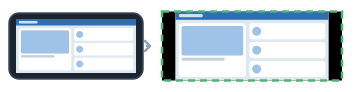
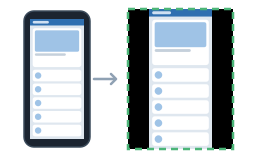

# Einstellungen im Überblick

Diese Seite geht den Einstellungsbildschirm der App von oben nach unten durch: was jede Einstellung bewirkt, wann du sie einschalten solltest und welche Grenzen ihre einzeilige Beschreibung verschweigt. Neu bei der App? Fang mit der [Verwendung](/docs/de/how-to-use/) an.

<aside class="sp-aside" aria-label="Einstellungsbildschirm von ScreenOnAuto">

Das ist der Einstellungsbildschirm der App. Tippe auf eine Zeile, um zu ihrer Erklärung zu springen. Die Schalter funktionieren, aber nur auf dieser Seite – an deinem Telefon ändert sich nichts.

</aside>

## Hauptbildschirm {#main}

### Statusfeld {#mirror}

Das dunkle Feld ganz oben. Die erste Zeile zeigt, ob Android Auto verbunden ist, und wenn ja, die gemessene Größe des Autobildschirms. Darunter stehen der aktuelle Zustand und die Schaltfläche Spiegelung starten / <svg viewBox="0 0 12 12" aria-hidden="true"><rect width="12" height="12" rx="2"/></svg>Spiegelung beenden. **Spiegelung starten** öffnet auf dem Telefon den Bildschirmaufnahme-Dialog von Android; die Spiegelung beginnt, sobald du auf **Jetzt starten** tippst.

Fehlt eine Berechtigung, weist eine gelbe Zeile unten im Feld darauf hin; tippe darauf, um zu den [Berechtigungen](#category_permissions) zu springen.

### Automatisch starten {#auto_start_mirror}

Ist diese Option an, lässt sich die Spiegelung vom Auto aus starten. So läuft es ab (mit „Du“ markierte Schritte erledigst du selbst, der Rest passiert von allein):

1. Du Tippe auf dem Autobildschirm auf einen der beiden ScreenOnAuto-Einträge ( oder ).
2. Ein schlafendes Telefon schaltet seinen Bildschirm ein.
3. Der Einstellungsbildschirm von ScreenOnAuto öffnet sich auf dem Telefon und tippt für dich auf Spiegelung starten.
4. Du Android zeigt seinen Bildschirmaufnahme-Dialog: Erlaube ihn mit **Jetzt starten**. Ist das Telefon mit PIN, Muster oder Fingerabdruck gesperrt, entsperre es zuerst, dann erscheint der Dialog.
5. Die Spiegelung startet, und der Telefonbildschirm erscheint im Auto.

> **💡 Tipp**
> - **Du willst nicht jedes Mal zustimmen?** [Erteile die Spiegelungsberechtigung einmal per ADB](/docs/de/grant-mirror-permission-via-adb/), dann erscheint der Dialog nicht mehr und Schritt 4 entfällt (bis du das Telefon entsperrst, zeigt das Auto den Sperrbildschirm).
> - **Der Einstellungsbildschirm soll nicht aufgehen?** Schalte unter Erweitert [Spiegelung im Hintergrund starten](#silent_car_start) ein: In Schritt 3 geht das Telefon direkt zum Aufnahme-Dialog, ohne ScreenOnAuto zu öffnen. Mit beidem bleibt dir nur Schritt 1, und auf dem Telefon erscheint überhaupt nichts.

Ist die Option aus, ist Schritt 3 deine Sache: Ein Tippen auf einen Eintrag im Auto zeigt nur den Wartebildschirm „Spiegelung auf dem Handy starten“, und du öffnest ScreenOnAuto auf dem Telefon und tippst selbst auf Spiegelung starten; danach folgt Schritt 4 wie oben.

### Ruhezustand verhindern {#keep_awake}

Verhindert, dass der Telefonbildschirm während der Spiegelung in den Ruhezustand geht. Die Spiegelung *ist* der Telefonbildschirm – geht er aus, bleibt auch das Bild im Auto stehen. Die Option hält den Bildschirm nur an, sie erhöht nicht die Helligkeit; daher passt sie gut zu [Auto-Dimmen](#auto_dim): Der Bildschirm bleibt an und wird bei Inaktivität gedimmt.

### Bei Trennung stoppen {#stop_on_disconnect}

Beendet die Spiegelung, wenn Android Auto getrennt wird (standardmäßig an). Ist die Option aus, läuft die Spiegelung nach dem Aussteigen im Hintergrund weiter, bis du sie beendest.

### Auto-Dimmen {#auto_dim}

Senkt während der Spiegelung die Helligkeit des Telefons auf das Minimum, wenn es eine Weile niemand berührt hat – das spart Akku und blendet nicht. Gedimmt wird nur die Hintergrundbeleuchtung des Telefons; das Bild im Auto bleibt so hell wie zuvor. Berührst du das Telefon, kehrt die Helligkeit zurück.

- Benötigt die Berechtigung [Über anderen Apps anzeigen](#overlay_access).
- Die Bedienung über den Autobildschirm ([Touch-Weiterleitung](#accessibility_access)) zählt nicht als Berührung des Telefons und weckt es daher nicht auf.
- Solange das Telefon auf dem Sperrbildschirm steht, wird nichts gedimmt; der Countdown beginnt, sobald du es entsperrst oder berührst.
- Mit Shizuku oder Root kann der Telefonbildschirm stattdessen ganz ausgeschaltet werden: siehe [Telefonbildschirm ausschalten](#root_screen_off).

### Dimmen nach {#auto_dim_delay}

Wie lange das Telefon unbenutzt sein muss, bevor es gedimmt wird: 15, 30 (Standard), 60 oder 120 Sekunden. Setzt voraus, dass [Auto-Dimmen](#auto_dim) an ist.

### App automatisch starten {#auto_launch_package}

Öffnet eine App auf dem Telefon – etwa eine Karten-App oder einen Musikplayer –, sobald Spiegelung und Android Auto beide aktiv sind. **Standard-Startbildschirm** ganz oben in der Liste öffnet die Startbildschirm-App, die du gerade nutzt; das funktioniert also auch nach einem Launcher-Wechsel weiter.

### Nur diese App spiegeln {#single_app_mirror}

Schickt statt des ganzen Telefonbildschirms nur die oben gewählte [App automatisch starten](#auto_launch_package) ins Auto. Wechselst du am Telefon zu einer anderen App, bleibt der Autobildschirm leer, bis du zurückkommst – praktisch, wenn Mitfahrende oder Benachrichtigungen nicht im Auto auftauchen sollen.

Die Zeile erscheint nur ab **Android 15**, nachdem du die [Spiegelungsberechtigung per ADB erteilt](/docs/de/grant-mirror-permission-via-adb/) hast. Sie ist ausgegraut, bis eine App für App automatisch starten gewählt ist.

**Wann du sie brauchst:**

- **Ohne die ADB-Berechtigung nicht.** Ab Android 14 lässt dich der Aufnahme-Dialog, der bei jedem Start der Spiegelung erscheint, ohnehin wählen, ob der gesamte Bildschirm oder eine einzelne App geteilt wird; wählst du dort eine App, wird nur diese gespiegelt. Unter Android 13 und älter bietet der Dialog diese Wahl nicht und spiegelt immer den ganzen Bildschirm.
- **Mit der ADB-Berechtigung schon.** Danach erscheint der Dialog nicht mehr, es gibt also keine Stelle, an der du eine App wählen könntest, und gespiegelt wird immer der gesamte Bildschirm. Um den Dialog zu überspringen *und* nur eine App zu spiegeln, nimm diesen Schalter: Zusammen mit [App automatisch starten](#auto_launch_package) oben schickt er genau diese App ins Auto.
- [Nur den gesamten Bildschirm teilen](#full_screen_share_only) unter Erweitert entfernt die App-Auswahl aus dem Dialog; diesem Schalter kommt es nicht in die Quere.

### Unterseiten {#subpages}

**Bildschirm-Schaltflächen**, **Erweitert** und **Privilegierte Funktionen** öffnen jeweils eine eigene Seite, die in den folgenden Kapiteln beschrieben wird: [Bildschirm-Schaltflächen](#screen_buttons), [Erweitert](#advanced), [Privilegierte Funktionen](#root_features).

### Berechtigungen {#category_permissions}

Jede Zeile öffnet die passende Seite der Systemeinstellungen; die Markierung rechts zeigt, ob die Berechtigung erteilt ist.

#### Benachrichtigungszugriff {#notification_access}

Lässt „ScreenOnAuto Mediensteuerung“  übernehmen, was gerade auf dem Telefon läuft. **Die Medientasten am Lenkrad** und der Medienbildschirm von Android Auto können dann auch **Player steuern, die Android Auto selbst nicht unterstützen**, etwa YouTube: Zurück / Weiter und Wiedergabe / Pause funktionieren.

- Gelesen wird nur, was gerade abgespielt wird (Mediensitzungen), nie der Inhalt deiner Benachrichtigungen.
- Musik-Apps mit eigener Android-Auto-Unterstützung (YouTube Music, Spotify und Co.) verbinden sich direkt mit Android Auto und bleiben unberührt.
- Ohne die Berechtigung gehen die Tasten an den Player, den das System für aktiv hält – sind mehrere Player offen, kann das der falsche sein.
- Ältere Versionen von Android Auto zeigen im App-Launcher einen eigenen Eintrag „ScreenOnAuto Mediensteuerung“, neuere nicht; das ist normal – die Mediensteuerung funktioniert so oder so.

#### Über anderen Apps anzeigen {#overlay_access}

Wird benötigt von [Auto-Dimmen](#auto_dim), der Ausrichtungssperre ([Ausrichtung beim Verbinden sperren](#force_landscape) und ihrer [Schaltfläche im Auto](#map_action_force_landscape)) und [Nachtdimmen](#night_dim).

#### Systemeinstellungen ändern {#write_settings_access}

Nur ab **Android 16** sichtbar. Ist das Telefon im Tablet-Modus (kürzeste Seite mindestens 600dp – der Innenbildschirm eines Foldables oder nach dem Absenken der [Anzeigedichte des Telefons](#phone_density)), ignoriert Android 16 die Bildschirmausrichtung, die Apps anfordern. Die Ausrichtungssperre nutzt dann stattdessen die Rotationssperre des Systems, und dafür ist diese Berechtigung nötig. Deine eigene Einstellung für automatisches Drehen kehrt zurück, wenn die Sperre endet.

#### Touch-Weiterleitung {#accessibility_access}

Gibt Tippen, Wischen und Zoomgesten auf dem Autobildschirm über einen Android-Bedienungshilfendienst an das Telefon weiter. Beide Spiegelungen unterstützen hier dieselben Gesten: Tippen, Scrollen (durch eine Liste wischen), schnelles Wischen und Zoomen mit zwei Fingern.

Mit Shizuku oder Root kannst du stattdessen [Echte Toucheingabe](#root_touch_injection) verwenden: Berührungen auf dem Autobildschirm kommen am Telefon als echte Fingerbewegungen an, es fühlt sich also an, als würdest du das Telefon direkt bedienen. **Langes Drücken**, **Drücken und Ziehen** (etwa ein Symbol auf dem Startbildschirm verschieben) und **Gesten mit mehreren Fingern**, die der Bedienungshilfendienst nicht kann, funktionieren dann auch – allerdings nur in der Spiegelung „ScreenOnAuto (Legacy)“.

### Über {#about}

Die Version (zum Kopieren antippen), Links zu GitHub und für Spenden, die Datenschutzerklärung, die Nutzungsbedingungen und die Lizenzen von Drittanbietern.

## Bildschirm-Schaltflächen {#screen_buttons}

Alles, was als Schaltfläche auf dem Autobildschirm erscheinen kann, wird auf dieser Seite eingerichtet.

### Startverknüpfungen {#category_shortcuts}

Bis zu 4 App-Verknüpfungen auf dem Autobildschirm. Tippst du auf eine, öffnet sich die App auf dem Telefon – und damit auch im Auto.

- Tippe auf eine Zeile, um die App zu wählen; der Schalter rechts blendet die Verknüpfung im Auto ein oder aus. **Standard-Startbildschirm** funktioniert auch hier, als „Zurück zum Startbildschirm“-Schaltfläche.
- **Tippe lange** auf eine belegte Verknüpfung, um den Text zu ändern, den das Auto zeigt (bis zu 30 Zeichen). Lässt du ihn leer, zeigt die Spiegelung „ScreenOnAuto (Legacy)“ nur das App-Symbol.
- Verknüpfungen erscheinen am **oberen** Rand der Spiegelung; auf welcher Seite, hängt von der Spiegelung ab:
  - Spiegelung „ScreenOnAuto“: Sie nutzt die Kartenvorlage von Android Auto, daher sind die Verknüpfungen Text-Schaltflächen, die Android Auto selbst zeichnet (ohne Symbole), und Android Auto entscheidet, wo sie hinkommen – die App kann sie nicht verschieben. Mit der Einstellung für die Fahrerposition in Android Auto wechseln sie womöglich die Seite, garantiert ist das aber nicht.
  - Spiegelung „ScreenOnAuto (Legacy)“: Die App zeichnet sie selbst als Schaltflächen mit Symbolen, standardmäßig **oben rechts**; [Schaltflächen links ausrichten](#legacy_buttons_left) setzt sie nach oben links, und [die Abstände](#legacy_gaps) regeln ihre Entfernung zu den Rändern.
- Verknüpfungen bleiben nicht dauerhaft sichtbar: In der Spiegelung „ScreenOnAuto (Legacy)“ verschwinden sie zusammen mit den [Funktionsschaltflächen](#category_control_buttons) nach 5 Sekunden ohne Bedienung und kommen zurück, wenn du den Autobildschirm berührst; in der Spiegelung „ScreenOnAuto“ entscheidet Android Auto, wann sie ausgeblendet werden.

### Funktionsschaltflächen {#category_control_buttons}

Runde Schaltflächen über der Spiegelung, in beiden Spiegelungen bis zu 4 gleichzeitig.

- Wo sie sitzen, hängt von der Spiegelung ab:
  - Spiegelung „ScreenOnAuto“: Sie bilden die Schaltflächenleiste der Kartenvorlage von Android Auto und werden von Android Auto **unten rechts oder unten links** gezeichnet. Android Auto entscheidet über die Seite – die App kann sie nicht verschieben; wie bei den [Startverknüpfungen](#category_shortcuts) wechseln sie mit der Einstellung für die Fahrerposition womöglich die Seite, garantiert ist das aber nicht.
  - Spiegelung „ScreenOnAuto (Legacy)“: eine Spalte, die die App selbst zeichnet, standardmäßig **unten rechts**; [Schaltflächen links ausrichten](#legacy_buttons_left) setzt sie nach unten links, und [die Abstände](#legacy_gaps) regeln ihre Entfernung zu den Rändern.
- Automatisches Ausblenden: In der Spiegelung „ScreenOnAuto (Legacy)“ verschwinden die Funktionsschaltflächen zusammen mit den Verknüpfungen nach 5 Sekunden ohne Bedienung und kommen zurück, wenn du den Autobildschirm berührst; in der Spiegelung „ScreenOnAuto“ entscheidet Android Auto, wann sie ausgeblendet werden.

#### Schaltfläche für Ausrichtungssperre {#map_action_force_landscape}

Schaltet die Ausrichtungssperre vorübergehend ein oder aus, ohne die Einstellung [Ausrichtung beim Verbinden sperren](#force_landscape) zu ändern; bei der nächsten Verbindung gilt wieder die Einstellung. Standardmäßig an.

#### Auto-Dimmen-Schaltfläche {#map_action_auto_dim}

Schaltet [Auto-Dimmen](#auto_dim) ein oder aus – derselbe Schalter wie in den Einstellungen. Wurde der Telefonbildschirm [ausgeschaltet](#root_screen_off), ist sie der schnellste Weg, ihn zurückzuholen.

#### Nachtdimmen-Schaltfläche {#map_action_night_dim}

Schaltet [Nachtdimmen](#night_dim) für den Moment ein oder aus – etwa bei der Einfahrt in einen Tunnel. Das hält, bis das Auto das nächste Mal zwischen Tag und Nacht wechselt; ist [Wann dimmen](#night_dim_trigger) auf Immer gestellt, bis Android Auto getrennt wird. Gedimmt wird auf den Wert von [Stärke](#night_dim_strength).

#### Zurück-, Home- und Letzte-Apps-Schaltfläche {#map_action_nav}

Die drei Navigationstasten des Telefons – sie funktionieren unabhängig davon, ob das Telefon Gesten oder Schaltflächen nutzt. Ist Shizuku oder Root verbunden, senden sie echte Tastendrücke; sonst brauchen sie die [Touch-Weiterleitung](#accessibility_access).

### Position der Schaltflächen {#category_button_placement}

Dieser Abschnitt betrifft nur die Spiegelung „ScreenOnAuto (Legacy)“. Die Schaltflächen der Spiegelung „ScreenOnAuto“ zeichnet Android Auto, sie lassen sich nicht verschieben.

#### Schaltflächen links ausrichten {#legacy_buttons_left}

Setzt die [Funktionsschaltflächen](#category_control_buttons) und die [Verknüpfungen](#category_shortcuts) nach links – für Rechtslenker oder wenn die eigenen Bedienelemente der Headunit die rechte Seite verdecken.

#### Der Navigationsleiste des Telefons ausweichen {#legacy_buttons_dodge_nav}

Ist die Navigationsleiste des Telefons in der Spiegelung zu sehen, rückt diese Option die Schaltflächen von ihr weg, damit sich beide nicht überlappen. Benötigt Android 11 oder höher (auf älteren Telefonen fehlt die Zeile). Solange sie an ist, sind die vier Abstände darunter ausgegraut – es gilt entweder die eine oder die andere Positionierung.

#### Abstände von Schaltflächen und Verknüpfungen {#legacy_gaps}

Vier Abstände in dp (0–400, Standard 16): die Funktionsschaltflächen zum Seitenrand und zum unteren Rand, die Verknüpfungen zum Seitenrand und zum oberen Rand. Damit holst du die Schaltflächen von ScreenOnAuto unter denen der Headunit hervor. Ist ein Wert zu groß, bleiben die Schaltflächen innerhalb des Bildschirms, statt aus ihm zu verschwinden.

## Erweitert {#advanced}

### Bildschirmausrichtung {#category_orientation}

#### Ausrichtung beim Verbinden sperren {#force_landscape}

Sperrt das Telefon beim Verbinden mit Android Auto in einer Ausrichtung, damit die Spiegelung nicht kippt, wenn sich das Telefon dreht, und ein quer liegendes Telefon einen breiten Autobildschirm ausfüllt. Die Option greift einmal, im Moment der Verbindung; danach hebt die [Schaltfläche für Ausrichtungssperre](#map_action_force_landscape) im Auto die Sperre auf oder setzt sie wieder. Benötigt die Berechtigung [Über anderen Apps anzeigen](#overlay_access).

#### Ausrichtung {#force_orientation_mode}

In welche Richtung gesperrt wird: **Querformat** (Standard), **Hochformat** oder **Am Autobildschirm automatisch erkennen** – Querformat, wenn die Fläche, die die Spiegelung im Auto tatsächlich bekommt, breiter als hoch ist, Hochformat, wenn sie höher ist. Ändert eine geteilte Ansicht diese Form, zieht die Einstellung mit.

#### Umgekehrtes Querformat {#force_landscape_reverse}

Dreht ein quer liegendes Telefon andersherum – für eine Halterung, die es kopfüber hält. Im Hochformat ausgegraut.

### Bildanpassung {#category_display_adjust}

#### Selbstgezeichnete Spiegelung {#self_draw}

Die App zeichnet das Bild des Telefons selbst auf den Autobildschirm, statt es vom System skalieren zu lassen. Die geteilte Ansicht verzerrt das Bild dann nicht mehr, und die Breiten- und Höhenanpassungen unten wirken gleich, ob du sie vor oder während einer Verbindung einstellst. Verbraucht etwas mehr Akku.

Eine Änderung gilt ab dem **nächsten Start der Spiegelung** – sie wird bewusst nicht mitten in einer Sitzung umgeschaltet.

#### Videoverzögerung {#video_delay}

Wenn das Bild dem Ton vorauseilt (etwa bei einer Android-Headunit, die Android Auto über eine Empfänger-App abspielt und der Ton hinterherhinkt), hält diese Option das Bild um 0–2000 Millisekunden zurück, damit beides zusammenpasst. Benötigt [Selbstgezeichnete Spiegelung](#self_draw); eine Änderung gilt sofort.

- Das Zurückhalten von Bildern kostet zusätzlich Speicher und GPU-Leistung. Laufen Ton und Bild auseinander, weil Telefon oder Headunit ohnehin an ihre Grenzen kommen, kann es das verschlimmern.
- Berührungen wirken weiterhin auf den Telefonbildschirm, wie er **jetzt** ist, nicht auf das verzögerte Bild.

#### Feste Spiegelungsgröße {#nav_fixed_size}

Nur Spiegelung „ScreenOnAuto“. Die Spiegelung behält ihre Größe, wenn das Auto in die geteilte Ansicht wechselt, und verzerrt daher nicht – ein Teil davon kann aber abgeschnitten werden. Am besten vor dem Verbinden einstellen.

#### Spiegelung bei Schaltflächen nicht verschieben {#nav_ignore_strip}

Nur Spiegelung „ScreenOnAuto“, standardmäßig an. Die Schaltflächenleiste von Android Auto blendet sich von selbst ein und aus und nimmt dabei jedes Mal etwas Platz weg. Ist diese Option an, sorgt das Einblenden der Leiste nicht dafür, dass die Spiegelung ihre Größe ändert und springt; echte Layoutänderungen wie die geteilte Ansicht werden weiterhin übernommen. Ausgegraut, solange [Feste Spiegelungsgröße](#nav_fixed_size) an ist.

#### Spiegelungsbreite anpassen, Spiegelungshöhe anpassen {#vd_gap}

Die Fläche, die das Auto der Spiegelung gibt (unten der gestrichelte grüne Rahmen), hat selten dieselbe Form wie der Telefonbildschirm. Das Bild des Telefons wird gleichmäßig skaliert, bis es hineinpasst, daher bleiben auf der Seite, die nicht passt, schwarze Balken: Ist das Bild **breiter** als die Fläche (etwa weil die geteilte Ansicht sie schmaler gemacht hat), liegen die Balken **oben und unten**; ist es **schmaler**, liegen sie **links und rechts**.

Diese beiden Einstellungen machen den Rahmen, in den die Spiegelung eingepasst wird, größer oder kleiner, in Pixeln. Ein **negativer** Wert vergrößert ihn: Das Bild wächst und die Balken schrumpfen – dafür ragt ein Teil des Bildes über die nutzbare Fläche hinaus und wird abgeschnitten (in den Abbildungen schraffiert).

<figure><figcaption>Balken oben und unten</figcaption></figure>
<figure><figcaption>Negative <b>Breite</b>: keine Balken oben und unten, rechts ragt das Bild hinaus</figcaption></figure>
<figure><figcaption>Balken links und rechts</figcaption></figure>
<figure><figcaption>Negative <b>Höhe</b>: keine Balken links und rechts, unten ragt das Bild hinaus</figcaption></figure>

- **Balken oben und unten → die *Breite* negativ machen.** Ein breiterer Rahmen lässt das Bild wachsen – und damit auch höher werden –, bis die Balken gefüllt sind.
- **Balken links und rechts → die *Höhe* negativ machen.** Ein höherer Rahmen lässt das Bild wachsen – und damit auch breiter werden –, bis die Balken gefüllt sind.
- Die Spiegelung ist an der **oberen linken Ecke** der Fläche verankert; was hinausragt, geht also über den **rechten** Rand (Breite) oder den **unteren** Rand (Höhe) – es wird nicht auf beide Seiten verteilt. Was dort abgeschnitten wird, auch Schaltflächen, lässt sich nicht antippen; hör also bei dem Wert auf, bei dem die Balken gerade verschwinden.
- Ein **positiver** Wert bewirkt das Gegenteil: Er verkleinert den Rahmen – für Headunits, die die Bildränder abschneiden – und holt einen abgeschnittenen Rand wieder ins Bild (mit einem schmalen schwarzen Balken).
- Am genauesten ist es mit eingeschalteter [Selbstgezeichneter Spiegelung](#self_draw). Ohne sie stellst du die Werte **während der Verbindung** ein: In der Spiegelung „ScreenOnAuto“ kann ein negativer Wert, der beim Start der Spiegelung schon eingestellt ist, das Bild stauchen, statt es zu vergrößern.

Tippe auf den Text, um einen Wert einzugeben (ein gespeicherter Wert ungleich null schaltet den Schalter ein); der Schalter hinter dem Trennstrich schaltet die Anpassung kurz aus, ohne den Wert zu verlieren, damit du vergleichen kannst.

> **💡 Ganz ohne schwarze Balken**
>
> Schalte mit Shizuku oder Root [Telefonbildschirm an das Auto anpassen](#root_display_override) ein. Das bringt den Telefonbildschirm in die Proportionen der Fläche, sodass die Spiegelung sie exakt ausfüllt – keine Balken, nichts abgeschnitten. Solange es an ist, ruhen diese beiden Anpassungen.

<figure><figcaption>Telefonbildschirm an das Auto anpassen: passt exakt</figcaption></figure>

### Nachtdimmen {#category_night_dim}

#### Autobildschirm dimmen {#night_dim}

Dunkelt die Spiegelung im Auto nachts ab, damit eine grell weiße App auf dem Telefon im Dunkeln nicht blendet.

- In der Spiegelung „ScreenOnAuto (Legacy)“ oder mit eingeschalteter [Selbstgezeichneter Spiegelung](#self_draw) wird nur das Bild im Auto gedimmt.
- In der Spiegelung „ScreenOnAuto“ ohne Selbstgezeichnete Spiegelung ist das Dimmen eine dunkle Ebene über dem Telefonbildschirm, daher **wird auch das Telefon dunkler**. Dafür ist die Berechtigung [Über anderen Apps anzeigen](#overlay_access) nötig.
- Um es kurz aus- oder einzuschalten, nutze die [Nachtdimmen-Schaltfläche](#map_action_night_dim) im Auto.

#### Wann dimmen {#night_dim_trigger}

**Wenn das Auto in den Nachtmodus wechselt** (Standard): nachts gedimmt, tagsüber normal. **Immer**: gedimmt, solange Android Auto verbunden ist.

#### Stärke {#night_dim_strength}

Wie dunkel: 10 %–80 % (Standard 50 %). Die [Nachtdimmen-Schaltfläche](#map_action_night_dim) nutzt diesen Wert ebenfalls.

### Start vom Auto aus {#category_car_start}

#### Spiegelung im Hintergrund starten {#silent_car_start}

Wird die Spiegelung [vom Auto aus gestartet](#auto_start_mirror), kommt der Einstellungsbildschirm von ScreenOnAuto auf dem Telefon nicht nach vorn und bleibt nicht in den letzten Apps zurück. Der Aufnahme-Dialog erscheint trotzdem.

> **💡 Tipp**
>
> Kommt die [per ADB erteilte Spiegelungsberechtigung](/docs/de/grant-mirror-permission-via-adb/) dazu, entfällt auch der Aufnahme-Dialog: Tippe im Auto auf einen Eintrag, und auf dem Telefon erscheint überhaupt nichts – die Spiegelung startet einfach, ohne dass du das Telefon anfasst. Bis du das Telefon entsperrst, zeigt das Auto den Sperrbildschirm.

#### Nur den gesamten Bildschirm teilen {#full_screen_share_only}

Ab Android 14 fragt der Aufnahme-Dialog zuerst, ob eine App oder der gesamte Bildschirm geteilt werden soll, und du musst dieses Menü jedes Mal öffnen. Ist diese Option an, bietet der Dialog nur den gesamten Bildschirm an. Sichtbar ab Android 14. Spiegelst du eine einzelne App, indem du sie in diesem Dialog wählst (der Weg ohne ADB-Berechtigung), lass die Option aus; mit ADB-Berechtigung nimm stattdessen [Nur diese App spiegeln](#single_app_mirror).

Siehst du trotzdem beide Auswahlmöglichkeiten? Android 16 hat in den Entwickleroptionen eine Kompatibilitätsüberschreibung (`OVERRIDE_DISABLE_MEDIA_PROJECTION_SINGLE_APP_OPTION`), die sie zurückbringt; prüfe, dass sie nicht eingeschaltet ist.

## Privilegierte Funktionen {#root_features}

Die Funktionen auf dieser Seite brauchen [Shizuku](https://shizuku.rikka.app/) oder Root, weil sie Systemeinstellungen ändern, an die eine normale App nicht herankommt. Jede stellt die eigene Einstellung des Telefons wieder her, wenn die Spiegelung endet.

### Verbindung {#root_status}

Das Feld oben zeigt, ob Shizuku oder Root verbunden ist; seine Schaltfläche lautet **Zugriff erteilen**, **Verbinden** oder **Trennen**. Bricht eine Verbindung ab (etwa weil Shizuku neu startet), verbindet sie sich von selbst wieder.

Ein per ADB gestarteter Shizuku-Server wird beendet, wenn das Telefon per USB mit dem Auto verbunden wird – siehe [Fehlerbehebung](/docs/de/how-to-use/#privilegierte-funktionen-shizuku--root).

### Root nicht erkannt? {#root_force}

Ist die Root-Verwaltung versteckt oder umbenannt, kann die App Root nicht erkennen, und das Verbindungsfeld bietet es nie an. Ein Tippen auf diese Zeile fordert Root direkt über su an. Sie erscheint nur, solange Root nicht erkannt und nichts verbunden ist.

### Funktionen {#category_root_features}

#### Telefonbildschirm ausschalten {#root_screen_off}

Greift [Auto-Dimmen](#auto_dim), wird die Hintergrundbeleuchtung des Telefons ausgeschaltet statt gedimmt. Setzt voraus, dass Auto-Dimmen an ist.

Nur der Bildschirm geht aus – **das Telefon geht nicht in den Ruhezustand**: Apps und System laufen weiter, die Spiegelung bleibt im Auto, und die Bedienung des Telefons vom Auto aus funktioniert weiterhin. Der Touchscreen schaltet sich allerdings mit dem Bildschirm ab; **eine Berührung des Telefonbildschirms bewirkt also nichts** und schaltet ihn auch nicht wieder ein.

So holst du den Bildschirm zurück: Tippe im Auto auf die [Auto-Dimmen-Schaltfläche](#map_action_auto_dim), beende die Spiegelung oder trenne Android Auto, oder drücke **zweimal** die Ein/Aus-Taste (der erste Druck versetzt das System in den Ruhezustand).

#### Echte Toucheingabe {#root_touch_injection}

Schickt Berührungen auf dem Autobildschirm als echte Fingerbewegungen an das Telefon, sodass langes Drücken, Ziehen und Gesten mit mehreren Fingern funktionieren – und der Bedienungshilfendienst der [Touch-Weiterleitung](#accessibility_access) nicht nötig ist. Voll zur Geltung kommt das in der Spiegelung „ScreenOnAuto (Legacy)“: Die Spiegelung „ScreenOnAuto“ erhält von Android Auto nur Tippen, Scrollen, schnelles Wischen und Zoomgesten – eine Grenze von Android Auto.

#### Virtueller Touchscreen {#root_virtual_touch}

Liefert diese Berührungen über ein virtuelles Touchscreen-Gerät, sodass auch Gesten-Apps, die den Touchscreen direkt lesen (etwa GMD Gestures), sie sehen. Setzt voraus, dass [Echte Toucheingabe](#root_touch_injection) an ist.

#### Tag-/Nachtmodus des Autos folgen {#root_follow_car_night}

Während der Spiegelung wechselt das helle/dunkle Design des Telefons mit dem Tag-/Nachtmodus von Android Auto und kehrt danach zur eigenen Einstellung des Telefons zurück. Ab Android 10.

#### Modus aus Android Auto lesen {#root_car_night_from_aa}

Erscheint, sobald der vorige Schalter an ist, und gilt für die Spiegelung „ScreenOnAuto“. Auf manchen Telefonen (zum Beispiel einigen Samsung-Modellen) ist der Tag-/Nachtmodus, der der App gemeldet wird, falsch, sodass das Telefon nie mit dem Auto umschaltet; diese Option liest stattdessen den Tag-/Nachtzustand direkt aus Android Auto. Lass sie aus, wenn das Telefon dem Auto bereits folgt.

#### Schriftgröße während der Spiegelung {#root_mirror_font_scale}

Nutzt während der Spiegelung eine andere Schriftgröße – etwa größeren Text im Auto – und stellt danach die des Telefons wieder her. Zur Auswahl stehen die Stufen aus den Einstellungen des Telefons.

#### Navigationsmodus während der Spiegelung {#root_mirror_nav_mode}

Wechselt während der Spiegelung zu Gestensteuerung, Bedienung über 2 Schaltflächen oder Bedienung über 3 Schaltflächen und danach zurück (ab Android 10). Bei geteiltem Bildschirm auf einer hochformatigen Headunit zum Beispiel lassen Gesten den Apps mehr Platz. Modi, die das Telefon nicht hat, sind als nicht verfügbar markiert.

#### Startbildschirm während der Spiegelung {#root_mirror_home}

Macht während der Spiegelung einen anderen Launcher zum Standard-Startbildschirm des Telefons und stellt danach deinen wieder her. Für einen Startbildschirm, der fürs Auto eingerichtet ist, oder für Telefone, deren vorinstallierter Launcher seine Symbole umsortiert, wenn sich die [Bildschirmform](#category_root_display) ändert (einige Xiaomi-Modelle mit HyperOS).

### Bildschirmform {#category_root_display}

#### Telefonbildschirm an das Auto anpassen {#root_display_override}

Bringt den Telefonbildschirm während der Spiegelung ins Seitenverhältnis des Autos, sodass die Spiegelung das Auto ohne schwarze Balken ausfüllt und in der geteilten Ansicht nicht verzerrt. Das wirkt sofort, ohne neue Verbindung.

<figure><figcaption>Vorher: Das Telefon hat eine andere Form als das Auto, im Auto bleiben Balken</figcaption></figure>
<figure><figcaption>Nachher: Das Telefon nimmt die Form des Autos an, das Auto wird exakt ausgefüllt</figcaption></figure>
<figure><figcaption>Vorher: Eine schmalere Fläche im Auto (etwa in der geteilten Ansicht) lässt oben und unten Balken</figcaption></figure>
<figure><figcaption>Nachher: Das Telefon nimmt die Form des Autos an, das Auto wird exakt ausgefüllt</figcaption></figure>
<figure><figcaption>Vorher: große Hochformat-Headunit, Telefon aufrecht, Balken links und rechts im Auto</figcaption></figure>
<figure><figcaption>Nachher: Das Telefon nimmt die Hochformat-Form des Autos an, das Auto wird exakt ausgefüllt</figcaption></figure>

Es funktioniert, ob das Auto Balken links und rechts (erstes Paar) oder oben und unten (zweites Paar) zeigt, und auch auf einer großen Hochformat-Headunit (drittes Paar – das Telefon steht aufrecht; ist [Ausrichtung](#force_orientation_mode) auf automatische Erkennung gestellt, sperrt es sich von selbst im Hochformat). Der physische Bildschirm des Telefons behält seine Form; sobald die Option an ist, zeigt also **das Telefon selbst** Balken in der anderen Richtung (oben und unten, wenn das Auto sie links und rechts hatte, und umgekehrt) – das ist so gewollt; die Spiegelung im Auto füllt es exakt aus.

- Das ist eine Änderung auf Systemebene, die **einen Neustart überdauert**, bis sie rückgängig gemacht wird. Normalerweise macht das Beenden der Spiegelung oder das Trennen sie automatisch rückgängig.
- Solange der Telefonbildschirm umgeformt ist, erscheint oben in diesem Abschnitt ein gelber Hinweis mit der Schaltfläche **Wiederherstellen**.
- Hängt der Telefonbildschirm einmal in der falschen Form fest und du kannst die App nicht öffnen, führe an einem Computer `adb shell wm size reset` und `adb shell wm density reset` aus.

#### Wiederherstellen-Verknüpfung zum Startbildschirm hinzufügen {#root_display_shortcut}

Legt eine Verknüpfung „Wiederherstellen“ auf dem Startbildschirm an, sodass ein Tippen den Telefonbildschirm zurücksetzt, ohne die App zu öffnen.

#### Was angewendet wird {#root_display_derived}

Die Größe, auf die der Telefonbildschirm geändert wird, berechnet aus der Größe des Autobildschirms, und was das System tatsächlich übernommen hat. Solange das Auto noch nicht ausgemessen ist, wartet die Anzeige auf das nächste Öffnen der Spiegelung in Android Auto.

#### Größe des Autobildschirms {#car_size}

Je eine pro Spiegelung (das Auto gibt den beiden Spiegelungen unterschiedlich große Flächen). Standardmäßig ist es die erkannte Größe, markiert mit **Automatisch**. Ändere sie nur, wenn die Erkennung falsch liegt: Breite und Höhe teilen sich einen Dialog, und ein leeres Feld nutzt den erkannten Wert (160–8192).

#### Anzeigedichte des Telefons {#phone_density}

Optional, je eine pro Spiegelung (72–640 dpi). Höhere Werte machen Text und Schaltflächen auf dem Autobildschirm größer; niedrigere zeigen mehr auf einmal. Stellst du sie so niedrig ein, dass die kürzeste Seite des Telefons über 600dp kommt, wechseln die meisten Apps und das System auf Tablet-Layouts (zwei Spalten, seitliche Navigation) – der Dialog sagt dir schon beim Tippen, ob das passiert. Leer lassen, um nichts zu ändern.

