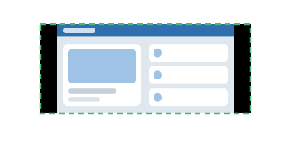

# Settings Guide

This page follows the app's settings screen from top to bottom: what each setting does, when to turn it on, and the limits its one-line summary leaves out. New to the app? Start with [How to Use](/docs/en/how-to-use/).

<aside class="sp-aside" aria-label="ScreenOnAuto settings screen">

This is the app's settings screen. Tap any row to jump to its explanation. The switches work, but only on this page — nothing on your phone changes.

</aside>

## Main screen {#main}

### Status panel {#mirror}

The dark panel at the top. Its first line says whether Android Auto is connected and, when it is, the size of the car screen it measured. Below that is the current state and the Start mirroring / <svg viewBox="0 0 12 12" aria-hidden="true"><rect width="12" height="12" rx="2"/></svg>Stop mirroring button. **Start mirroring** brings up Android's screen-capture dialog on the phone; mirroring begins once you tap **Start now**.

When a permission is missing, an amber line at the bottom of the panel says so; tap it to scroll to [Permissions](#category_permissions).

### Auto Start Mirror {#auto_start_mirror}

With this on, mirroring can be started from the car. Here is what happens (steps marked “You” are yours; the rest happen by themselves):

1. You Tap either ScreenOnAuto entry ( or ) on the car screen.
2. A sleeping phone turns its screen on.
3. ScreenOnAuto's settings screen opens on the phone and taps Start mirroring for you.
4. You Android shows its screen-capture dialog: allow it with **Start now**. If the phone is locked with a PIN, pattern or fingerprint, unlock it first and the dialog appears.
5. Mirroring starts and the phone's screen appears on the car.

> **💡 Tip**
> - **Don't want to allow it every time?** [Grant the mirror permission via ADB](/docs/en/grant-mirror-permission-via-adb/) once and the dialog stops appearing, which removes step 4 (until you unlock the phone, the car shows its lock screen).
> - **Don't want the settings screen to come up?** Turn on [Start mirroring in the background](#silent_car_start) under Advanced: in step 3 the phone goes straight to the capture dialog without opening ScreenOnAuto. With both, step 1 is all you do, and nothing shows on the phone at all.

With it off, step 3 is yours: tapping an entry on the car only shows the "Start mirroring on your phone" waiting screen, and you open ScreenOnAuto on the phone and tap Start mirroring yourself, then step 4 as above.

### Prevent Sleep {#keep_awake}

Keeps the phone's screen from sleeping while mirroring. The mirror *is* the phone's screen, so when the screen goes off the car's picture stops too. It only keeps the screen on — it does not raise the brightness — so it pairs with [Auto Dim Screen](#auto_dim): the screen stays on, and dims when idle.

### Stop on Disconnect {#stop_on_disconnect}

Stops mirroring when Android Auto disconnects (on by default). With it off, mirroring keeps running in the background after you leave the car until you stop it.

### Auto Dim Screen {#auto_dim}

While mirroring, turns the phone's brightness down to the minimum when nobody has touched it for a while — saves battery and glare. Only the phone's backlight dims; the picture on the car stays as bright as before. Touch the phone and the brightness comes back.

- Needs the [Display Over Other Apps](#overlay_access) permission.
- Using the car screen ([touch forwarding](#accessibility_access)) does not count as touching the phone, so it does not wake the phone up.
- Nothing dims while the phone sits on its lock screen; the countdown starts once you unlock it or touch it.
- With Shizuku or root, the phone screen can be switched off instead: see [Turn the phone screen off](#root_screen_off).

### Dim After {#auto_dim_delay}

How long the phone must be idle before it dims: 15, 30 (default), 60 or 120 seconds. Needs [Auto Dim Screen](#auto_dim) on.

### Auto Launch App {#auto_launch_package}

Opens an app on the phone — say a map or a music player — as soon as mirroring and Android Auto are both active. **Default home screen**, at the top of the list, opens whatever home screen app you use, so it keeps working if you switch launchers.

### Mirror only this app {#single_app_mirror}

Sends only the [Auto Launch App](#auto_launch_package) above to the car instead of the whole phone screen. Switch to another app on the phone and the car screen goes blank until you come back — useful when passengers or notifications should not show up on the car.

The row appears only on **Android 15 and above**, after you have [granted the mirror permission via ADB](/docs/en/grant-mirror-permission-via-adb/). It is greyed out until an Auto Launch App is chosen.

**When you need it:**

- **Without the ADB grant you don't.** From Android 14, the capture dialog that appears each time mirroring starts already lets you choose between sharing the entire screen and sharing one app; pick an app there and only that app is mirrored. On Android 13 and below the dialog has no such choice and always mirrors the whole screen.
- **With the ADB grant you do.** Once granted, the dialog no longer appears, so there is nowhere to pick an app and mirroring is always the entire screen. To skip the dialog *and* mirror one app, use this switch: together with the [Auto Launch App](#auto_launch_package) above, it sends just that app to the car.
- [Share the entire screen only](#full_screen_share_only) under Advanced removes the one-app choice from the dialog; it does not get in the way of this switch.

### Sub-pages {#subpages}

**On-screen buttons**, **Advanced** and **Privileged Features** each open a page of their own, covered in the chapters below: [On-screen buttons](#screen_buttons), [Advanced](#advanced), [Privileged Features](#root_features).

### Permissions {#category_permissions}

Each row opens the matching system settings page; the tag on the right says whether it is granted.

#### Notification Access {#notification_access}

Lets "ScreenOnAuto Media Controller"  take over whatever is playing on the phone. **The media buttons on your steering wheel** and Android Auto's media screen can then control **players that don't support Android Auto themselves**, such as YouTube: previous / next and play / pause all work.

- It only reads what is playing (media sessions), never the content of your notifications.
- Music apps with their own Android Auto support (YouTube Music, Spotify and the like) connect to Android Auto directly and are left alone.
- Without the permission the buttons go to whichever player the system considers active — with several players open, that may be the wrong one.
- Older versions of Android Auto list a separate "ScreenOnAuto Media Controller" entry in the app launcher; newer ones do not, which is normal — media control works either way.

#### Display Over Other Apps {#overlay_access}

Needed by [Auto Dim Screen](#auto_dim), Lock Orientation ([Lock orientation on connect](#force_landscape) and its [car button](#map_action_force_landscape)) and [Night Dim](#night_dim).

#### Modify System Settings {#write_settings_access}

Shown on **Android 16 and above** only. When the phone is in tablet mode (shortest side 600dp or more — a foldable's inner screen, or after lowering the [Phone density](#phone_density)), Android 16 ignores the screen orientation apps ask for, so Lock Orientation switches to the system's rotation lock instead, which needs this permission. Your own auto-rotate setting comes back when the lock ends.

#### Touch Forwarding {#accessibility_access}

Passes taps, swipes and pinches on the car screen on to the phone, through an Android accessibility service. Both mirrors support the same gestures here: tap, scroll (swiping through a list), fling and pinch to zoom.

With Shizuku or root you can use [Real touch injection](#root_touch_injection) instead: touches on the car screen reach the phone as real finger movements, so it feels like using the phone directly. **Long-press**, **press-and-drag** (moving a home-screen icon, say) and **multi-finger gestures**, which the accessibility service cannot do, work too — in the **ScreenOnAuto (Legacy)** mirror only.

### About {#about}

The version (tap to copy it), GitHub and donation links, the Privacy Policy, Terms of Use and third-party licenses.

## On-screen buttons {#screen_buttons}

Everything that can appear as a button on the car screen is set up on this page.

### Launch Shortcuts {#category_shortcuts}

Up to 4 app shortcuts on the car screen. Tap one and the app opens on the phone — and therefore on the car.

- Tap a row to pick the app; the switch on the right shows or hides it on the car. **Default home screen** works here too, as a "go home" button.
- **Long-press** a set shortcut to change the text the car shows (up to 30 characters). Clear it and the **ScreenOnAuto (Legacy)** mirror shows the app icon alone.
- Shortcuts appear along the **top** of the mirror; which side depends on the mirror:
  - **ScreenOnAuto** mirror: it uses Android Auto's map screen template, so the shortcuts are text buttons Android Auto draws itself (no icons), and Android Auto decides where they go — the app cannot move them. They may switch sides with Android Auto's driver-position setting, but that is not guaranteed.
  - **ScreenOnAuto (Legacy)** mirror: the app draws them itself as buttons with icons, at the **top right** by default; [Left-align buttons](#legacy_buttons_left) moves them to the top left, and [the gaps](#legacy_gaps) fine-tune their distance from the edges.
- Shortcuts do not stay on screen: in the **ScreenOnAuto (Legacy)** mirror they hide together with the [control buttons](#category_control_buttons) after 5 seconds idle and come back when you touch the car screen; in the **ScreenOnAuto** mirror Android Auto decides when they hide.

### Control buttons {#category_control_buttons}

Round buttons over the mirror, up to 4 at a time in either mirror.

- Where they are depends on the mirror:
  - **ScreenOnAuto** mirror: they are the button strip of Android Auto's map screen template, drawn by Android Auto at the **bottom right or bottom left**. Android Auto decides which side — the app cannot move it; as with [Launch Shortcuts](#category_shortcuts), it may switch sides with the driver-position setting, but that is not guaranteed.
  - **ScreenOnAuto (Legacy)** mirror: a column the app draws itself, at the **bottom right** by default; [Left-align buttons](#legacy_buttons_left) moves it to the bottom left, and [the gaps](#legacy_gaps) fine-tune its distance from the edges.
- Auto-hide: in the **ScreenOnAuto (Legacy)** mirror the control buttons hide together with the shortcuts after 5 seconds idle and come back when you touch the car screen; in the **ScreenOnAuto** mirror Android Auto decides when they hide.

#### Lock Orientation button {#map_action_force_landscape}

Turns Lock Orientation on or off for now without changing the [Lock orientation on connect](#force_landscape) setting; the next connection follows the setting again. On by default.

#### Auto Dim button {#map_action_auto_dim}

Turns [Auto Dim Screen](#auto_dim) on or off — the same switch as in the settings. When the phone screen has been [switched off](#root_screen_off), it is the quickest way to bring it back.

#### Night Dim button {#map_action_night_dim}

Turns [Night Dim](#night_dim) on or off for the moment — entering a tunnel, say. It holds until the car next switches between day and night; with [When to dim](#night_dim_trigger) set to Always, until Android Auto disconnects. It dims to the [Strength](#night_dim_strength) setting.

#### Back, Home and Recent apps buttons {#map_action_nav}

The phone's three navigation keys, working whether the phone uses gestures or buttons. With Shizuku or root connected they send real key presses; otherwise they need [Touch Forwarding](#accessibility_access).

### Button placement {#category_button_placement}

This section affects the **ScreenOnAuto (Legacy)** mirror only. The **ScreenOnAuto** mirror's buttons are drawn by Android Auto and cannot be moved.

#### Left-align buttons {#legacy_buttons_left}

Moves the [control buttons](#category_control_buttons) and the [shortcuts](#category_shortcuts) to the left — for right-hand-drive cars, or when the head unit's own controls cover the right side.

#### Avoid the phone's navigation bar {#legacy_buttons_dodge_nav}

When the phone's navigation bar shows in the mirror, moves the buttons off it so the two sets do not overlap. Needs Android 11 or above (older phones do not show the row). While it is on, the four gaps below are greyed out — it is one placement or the other.

#### Button and shortcut gaps {#legacy_gaps}

Four distances in dp (0–400, default 16): the control buttons from the side and the bottom, and the shortcuts from the side and the top. Use them to move ScreenOnAuto's buttons out from under the head unit's own. If a value is too big to fit, the buttons stay inside the screen rather than disappearing off it.

## Advanced {#advanced}

### Screen orientation {#category_orientation}

#### Lock orientation on connect {#force_landscape}

Locks the phone in one orientation when Android Auto connects, so the mirror does not flip when the phone turns, and a landscape phone fills a wide car screen. It acts once, at the moment of connecting; after that the [Lock Orientation button](#map_action_force_landscape) on the car releases or re-applies it. Needs the [Display Over Other Apps](#overlay_access) permission.

#### Orientation {#force_orientation_mode}

Which way to lock: **Landscape** (default), **Portrait**, or **Auto-detect from the car screen** — landscape when the area the mirror really gets on the car is wider than tall, portrait when it is taller. It follows a split screen that changes that shape.

#### Reverse landscape {#force_landscape_reverse}

Turns a landscape phone the other way round — for a mount that holds it upside down. Greyed out in portrait.

### Display Adjustment {#category_display_adjust}

#### Self-drawn mirror {#self_draw}

The app draws the phone's picture onto the car itself instead of letting the system scale it. Split view then no longer distorts the image, and the width/height adjustments below work the same whether you set them before or during a connection. Uses slightly more battery.

A change takes effect the **next time mirroring starts** — it deliberately does not switch mid-session.

#### Video delay {#video_delay}

When the picture runs ahead of the sound (for example on an Android head unit that plays Android Auto through a receiver app, where the sound lags), holds the picture back by 0–2000 milliseconds so the two line up. Needs [Self-drawn mirror](#self_draw); a change applies immediately.

- Holding frames back takes extra memory and GPU work. If audio and video drift apart because the phone or head unit is already struggling, it can make things worse.
- Taps still act on the phone's screen as it is **now**, not on the delayed picture.

#### Fixed mirror size {#nav_fixed_size}

**ScreenOnAuto** mirror only. The mirror keeps its size when the car switches to split view, so it does not distort — but part of it may be cut off. Best set before connecting.

#### Keep mirror still when buttons appear {#nav_ignore_strip}

**ScreenOnAuto** mirror only, on by default. Android Auto's button strip appears and hides on its own, and each time it takes a little room. With this on, the strip appearing does not make the mirror resize and jump; real layout changes such as split view still apply. Greyed out while [Fixed mirror size](#nav_fixed_size) is on.

#### Adjust mirror width, Adjust mirror height {#vd_gap}

The area the car gives the mirror (the dashed green frame below) rarely has the same shape as the phone's screen. The phone's picture is scaled evenly to fit inside it, so the side that doesn't match is left with black bars: when the picture is **wider** than the area (say split view has narrowed it), the bars are **above and below**; when it is **narrower**, they are **left and right**.

These two settings make the frame the mirror is fitted into bigger or smaller, in pixels. A **negative** value enlarges it: the picture grows and the bars shrink, at the cost of part of the picture spilling past the usable area and being cut off (hatched in the pictures).

<figure><figcaption>Bars above and below</figcaption></figure>
<figure><figcaption>Negative <b>width</b>: no bars above and below, the right side spills out</figcaption></figure>
<figure><figcaption>Bars left and right</figcaption></figure>
<figure><figcaption>Negative <b>height</b>: no bars left and right, the bottom spills out</figcaption></figure>

- **Bars above and below → make the *width* negative.** A wider frame lets the picture grow, and grow taller, filling the bars.
- **Bars left and right → make the *height* negative.** A taller frame lets the picture grow, and grow wider, filling the bars.
- The mirror is anchored at the area's **top-left corner**, so whatever spills out goes past the **right** edge (width) or the **bottom** (height) — it is not shared between both sides. Anything cut off there, buttons included, can't be tapped, so stop at the value where the bars just disappear.
- A **positive** value does the opposite: it shrinks the frame, for head units that crop the picture's edges, bringing a cropped edge back into view (with a little black bar).
- It is most accurate with [Self-drawn mirror](#self_draw) on. Without it, adjust the values **while connected**: in the **ScreenOnAuto** mirror, a negative value already set when mirroring starts can squash the picture instead of enlarging it.

Tap the text to enter a value (saving a non-zero value turns the switch on); the switch beyond the divider turns it off for a moment while keeping the value, so you can compare.

> **💡 For no black bars at all**
>
> With Shizuku or root, turn on [Match the phone screen to the car](#root_display_override). It reshapes the phone's screen to the area's own proportions, so the mirror fills it exactly — no bars, nothing cut off. While it is on, these two adjustments are paused.

<figure><figcaption>Match the phone screen to the car: an exact fit</figcaption></figure>

### Night Dim {#category_night_dim}

#### Dim the car screen {#night_dim}

Darkens the mirror on the car at night, so a bright white phone app does not dazzle in the dark.

- In the **ScreenOnAuto (Legacy)** mirror, or with [Self-drawn mirror](#self_draw) on, only the car's picture dims.
- In the **ScreenOnAuto** mirror without Self-drawn mirror, the dimming is a dark layer over the phone's screen, so **the phone dims too**. That needs the [Display Over Other Apps](#overlay_access) permission.
- To switch it off or on for a moment, use the [Night Dim button](#map_action_night_dim) on the car.

#### When to dim {#night_dim_trigger}

**When the car switches to night mode** (default): dims at night, back to normal by day. **Always**: dims for as long as Android Auto is connected.

#### Strength {#night_dim_strength}

How dark: 10%–80% (default 50%). The [Night Dim button](#map_action_night_dim) uses it too.

### Starting from the car {#category_car_start}

#### Start mirroring in the background {#silent_car_start}

When mirroring [starts from the car](#auto_start_mirror), ScreenOnAuto's settings screen does not come to the front of the phone and is not left in Recent apps. The capture dialog still appears.

> **💡 Tip**
>
> Add the [mirror permission granted via ADB](/docs/en/grant-mirror-permission-via-adb/) and the capture dialog goes too: tap an entry on the car and nothing comes up on the phone at all — mirroring just starts, without touching the phone. Until you unlock the phone, the car shows its lock screen.

#### Share the entire screen only {#full_screen_share_only}

From Android 14 the capture dialog first asks whether to share one app or the entire screen, and you have to open that menu every time. With this on the dialog offers the entire screen only. Shown on Android 14 and above. If you mirror a single app by picking it in that dialog (the way to do it without the ADB grant), leave this off; with the ADB grant, use [Mirror only this app](#single_app_mirror) instead.

Still seeing both choices? Android 16 has a compatibility override in Developer options (`OVERRIDE_DISABLE_MEDIA_PROJECTION_SINGLE_APP_OPTION`) that brings them back; check it is not turned on.

## Privileged Features {#root_features}

The features on this page need [Shizuku](https://shizuku.rikka.app/) or root, because they change system settings an ordinary app cannot touch. Each one puts the phone's own setting back when mirroring ends.

### Connection {#root_status}

The box at the top says whether Shizuku or root is connected; its button **grants access**, **connects** or **disconnects**. A connection that drops (Shizuku restarting, say) reconnects on its own.

A Shizuku server started over ADB is shut down both when the phone is plugged into the car by USB and when it is unplugged: the phone switches in and out of accessory mode, which restarts ADB and takes Shizuku with it. Wireless debugging goes through the same ADB, so it does not help. Root and wireless Android Auto connections are unaffected.

Starting Shizuku again is enough — ScreenOnAuto reconnects on its own. To skip even that, use [Shizuku-Next](https://github.com/rushiranpise/Shizuku-Next) (a fork that carries Shizuku on; Shizuku itself has had no updates since May 2025) and turn on its watchdog and TCP mode: after ADB restarts, the watchdog starts the server again over TCP mode within seconds, and ScreenOnAuto then reconnects by itself. TCP mode has to be switched on once after every reboot, from a computer or over wireless debugging; while it is on, devices on the same network can try to connect (the phone asks you to allow them).

### Root not detected? {#root_force}

If the root manager is hidden or renamed, the app cannot see root, and the connection box never offers it. Tapping this row asks su for root directly. It shows only while root is not detected and nothing is connected.

### Features {#category_root_features}

#### Turn the phone screen off {#root_screen_off}

When [Auto Dim Screen](#auto_dim) kicks in, switches the phone's backlight off instead of dimming it. Needs Auto Dim Screen on.

Only the screen goes off — **the phone does not go to sleep**: apps and the system keep running, the mirror stays on the car, and using the phone from the car still works. The touchscreen switches off with the screen, though, so **touching the phone's screen does nothing** and won't turn it back on.

To bring the screen back: tap the [Auto Dim button](#map_action_auto_dim) on the car, stop mirroring or disconnect Android Auto, or press the power button **twice** (the first press is what puts the system to sleep).

#### Real touch injection {#root_touch_injection}

Sends touches on the car screen to the phone as real finger movements, so long-press, drag and multi-finger gestures work — and [Touch Forwarding](#accessibility_access)'s accessibility service is not needed. The full effect is in the **ScreenOnAuto (Legacy)** mirror: from Android Auto, the **ScreenOnAuto** mirror only receives taps, scrolls, flings and pinches, which is an Android Auto limit.

#### Virtual touchscreen {#root_virtual_touch}

Delivers those touches through a virtual touchscreen device, so gesture apps that read the touchscreen directly (such as GMD Gestures) see them too. Needs [Real touch injection](#root_touch_injection) on.

#### Follow the car's day/night mode {#root_follow_car_night}

While mirroring, the phone's light/dark theme switches with Android Auto's day/night mode, and goes back to the phone's own setting afterwards. Android 10 and above.

#### Read the mode from Android Auto {#root_car_night_from_aa}

Appears once the previous switch is on, and applies to the **ScreenOnAuto** mirror. On some phones (some Samsung models, for one) the day/night mode reported to the app is wrong, so the phone never switches with the car; this reads Android Auto's own day/night state instead. Leave it off if the phone already follows the car.

#### Font size while mirroring {#root_mirror_font_scale}

Uses another font size while mirroring — larger text on the car, say — and puts the phone's own back afterwards. The choices are the steps of the phone's own Settings.

#### Navigation mode while mirroring {#root_mirror_nav_mode}

Switches to gesture, 2-button or 3-button navigation while mirroring and back afterwards (Android 10 and above). On a portrait head unit's split screen, for example, gestures leave the apps more room. Modes the phone does not have are marked as not available.

#### Home screen while mirroring {#root_mirror_home}

Makes another launcher the phone's default home screen while mirroring, and puts yours back afterwards. For a home screen laid out for the car, or for phones whose stock launcher rearranges its icons when the [screen shape](#category_root_display) changes (some Xiaomi HyperOS models).

### Screen Shape {#category_root_display}

#### Match the phone screen to the car {#root_display_override}

While mirroring, reshapes the phone's screen to the car's aspect ratio, so the mirror fills the car with no black bars and does not distort in split view. It applies live, with no reconnect.

<figure><figcaption>Before: the phone's shape differs from the car's, leaving bars on the car</figcaption></figure>
<figure><figcaption>After: the phone takes the car's shape, and the car is filled exactly</figcaption></figure>
<figure><figcaption>Before: a narrower area on the car (split view, say) leaves bars above and below</figcaption></figure>
<figure><figcaption>After: the phone takes the car's shape, and the car is filled exactly</figcaption></figure>
<figure><figcaption>Before: a large portrait head unit, phone upright, bars left and right on the car</figcaption></figure>
<figure><figcaption>After: the phone takes the car's portrait shape, and the car is filled exactly</figcaption></figure>

It works whether the car shows bars left and right (first pair) or above and below (second pair), and on a large portrait head unit too (third pair — the phone stands upright; with [Orientation](#force_orientation_mode) set to auto-detect it locks to portrait by itself). The phone's physical screen keeps its shape, so once this is on **the phone itself** shows bars the other way round (above and below when the car had them left and right, and the reverse) — that is expected; the mirror on the car fills it exactly.

- This is a system-level change that **survives a restart** until it is undone. Normally stopping mirroring or disconnecting undoes it automatically.
- While the phone's screen is reshaped, an amber notice with a **Restore** button appears at the top of this section.
- If the phone's screen is ever stuck in the wrong shape and you cannot open the app, run `adb shell wm size reset` and `adb shell wm density reset` from a computer.

#### Add a restore shortcut to the home screen {#root_display_shortcut}

Puts a "Restore screen" shortcut on the home screen, so one tap puts the phone's screen back without opening the app.

#### What will be applied {#root_display_derived}

The size the phone's screen will be changed to, worked out from the car's size, and what the system actually accepted. Until the car has been measured, this waits for the next time the mirror opens in Android Auto.

#### Car screen size {#car_size}

One per mirror (the car gives the two mirrors differently sized areas). By default it is the detected size, marked **Auto**. Change it only if the detection is wrong: width and height share one dialog, and a blank field uses the detected value (160–8192).

#### Phone density {#phone_density}

Optional, one per mirror (72–640 dpi). Higher numbers make text and buttons bigger on the car screen; lower numbers fit more on it at once. Set it so low that the phone's shortest side goes past 600dp and most apps and the system switch to tablet layouts (two columns, side navigation) — the dialog tells you as you type whether that will happen. Leave it blank to keep it unchanged.

