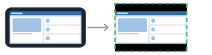

# Guide des réglages

Cette page parcourt l'écran des réglages de l'app de haut en bas : ce que fait chaque réglage, quand l'activer et les limites que son résumé d'une ligne passe sous silence. Vous découvrez l'app ? Commencez par [Comment utiliser](/docs/fr/how-to-use/).

<aside class="sp-aside" aria-label="Écran des réglages de ScreenOnAuto">

Voici l'écran des réglages de l'app. Touchez une ligne pour accéder à son explication. Les interrupteurs fonctionnent, mais uniquement sur cette page — rien ne change sur votre téléphone.

</aside>

## Écran principal {#main}

### Panneau d'état {#mirror}

Le panneau sombre en haut. Sa première ligne indique si Android Auto est connecté et, le cas échéant, la taille de l'écran de la voiture qu'il a mesurée. En dessous se trouvent l'état actuel et le bouton Démarrer la duplication / <svg viewBox="0 0 12 12" aria-hidden="true"><rect width="12" height="12" rx="2"/></svg>Arrêter la duplication. **Démarrer la duplication** ouvre sur le téléphone la boîte de dialogue de capture d'écran d'Android ; la duplication commence dès que vous touchez **Commencer**.

Quand une autorisation manque, une ligne ambre en bas du panneau le signale ; touchez-la pour faire défiler jusqu'à [Autorisations](#category_permissions).

### Démarrage automatique {#auto_start_mirror}

Lorsque cette option est activée, la duplication peut être lancée depuis la voiture. Voici ce qui se passe (les étapes marquées « Vous » sont à faire par vous ; les autres se font toutes seules) :

1. Vous Touchez l'une des entrées ScreenOnAuto ( ou ) sur l'écran de la voiture.
2. Si le téléphone est en veille, son écran s'allume.
3. L'écran des réglages de ScreenOnAuto s'ouvre sur le téléphone et touche Démarrer la duplication à votre place.
4. Vous Android affiche sa boîte de dialogue de capture d'écran : autorisez-la avec **Commencer**. Si le téléphone est verrouillé par un code, un schéma ou une empreinte, déverrouillez-le d'abord pour que la boîte de dialogue apparaisse.
5. La duplication démarre et l'écran du téléphone apparaît dans la voiture.

> **💡 Astuce**
> - **Vous ne voulez pas autoriser à chaque fois ?** [Accordez la permission de duplication via ADB](/docs/fr/grant-mirror-permission-via-adb/) une fois et la boîte de dialogue n'apparaît plus, ce qui supprime l'étape 4 (tant que vous n'avez pas déverrouillé le téléphone, la voiture affiche son écran de verrouillage).
> - **Vous ne voulez pas que l'écran des réglages s'affiche ?** Activez [Lancer la duplication en arrière-plan](#silent_car_start) dans Avancé : à l'étape 3, le téléphone passe directement à la boîte de dialogue de capture sans ouvrir ScreenOnAuto. Avec les deux, l'étape 1 est la seule chose à faire, et rien ne s'affiche sur le téléphone.

Lorsque l'option est désactivée, l'étape 3 vous revient : toucher une entrée dans la voiture affiche seulement l'écran d'attente « Lancez la duplication sur le téléphone », puis vous ouvrez ScreenOnAuto sur le téléphone et touchez vous-même Démarrer la duplication, puis l'étape 4 comme ci-dessus.

### Empêcher la mise en veille {#keep_awake}

Empêche l'écran du téléphone de se mettre en veille pendant la duplication. La duplication *est* l'écran du téléphone : quand l'écran s'éteint, l'image dans la voiture s'arrête aussi. L'option garde seulement l'écran allumé — elle n'augmente pas la luminosité —, elle se combine donc bien avec [Atténuation automatique](#auto_dim) : l'écran reste allumé et s'assombrit en cas d'inactivité.

### Arrêter à la déconnexion {#stop_on_disconnect}

Arrête la duplication quand Android Auto se déconnecte (activé par défaut). Désactivée, la duplication continue en arrière-plan après que vous avez quitté la voiture, jusqu'à ce que vous l'arrêtiez.

### Atténuation automatique {#auto_dim}

Pendant la duplication, baisse la luminosité du téléphone au minimum quand personne ne l'a touché depuis un moment — pour économiser la batterie et éviter l'éblouissement. Seul le rétroéclairage du téléphone baisse ; l'image dans la voiture reste aussi lumineuse qu'avant. Touchez le téléphone et la luminosité revient.

- Nécessite l'autorisation [Afficher par-dessus les autres apps](#overlay_access).
- Utiliser l'écran de la voiture ([Transfert tactile](#accessibility_access)) ne compte pas comme toucher le téléphone et ne le réveille donc pas.
- Rien ne s'assombrit tant que le téléphone est sur son écran de verrouillage ; le compte à rebours démarre quand vous le déverrouillez ou le touchez.
- Avec Shizuku ou root, l'écran du téléphone peut être éteint à la place : voir [Éteindre l'écran du téléphone](#root_screen_off).

### Atténuer après {#auto_dim_delay}

Durée d'inactivité du téléphone avant l'atténuation : 15, 30 (par défaut), 60 ou 120 secondes. Nécessite [Atténuation automatique](#auto_dim) activée.

### Lancer une app automatiquement {#auto_launch_package}

Ouvre une app sur le téléphone — une carte ou un lecteur de musique, par exemple — dès que la duplication et Android Auto sont tous deux actifs. **Écran d'accueil par défaut**, en haut de la liste, ouvre l'app d'écran d'accueil que vous utilisez ; elle continue donc de fonctionner si vous changez de lanceur.

### Dupliquer seulement cette application {#single_app_mirror}

N'envoie à la voiture que l'app choisie dans [Lancer une app automatiquement](#auto_launch_package) ci-dessus, au lieu de tout l'écran du téléphone. Si vous passez à une autre app sur le téléphone, l'écran de la voiture reste vide jusqu'à votre retour — utile quand les passagers ou les notifications ne doivent pas apparaître dans la voiture.

La ligne n'apparaît que sur **Android 15 et versions ultérieures**, après que vous avez [accordé la permission de duplication via ADB](/docs/fr/grant-mirror-permission-via-adb/). Elle reste grisée tant qu'aucune app n'est choisie dans Lancer une app automatiquement.

**Quand en avez-vous besoin ?**

- **Sans la permission ADB, vous n'en avez pas besoin.** Depuis Android 14, la boîte de dialogue de capture qui s'affiche à chaque démarrage de la duplication permet déjà de choisir entre partager l'écran entier et partager une seule app ; choisissez une app et seule celle-ci est dupliquée. Sur Android 13 et versions antérieures, la boîte de dialogue n'offre pas ce choix et duplique toujours l'écran entier.
- **Avec la permission ADB, vous en avez besoin.** Une fois la permission accordée, la boîte de dialogue n'apparaît plus : il n'y a donc nulle part où choisir une app, et la duplication porte toujours sur l'écran entier. Pour passer la boîte de dialogue *et* dupliquer une seule app, utilisez cet interrupteur : avec [Lancer une app automatiquement](#auto_launch_package) ci-dessus, il n'envoie que cette app à la voiture.
- [Partager uniquement l'écran entier](#full_screen_share_only), dans Avancé, retire de la boîte de dialogue le choix d'une seule app ; il ne gêne pas cet interrupteur.

### Sous-pages {#subpages}

**Boutons à l'écran**, **Avancé** et **Fonctions privilégiées** ouvrent chacun leur propre page, décrite dans les chapitres ci-dessous : [Boutons à l'écran](#screen_buttons), [Avancé](#advanced), [Fonctions privilégiées](#root_features).

### Autorisations {#category_permissions}

Chaque ligne ouvre la page correspondante des paramètres système ; l'étiquette à droite indique si l'autorisation est accordée.

#### Accès aux notifications {#notification_access}

Permet à « ScreenOnAuto Contrôleur multimédia »  de prendre la main sur ce qui est lu sur le téléphone. **Les boutons multimédias de votre volant** et l'écran multimédia d'Android Auto peuvent alors contrôler **les lecteurs qui ne prennent pas eux-mêmes en charge Android Auto**, comme YouTube : précédent / suivant et lecture / pause fonctionnent.

- L'app lit seulement ce qui est en cours de lecture (sessions multimédias), jamais le contenu de vos notifications.
- Les apps de musique qui prennent en charge Android Auto elles-mêmes (YouTube Music, Spotify, etc.) se connectent directement à Android Auto et ne sont pas concernées.
- Sans cette autorisation, les boutons vont au lecteur que le système considère comme actif — avec plusieurs lecteurs ouverts, ce n'est pas forcément le bon.
- Les anciennes versions d'Android Auto affichent une entrée distincte « ScreenOnAuto Contrôleur multimédia » dans le lanceur d'apps ; les plus récentes non, ce qui est normal — le contrôle multimédia fonctionne dans les deux cas.

#### Afficher par-dessus les autres apps {#overlay_access}

Nécessaire pour [Atténuation automatique](#auto_dim), Verrouiller l'orientation ([Verrouiller l'orientation à la connexion](#force_landscape) et son [bouton dans la voiture](#map_action_force_landscape)) et [Atténuation de nuit](#night_dim).

#### Modifier les paramètres système {#write_settings_access}

Affiché uniquement sur **Android 16 et versions ultérieures**. Quand le téléphone est en mode tablette (petit côté de 600dp ou plus — l'écran intérieur d'un pliable, ou après avoir baissé la [Densité du téléphone](#phone_density)), Android 16 ignore l'orientation d'écran demandée par les apps ; Verrouiller l'orientation utilise donc à la place le verrouillage de la rotation du système, qui nécessite cette autorisation. Votre propre réglage de rotation automatique revient à la fin du verrouillage.

#### Transfert tactile {#accessibility_access}

Transmet au téléphone les appuis, balayages et pincements effectués sur l'écran de la voiture, via un service d'accessibilité Android. Les deux duplications prennent en charge les mêmes gestes ici : appui, défilement (balayer une liste), lancer rapide et pincer pour zoomer.

Avec Shizuku ou root, vous pouvez utiliser [Injection tactile réelle](#root_touch_injection) à la place : les touchers sur l'écran de la voiture arrivent au téléphone comme de vrais gestes du doigt, et l'on a l'impression d'utiliser directement le téléphone. **L'appui long**, **l'appui-glisser** (déplacer une icône de l'écran d'accueil, par exemple) et **les gestes à plusieurs doigts**, dont le service d'accessibilité est incapable, fonctionnent aussi — dans la duplication « ScreenOnAuto (Legacy) » uniquement.

### À propos {#about}

La version (touchez-la pour la copier), les liens GitHub et de don, la Politique de confidentialité, les Conditions d'utilisation et les licences tierces.

## Boutons à l'écran {#screen_buttons}

Tout ce qui peut apparaître comme bouton sur l'écran de la voiture se configure sur cette page.

### Raccourcis de lancement {#category_shortcuts}

Jusqu'à 4 raccourcis d'apps sur l'écran de la voiture. Touchez-en un et l'app s'ouvre sur le téléphone — et donc dans la voiture.

- Touchez une ligne pour choisir l'app ; l'interrupteur à droite l'affiche ou la masque dans la voiture. **Écran d'accueil par défaut** fonctionne aussi ici, comme bouton « retour à l'accueil ».
- **Appuyez longuement** sur un raccourci configuré pour changer le texte affiché dans la voiture (30 caractères maximum). Effacez-le et la duplication « ScreenOnAuto (Legacy) » n'affiche que l'icône de l'app.
- Les raccourcis apparaissent en **haut** de la duplication ; le côté dépend de la duplication :
  - Duplication « ScreenOnAuto » : elle utilise le modèle d'écran de carte d'Android Auto, donc les raccourcis sont des boutons texte qu'Android Auto dessine lui-même (sans icônes), et c'est Android Auto qui décide de leur position — l'app ne peut pas les déplacer. Ils peuvent changer de côté selon le réglage de position du conducteur d'Android Auto, mais ce n'est pas garanti.
  - Duplication « ScreenOnAuto (Legacy) » : l'app les dessine elle-même sous forme de boutons avec icônes, en **haut à droite** par défaut ; [Aligner les boutons à gauche](#legacy_buttons_left) les place en haut à gauche, et [les écarts](#legacy_gaps) ajustent leur distance aux bords.
- Les raccourcis ne restent pas à l'écran : dans la duplication « ScreenOnAuto (Legacy) », ils se masquent avec les [boutons de fonction](#category_control_buttons) après 5 secondes d'inactivité et reviennent quand vous touchez l'écran de la voiture ; dans la duplication « ScreenOnAuto », c'est Android Auto qui décide quand ils se masquent.

### Boutons de fonction {#category_control_buttons}

Des boutons ronds au-dessus de la duplication, 4 au maximum à la fois dans l'une ou l'autre duplication.

- Leur position dépend de la duplication :
  - Duplication « ScreenOnAuto » : ils forment la barre de boutons du modèle d'écran de carte d'Android Auto, dessinée par Android Auto en **bas à droite ou en bas à gauche**. Android Auto décide du côté — l'app ne peut pas le changer ; comme pour les [Raccourcis de lancement](#category_shortcuts), il peut changer selon le réglage de position du conducteur, mais ce n'est pas garanti.
  - Duplication « ScreenOnAuto (Legacy) » : une colonne que l'app dessine elle-même, en **bas à droite** par défaut ; [Aligner les boutons à gauche](#legacy_buttons_left) la place en bas à gauche, et [les écarts](#legacy_gaps) ajustent sa distance aux bords.
- Masquage automatique : dans la duplication « ScreenOnAuto (Legacy) », les boutons de fonction se masquent avec les raccourcis après 5 secondes d'inactivité et reviennent quand vous touchez l'écran de la voiture ; dans la duplication « ScreenOnAuto », c'est Android Auto qui décide quand ils se masquent.

#### Bouton Verrouiller l'orientation {#map_action_force_landscape}

Active ou désactive Verrouiller l'orientation pour le moment, sans modifier le réglage [Verrouiller l'orientation à la connexion](#force_landscape) ; la connexion suivante suit de nouveau le réglage. Activé par défaut.

#### Bouton Atténuation automatique {#map_action_auto_dim}

Active ou désactive [Atténuation automatique](#auto_dim) — le même interrupteur que dans les réglages. Quand l'écran du téléphone a été [éteint](#root_screen_off), c'est le moyen le plus rapide de le rallumer.

#### Bouton Atténuation de nuit {#map_action_night_dim}

Active ou désactive l'[Atténuation de nuit](#night_dim) momentanément — en entrant dans un tunnel, par exemple. Cela dure jusqu'au prochain passage de la voiture entre jour et nuit ; avec [Quand atténuer](#night_dim_trigger) réglé sur Toujours, jusqu'à la déconnexion d'Android Auto. L'atténuation suit le réglage [Intensité](#night_dim_strength).

#### Boutons Retour, Accueil et Applis récentes {#map_action_nav}

Les trois touches de navigation du téléphone, qu'il utilise les gestes ou les boutons. Avec Shizuku ou root connecté, elles envoient de vraies pressions de touches ; sinon, elles nécessitent [Transfert tactile](#accessibility_access).

### Position des boutons {#category_button_placement}

Cette section ne concerne que la duplication « ScreenOnAuto (Legacy) ». Les boutons de la duplication « ScreenOnAuto » sont dessinés par Android Auto et ne peuvent pas être déplacés.

#### Aligner les boutons à gauche {#legacy_buttons_left}

Place les [boutons de fonction](#category_control_buttons) et les [raccourcis](#category_shortcuts) à gauche — pour les voitures à conduite à droite, ou quand les commandes propres de l'autoradio recouvrent le côté droit.

#### Éviter la barre de navigation du téléphone {#legacy_buttons_dodge_nav}

Quand la barre de navigation du téléphone apparaît dans la duplication, écarte les boutons pour que les deux ne se chevauchent pas. Nécessite Android 11 ou version ultérieure (les téléphones plus anciens n'affichent pas la ligne). Tant que l'option est activée, les quatre écarts ci-dessous sont grisés — c'est l'un ou l'autre placement.

#### Écarts des boutons et des raccourcis {#legacy_gaps}

Quatre distances en dp (0–400, 16 par défaut) : les boutons de fonction par rapport au bord latéral et au bord inférieur, et les raccourcis par rapport au bord latéral et au bord supérieur. Servez-vous-en pour sortir les boutons de ScreenOnAuto de sous ceux de l'autoradio. Si une valeur est trop grande, les boutons restent à l'intérieur de l'écran au lieu d'en sortir.

## Avancé {#advanced}

### Orientation de l'écran {#category_orientation}

#### Verrouiller l'orientation à la connexion {#force_landscape}

Verrouille le téléphone dans une orientation quand Android Auto se connecte, pour que la duplication ne bascule pas quand le téléphone tourne et qu'un téléphone en paysage remplisse un écran de voiture large. L'option agit une seule fois, au moment de la connexion ; ensuite, le [Bouton Verrouiller l'orientation](#map_action_force_landscape) dans la voiture libère ou réapplique le verrouillage. Nécessite l'autorisation [Afficher par-dessus les autres apps](#overlay_access).

#### Orientation {#force_orientation_mode}

Le sens du verrouillage : **Paysage** (par défaut), **Portrait**, ou **Détecter selon l'écran de la voiture** — paysage quand la zone réellement attribuée à la duplication dans la voiture est plus large que haute, portrait quand elle est plus haute. L'option suit un écran partagé qui change cette forme.

#### Mode paysage inversé {#force_landscape_reverse}

Retourne un téléphone en paysage dans l'autre sens — pour un support qui le tient à l'envers. Grisé en portrait.

### Réglage de l'affichage {#category_display_adjust}

#### Duplication dessinée par l'application {#self_draw}

L'app dessine elle-même l'image du téléphone dans la voiture au lieu de laisser le système la mettre à l'échelle. L'écran partagé ne déforme alors plus l'image, et les réglages de largeur/hauteur ci-dessous fonctionnent de la même façon, que vous les fixiez avant ou pendant une connexion. Consomme un peu plus de batterie.

Une modification prend effet au **prochain démarrage de la duplication** — elle ne bascule volontairement pas en cours de session.

#### Délai vidéo {#video_delay}

Quand l'image est en avance sur le son (par exemple sur un autoradio Android qui lit Android Auto via une app réceptrice, où le son est en retard), retient l'image de 0–2000 millisecondes pour que les deux soient synchronisés. Nécessite [Duplication dessinée par l'application](#self_draw) ; une modification s'applique immédiatement.

- Retenir les images consomme de la mémoire et du GPU en plus. Si l'audio et la vidéo se décalent parce que le téléphone ou l'autoradio est déjà à la peine, cela peut aggraver les choses.
- Les appuis agissent toujours sur l'écran du téléphone tel qu'il est **maintenant**, pas sur l'image retardée.

#### Taille fixe de la duplication {#nav_fixed_size}

Duplication « ScreenOnAuto » uniquement. La duplication garde sa taille quand la voiture passe en écran partagé, elle n'est donc pas déformée — mais une partie peut être coupée. À régler de préférence avant la connexion.

#### Figer la duplication à l'affichage des boutons {#nav_ignore_strip}

Duplication « ScreenOnAuto » uniquement, activé par défaut. La barre de boutons d'Android Auto apparaît et disparaît d'elle-même, et prend un peu de place à chaque fois. Avec cette option, l'apparition de la barre ne redimensionne pas la duplication et ne la fait pas sauter ; les vrais changements de disposition, comme l'écran partagé, s'appliquent toujours. Grisé tant que [Taille fixe de la duplication](#nav_fixed_size) est activé.

#### Ajuster la largeur de la duplication, Ajuster la hauteur de la duplication {#vd_gap}

La zone que la voiture attribue à la duplication (le cadre vert en pointillés ci-dessous) a rarement la même forme que l'écran du téléphone. L'image du téléphone est mise à l'échelle uniformément pour y tenir, donc le côté qui ne correspond pas se retrouve avec des bandes noires : quand l'image est **plus large** que la zone (par exemple parce que l'écran partagé l'a rétrécie), les bandes sont **en haut et en bas** ; quand elle est **plus étroite**, elles sont **à gauche et à droite**.

Ces deux réglages agrandissent ou réduisent, en pixels, le cadre dans lequel la duplication est ajustée. Une valeur **négative** l'agrandit : l'image grandit et les bandes rétrécissent, au prix d'une partie de l'image qui dépasse de la zone utilisable et se retrouve coupée (hachurée sur les illustrations).

<figure><figcaption>Bandes en haut et en bas</figcaption></figure>
<figure><figcaption><b>Largeur</b> négative : plus de bandes en haut et en bas, le côté droit déborde</figcaption></figure>
<figure><figcaption>Bandes à gauche et à droite</figcaption></figure>
<figure><figcaption><b>Hauteur</b> négative : plus de bandes à gauche et à droite, le bas déborde</figcaption></figure>

- **Bandes en haut et en bas → rendez la *largeur* négative.** Un cadre plus large laisse l'image grandir, y compris en hauteur, et combler les bandes.
- **Bandes à gauche et à droite → rendez la *hauteur* négative.** Un cadre plus haut laisse l'image grandir, y compris en largeur, et combler les bandes.
- La duplication est ancrée au **coin supérieur gauche** de la zone, donc ce qui déborde dépasse du bord **droit** (largeur) ou du **bas** (hauteur) — ce n'est pas réparti entre les deux côtés. Ce qui est coupé à cet endroit, boutons compris, ne peut pas être touché : arrêtez-vous à la valeur où les bandes disparaissent tout juste.
- Une valeur **positive** fait l'inverse : elle réduit le cadre, pour les autoradios qui rognent les bords de l'image, et fait réapparaître un bord rogné (avec une petite bande noire).
- C'est plus précis avec [Duplication dessinée par l'application](#self_draw) activée. Sans elle, ajustez les valeurs **pendant la connexion** : dans la duplication « ScreenOnAuto », une valeur négative déjà définie au démarrage de la duplication peut écraser l'image au lieu de l'agrandir.

Touchez le texte pour saisir une valeur (enregistrer une valeur non nulle active l'interrupteur) ; l'interrupteur après le séparateur la désactive un instant tout en conservant la valeur, pour comparer.

> **💡 Pour ne plus avoir aucune bande noire**
>
> Avec Shizuku ou root, activez [Adapter l'écran du téléphone à celui de la voiture](#root_display_override). L'écran du téléphone prend alors les proportions de la zone, et la duplication la remplit exactement — sans bandes, sans rien de coupé. Tant que l'option est activée, ces deux réglages sont suspendus.

<figure><figcaption>Adapter l'écran du téléphone à celui de la voiture : un ajustement exact</figcaption></figure>

### Atténuation de nuit {#category_night_dim}

#### Atténuer l'écran de la voiture {#night_dim}

Assombrit la duplication dans la voiture la nuit, pour qu'une app de téléphone très blanche n'éblouisse pas dans le noir.

- Dans la duplication « ScreenOnAuto (Legacy) », ou avec [Duplication dessinée par l'application](#self_draw) activée, seule l'image dans la voiture s'assombrit.
- Dans la duplication « ScreenOnAuto » sans Duplication dessinée par l'application, l'atténuation est un calque sombre posé sur l'écran du téléphone, donc **le téléphone s'assombrit aussi**. Il faut pour cela l'autorisation [Afficher par-dessus les autres apps](#overlay_access).
- Pour la désactiver ou l'activer un instant, utilisez le [Bouton Atténuation de nuit](#map_action_night_dim) dans la voiture.

#### Quand atténuer {#night_dim_trigger}

**Quand la voiture passe en mode nuit** (par défaut) : assombrit la nuit, revient à la normale le jour. **Toujours** : assombrit tant qu'Android Auto est connecté.

#### Intensité {#night_dim_strength}

Le niveau d'assombrissement : 10 %–80 % (50 % par défaut). Le [Bouton Atténuation de nuit](#map_action_night_dim) l'utilise aussi.

### Démarrage depuis la voiture {#category_car_start}

#### Lancer la duplication en arrière-plan {#silent_car_start}

Quand la duplication [démarre depuis la voiture](#auto_start_mirror), l'écran des réglages de ScreenOnAuto ne passe pas au premier plan sur le téléphone et ne reste pas dans les Applis récentes. La boîte de dialogue de capture s'affiche toujours.

> **💡 Astuce**
>
> Ajoutez la [permission de duplication accordée via ADB](/docs/fr/grant-mirror-permission-via-adb/) et la boîte de dialogue de capture disparaît aussi : touchez une entrée dans la voiture et rien ne s'affiche sur le téléphone — la duplication démarre simplement, sans toucher au téléphone. Tant que vous n'avez pas déverrouillé le téléphone, la voiture affiche son écran de verrouillage.

#### Partager uniquement l'écran entier {#full_screen_share_only}

Depuis Android 14, la boîte de dialogue de capture demande d'abord s'il faut partager une app ou l'écran entier, et vous devez ouvrir ce menu à chaque fois. Avec cette option, la boîte de dialogue ne propose que l'écran entier. Affiché sur Android 14 et versions ultérieures. Si vous dupliquez une seule app en la choisissant dans cette boîte de dialogue (la méthode sans la permission ADB), laissez l'option désactivée ; avec la permission ADB, utilisez plutôt [Dupliquer seulement cette application](#single_app_mirror).

Vous voyez encore les deux choix ? Android 16 a, dans les Options pour les développeurs, un remplacement de compatibilité (`OVERRIDE_DISABLE_MEDIA_PROJECTION_SINGLE_APP_OPTION`) qui les fait revenir ; vérifiez qu'il n'est pas activé.

## Fonctions privilégiées {#root_features}

Les fonctions de cette page nécessitent [Shizuku](https://shizuku.rikka.app/) ou root, car elles modifient des paramètres système auxquels une app ordinaire ne peut pas toucher. Chacune rétablit le réglage d'origine du téléphone à la fin de la duplication.

### Connexion {#root_status}

Le cadre en haut indique si Shizuku ou root est connecté ; son bouton sert à **Accorder l'accès**, **Se connecter** ou **Se déconnecter**. Une connexion qui tombe (Shizuku qui redémarre, par exemple) se rétablit d'elle-même.

Un serveur Shizuku démarré via ADB s'arrête quand le téléphone est branché à la voiture en USB — voir [Dépannage](/docs/fr/how-to-use/#fonctions-privilégiées-shizuku--root).

### Root non détecté ? {#root_force}

Si le gestionnaire root est masqué ou renommé, l'app ne voit pas le root, et le cadre de connexion ne le propose jamais. Toucher cette ligne demande directement le root à su. Elle ne s'affiche que tant que le root n'est pas détecté et que rien n'est connecté.

### Fonctions {#category_root_features}

#### Éteindre l'écran du téléphone {#root_screen_off}

Quand [Atténuation automatique](#auto_dim) se déclenche, éteint le rétroéclairage du téléphone au lieu de l'atténuer. Nécessite Atténuation automatique activée.

Seul l'écran s'éteint — **le téléphone ne se met pas en veille** : les apps et le système continuent de tourner, la duplication reste affichée dans la voiture, et l'utilisation du téléphone depuis la voiture fonctionne toujours. En revanche, l'écran tactile s'éteint avec l'écran : **toucher l'écran du téléphone ne fait rien** et ne le rallume pas.

Pour rallumer l'écran : touchez le [Bouton Atténuation automatique](#map_action_auto_dim) dans la voiture, arrêtez la duplication ou déconnectez Android Auto, ou appuyez **deux fois** sur le bouton marche/arrêt (le premier appui est celui qui met le système en veille).

#### Injection tactile réelle {#root_touch_injection}

Envoie au téléphone les touchers sur l'écran de la voiture sous forme de vrais gestes du doigt : l'appui long, le glisser et les gestes à plusieurs doigts fonctionnent — et le service d'accessibilité du [Transfert tactile](#accessibility_access) n'est plus nécessaire. L'effet complet s'obtient dans la duplication « ScreenOnAuto (Legacy) » : depuis Android Auto, la duplication « ScreenOnAuto » ne reçoit que les appuis, défilements, lancers rapides et pincements, ce qui est une limite d'Android Auto.

#### Écran tactile virtuel {#root_virtual_touch}

Transmet ces touchers via un écran tactile virtuel, pour que les applis de gestes qui lisent directement l'écran tactile (comme GMD Gestures) les reçoivent aussi. Nécessite [Injection tactile réelle](#root_touch_injection) activée.

#### Suivre le mode jour/nuit de la voiture {#root_follow_car_night}

Pendant la duplication, le thème clair ou sombre du téléphone change avec le mode jour/nuit d'Android Auto, puis revient ensuite au réglage du téléphone. Android 10 et versions ultérieures.

#### Lire le mode depuis Android Auto {#root_car_night_from_aa}

Apparaît une fois l'interrupteur précédent activé, et s'applique à la duplication « ScreenOnAuto ». Sur certains téléphones (certains modèles Samsung, par exemple), le mode jour/nuit transmis à l'app est faux, si bien que le téléphone ne change jamais avec la voiture ; cette option lit à la place l'état jour/nuit d'Android Auto lui-même. Laissez-la désactivée si le téléphone suit déjà la voiture.

#### Taille de police pendant la duplication {#root_mirror_font_scale}

Utilise une autre taille de police pendant la duplication — un texte plus grand dans la voiture, par exemple — puis rétablit celle du téléphone. Les choix sont les mêmes paliers que dans les Paramètres du téléphone.

#### Mode de navigation pendant la duplication {#root_mirror_nav_mode}

Passe à la navigation par gestes, à deux boutons ou à trois boutons pendant la duplication, puis revient (Android 10 et versions ultérieures). Sur l'écran partagé d'un autoradio en portrait, par exemple, les gestes laissent plus de place aux apps. Les modes dont le téléphone ne dispose pas sont indiqués comme non disponibles.

#### Écran d'accueil pendant la duplication {#root_mirror_home}

Fait d'un autre lanceur l'écran d'accueil par défaut du téléphone pendant la duplication, puis remet le vôtre. Pour avoir un écran d'accueil organisé pour la voiture, ou pour les téléphones dont le lanceur d'origine réorganise ses icônes quand la [forme de l'écran](#category_root_display) change (certains modèles Xiaomi sous HyperOS).

### Forme de l'écran {#category_root_display}

#### Adapter l'écran du téléphone à celui de la voiture {#root_display_override}

Pendant la duplication, donne à l'écran du téléphone le rapport largeur/hauteur de la voiture, pour que la duplication remplisse la voiture sans bandes noires et ne se déforme pas en écran partagé. S'applique en direct, sans reconnexion.

<figure><figcaption>Avant : la forme du téléphone diffère de celle de la voiture, d'où des bandes dans la voiture</figcaption></figure>
<figure><figcaption>Après : le téléphone prend la forme de la voiture, qui est remplie exactement</figcaption></figure>
<figure><figcaption>Avant : une zone plus étroite dans la voiture (écran partagé, par exemple) laisse des bandes en haut et en bas</figcaption></figure>
<figure><figcaption>Après : le téléphone prend la forme de la voiture, qui est remplie exactement</figcaption></figure>
<figure><figcaption>Avant : un grand autoradio en portrait, téléphone vertical, bandes à gauche et à droite dans la voiture</figcaption></figure>
<figure><figcaption>Après : le téléphone prend la forme portrait de la voiture, qui est remplie exactement</figcaption></figure>

Cela fonctionne que la voiture affiche des bandes à gauche et à droite (première paire) ou en haut et en bas (deuxième paire), et aussi sur un grand autoradio en portrait (troisième paire — le téléphone est vertical ; avec [Orientation](#force_orientation_mode) réglé sur la détection selon l'écran de la voiture, il se verrouille de lui-même en portrait). L'écran physique du téléphone garde sa forme : une fois l'option activée, **le téléphone lui-même** affiche des bandes dans l'autre sens (en haut et en bas quand la voiture en avait à gauche et à droite, et inversement) — c'est normal ; la duplication dans la voiture la remplit exactement.

- C'est une modification au niveau du système qui **persiste après un redémarrage** tant qu'elle n'est pas annulée. Normalement, arrêter la duplication ou se déconnecter l'annule automatiquement.
- Tant que la forme de l'écran du téléphone est modifiée, un avis ambre avec un bouton **Rétablir** apparaît en haut de cette section.
- Si l'écran du téléphone reste bloqué dans une mauvaise forme et que vous ne pouvez pas ouvrir l'app, exécutez `adb shell wm size reset` et `adb shell wm density reset` depuis un ordinateur.

#### Ajouter un raccourci de rétablissement à l'écran d'accueil {#root_display_shortcut}

Place un raccourci « Rétablir l'écran » sur l'écran d'accueil : un seul appui rétablit l'écran du téléphone sans ouvrir l'app.

#### Ce qui sera appliqué {#root_display_derived}

La taille que prendra l'écran du téléphone, calculée à partir de la taille de la voiture, et ce que le système a réellement accepté. Tant que la voiture n'a pas été mesurée, cela attend la prochaine ouverture de la duplication dans Android Auto.

#### Taille de l'écran de la voiture {#car_size}

Une par duplication (la voiture attribue aux deux duplications des zones de tailles différentes). Par défaut, c'est la taille détectée, marquée **Auto**. Ne la modifiez que si la détection est fausse : largeur et hauteur partagent une même boîte de dialogue, et un champ vide utilise la valeur détectée (160–8192).

#### Densité du téléphone {#phone_density}

Facultatif, une par duplication (72–640 dpi). Plus le nombre est élevé, plus le texte et les boutons sont grands sur l'écran de la voiture ; plus il est bas, plus l'écran affiche de contenu à la fois. Si vous la baissez au point que le petit côté du téléphone dépasse 600dp, la plupart des apps et le système passent aux mises en page tablette (deux colonnes, navigation latérale) — la boîte de dialogue vous indique pendant la saisie si ce sera le cas. Laissez vide pour ne rien changer.

