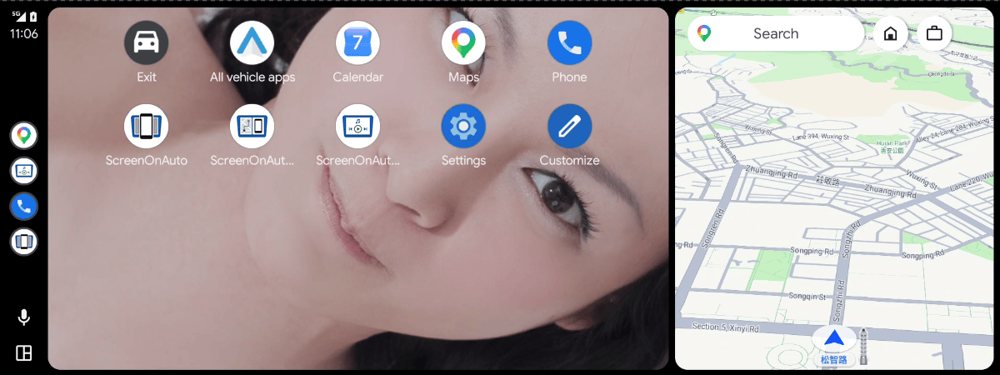
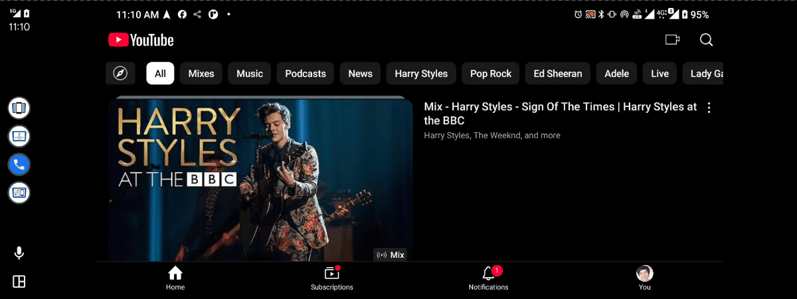
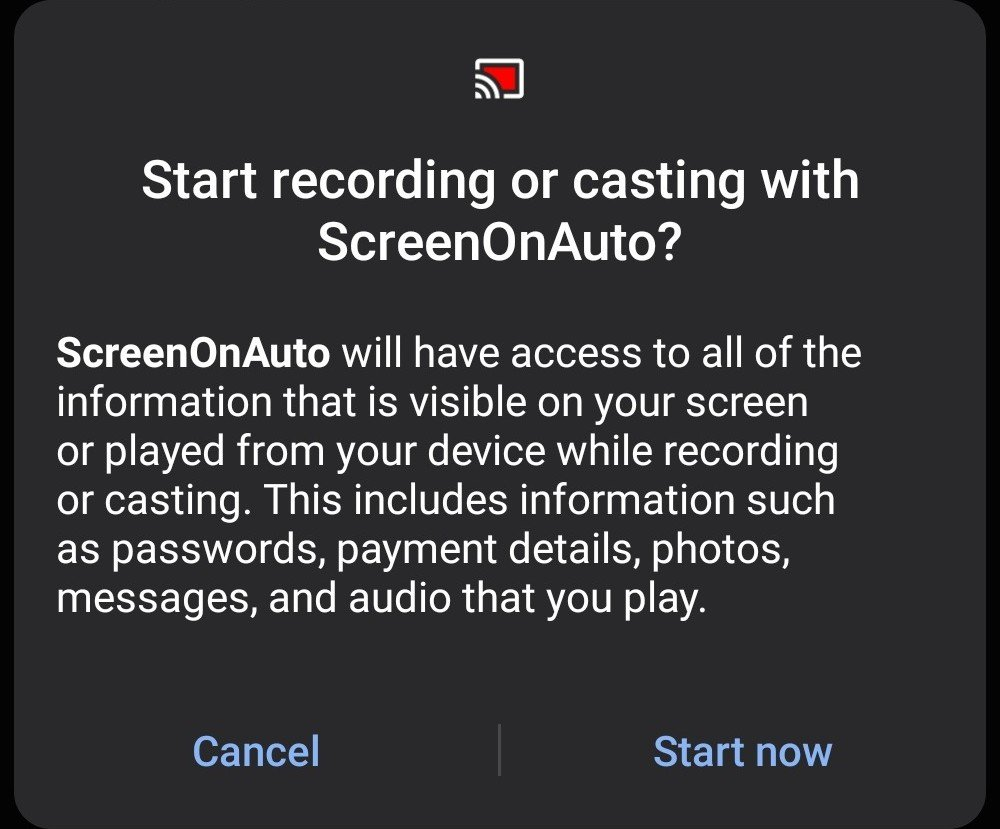
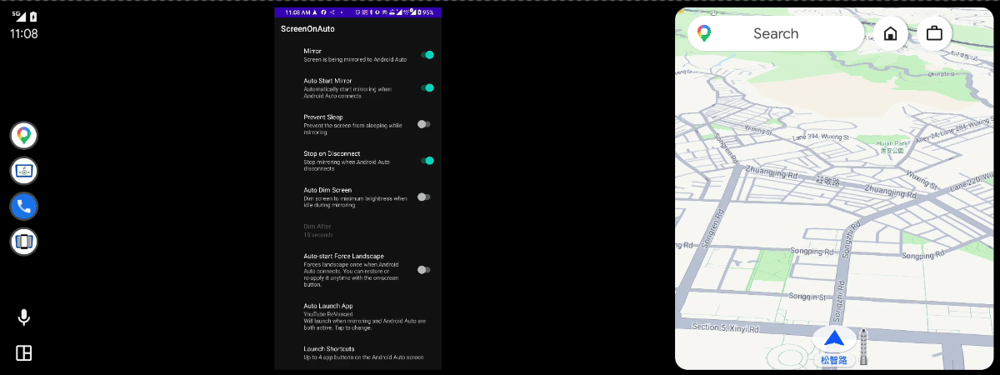

# Cara Menggunakan

> **ℹ️ Catatan**
> **Sebelum mulai**, pastikan:
> - ScreenOnAuto sudah terinstal dan kedua entrinya ( **ScreenOnAuto** dan  **ScreenOnAuto (Legacy)**) muncul di peluncur Android Auto.
> - Anda sudah membuka aplikasi sekali di ponsel dan memberikan izin yang dimintanya.

## Dua entri pencerminan

Peluncur aplikasi Android Auto menampilkan **dua** entri pencerminan:  **ScreenOnAuto** dan  **ScreenOnAuto (Legacy)**. Keduanya mencerminkan
layar ponsel yang sama — perbedaannya ada pada *cara* pencerminan ditampilkan di layar mobil:

<table class="entry-pair" role="presentation">
<tr>
<td width="50%" valign="top">
 <b>ScreenOnAuto</b> 

Layar penuh — mengambil alih area peta
</td>
<td width="50%" valign="top">
 <b>ScreenOnAuto (Legacy)</b> 

Di <b>layar mobil yang cukup besar</b>, entri ini bisa tampil <b>berdampingan dengan peta</b> dalam tampilan terpisah; di layar yang lebih kecil, peta hanya berpindah ke latar belakang dan yang tampil hanya pencerminan (entri ini <b>tidak</b> menggantikan peta)
</td>
</tr>
</table>

Coba keduanya dan pakai yang paling cocok di head unit Anda. Keduanya menampilkan pencerminan
yang sama, dan Anda bisa berpindah di antaranya kapan saja — saat pencerminan sedang berjalan,
membuka entri yang lain langsung menampilkannya tanpa meminta izin lagi.

> **💡 Tips**
> Jika sebelumnya Anda pernah membuka  **ScreenOnAuto** (entri layar penuh) dan sekarang ingin
> memakai  **ScreenOnAuto (Legacy)**, buka dulu aplikasi peta Anda (mis. Google Maps) di layar
> mobil, baru kemudian mulai pencerminan Legacy. Dengan begitu aplikasi peta kembali menjadi
> peta default di layar mobil, sehingga fungsi yang terkait peta tidak diambil alih oleh
> pencerminan layar penuh.

## Memulai pencerminan

### Dengan Mulai pencerminan otomatis AKTIF (disarankan)

1. Di aplikasi pada ponsel, aktifkan [**Mulai pencerminan otomatis**](/docs/id/settings/#auto_start_mirror) (pengaturan sekali saja).
2. Hubungkan ponsel ke mobil lalu ketuk entri ScreenOnAuto
   ( atau
   ) di peluncur
   Android Auto.
3. Ponsel otomatis menampilkan dialog izin perekaman layar — ambil ponsel lalu ketuk
   **Mulai sekarang**:

   

   Jika ponsel sedang tidur, layarnya menyala sendiri. Jika ponsel dikunci dengan PIN, pola, atau sidik jari, buka kuncinya dulu; setelah itu dialog akan muncul. Jika izin sudah diberikan lewat ADB, tidak ada dialog: pencerminan langsung dimulai, dan mobil menampilkan layar kunci sampai Anda membuka kunci ponsel.

4. Layar ponsel Anda muncul di head unit:

   

> **ℹ️ Catatan**
> Dialog izin adalah persyaratan Android — dialog ini muncul sekali setiap kali pencerminan
> dimulai, bukan setiap kali layar berganti. Jika *Mulai pencerminan otomatis* nonaktif,
> mengetuk entri hanya membuka layar pencerminan; tidak ada yang direkam sampai Anda
> memulainya sendiri.

### Memulai secara manual

Jika Anda lebih suka membiarkan **Mulai pencerminan otomatis** nonaktif:

1. Buka ScreenOnAuto di ponsel dan ketuk **Mulai pencerminan**, lalu ketuk **Mulai sekarang** di dialog izin.
2. Di layar mobil, buka salah satu entri ScreenOnAuto — pencerminan sudah berjalan dan
   langsung tampil.

(Urutannya tidak penting — Anda juga bisa membuka entri lebih dulu, lalu mengetuk **Mulai pencerminan** sesudahnya.)

### Melewati dialog izin

Bosan dialog muncul setiap kali? Anda bisa memberikan izin itu sekali saja lewat ADB — lihat
[Berikan Izin Pencerminan melalui ADB](/docs/id/grant-mirror-permission-via-adb/). Aktifkan juga [**Mulai pencerminan di latar belakang**](/docs/id/settings/#silent_car_start), maka layar pengaturan ScreenOnAuto juga tidak muncul di ponsel: Anda mengetuk entri di mobil, tidak ada yang muncul di ponsel, dan pencerminan langsung dimulai.

## Menghentikan pencerminan

Salah satu cara berikut bisa dipakai:

- **Putuskan sambungan dari mobil** — pencerminan berhenti otomatis (pengaturan default
  [*Hentikan saat terputus*](/docs/id/settings/#stop_on_disconnect)).
- Ketuk **Hentikan pencerminan** pada notifikasi ponsel yang selalu tampil.
- Ketuk **Hentikan pencerminan** di aplikasi.

## Panduan Pengaturan

Fungsi setiap pengaturan, kapan sebaiknya diaktifkan, dan batasannya dijelaskan di [Panduan Pengaturan](/docs/id/settings/), lengkap dengan tiruan layar pengaturan yang bisa dicoba.

## Pemecahan masalah

### Pencerminan dan tampilan

#### Entri terbuka tetapi tetap kosong

Pencerminan belum dimulai; periksa apakah ada dialog izin di ponsel, atau mulai lewat tombol **Mulai pencerminan** di aplikasi.

#### Ada bilah hitam di sekeliling gambar

Layar ponsel dan layar mobil memiliki rasio aspek yang berbeda. Gunakan tombol [**Kunci orientasi**](/docs/id/settings/#map_action_force_landscape)
di layar pencerminan (atau [**Kunci orientasi saat terhubung**](/docs/id/settings/#force_landscape) di pengaturan). Agar pas persis dengan area
layar mobil yang bisa dipakai, aktifkan [**Samakan layar ponsel dengan mobil**](/docs/id/settings/#root_display_override) di Fitur istimewa
(Shizuku atau root). [**Sesuaikan lebar pencerminan, Sesuaikan tinggi pencerminan**](/docs/id/settings/#vd_gap) juga bisa memperbesar gambar hingga menutupi pita hitam, dengan sedikit tepi yang terpotong; Panduan Pengaturan menjelaskannya dengan diagram.

#### Gambar terlihat melar atau terdistorsi setelah tata letak berubah

Ini terjadi saat area yang terlihat membesar atau mengecil dalam tampilan terpisah. Memutar
ponsel hingga layar berganti antara potret dan lanskap akan memulihkannya (jika **Kunci orientasi** aktif, lepaskan dulu lewat tombolnya di layar). Dua pengaturan
juga bisa memperbaikinya:

- Aktifkan [**Pengaturan → Lanjutan → Ukuran pencerminan tetap**](/docs/id/settings/#nav_fixed_size). Pencerminan kemudian
  mempertahankan ukurannya alih-alih terdistorsi (sebagian mungkin tersembunyi). Hanya berlaku untuk entri layar penuh  **ScreenOnAuto**.
- Aktifkan [**Pengaturan → Lanjutan → Pencerminan digambar aplikasi (eksperimental)**](/docs/id/settings/#self_draw). Aplikasi
  kemudian menggambar sendiri gambar pencerminan alih-alih menyerahkan penskalaan ke sistem,
  sehingga gambar tidak lagi terdistorsi dalam tampilan terpisah. Fitur ini memakai sedikit
  lebih banyak baterai dan berlaku saat pencerminan dimulai berikutnya. [**Samakan layar ponsel dengan mobil**](/docs/id/settings/#root_display_override) (Fitur istimewa) memperbaiki masalah yang sama dengan cara lain, dan keduanya bisa aktif bersamaan.

#### Google Maps di Android Auto menjadi hitam selama pencerminan

Di Android 15 dan yang lebih baru, selama ada aplikasi yang merekam layar (yang memang harus dilakukan setiap aplikasi pencerminan), Android menyembunyikan aplikasi yang dianggapnya sensitif, dan Google Maps bisa masuk daftar itu. Peta Android Auto lalu tetap hitam sampai pencerminan dihentikan, dan hal yang sama terjadi dengan aplikasi pencerminan dan peta lain. Untuk memperbaikinya, aktifkan **Setelan → Opsi developer → Nonaktifkan perlindungan berbagi layar**. Jika Opsi developer tidak muncul, cari **Nomor build** di Setelan lalu ketuk 7 kali. Dengan begitu Android juga tidak lagi menyembunyikan notifikasi berisi kode sekali pakai saat Anda berbagi layar; jika itu penting bagi Anda, biarkan nonaktif. Setelah mengaktifkannya, hentikan pencerminan lalu mulai lagi: setelan ini baru berlaku saat pencerminan dimulai.

#### Bilah navigasi Android Auto tetap tampil di layar

**Bilah navigasi Android Auto** di layar mobil digambar oleh Android Auto sendiri dan tidak
bisa disembunyikan oleh aplikasi.

### Fitur istimewa (Shizuku / Root)

#### Server Shizuku yang dijalankan lewat ADB mati saat ponsel dicolokkan ke mobil

Sambungan USB membuat ponsel masuk ke mode aksesori, yang memulai ulang ADB dan ikut
menghentikan Shizuku — debugging nirkabel juga melalui ADB yang sama, jadi tidak membantu.
Jalankan Shizuku lagi dan ScreenOnAuto akan tersambung kembali dengan sendirinya; lebih baik
lagi, pakai [fork Shizuku-Next](https://github.com/rushiranpise/Shizuku-Next), yang layanan
watchdog-nya memulai ulang Shizuku untuk Anda. Pengguna Root dan sambungan Android Auto nirkabel
tidak terpengaruh.

#### Menyalakan layar kembali

Saat [**Matikan layar ponsel**](/docs/id/settings/#root_screen_off) aktif, layar sentuh ikut mati bersama panel, jadi mengetuk ponsel tidak berpengaruh apa pun. Ketuk
tombol [**Peredupan otomatis**](/docs/id/settings/#map_action_auto_dim) di layar mobil — mengalihkan Peredupan otomatis akan menyalakan
layar (aktifkan dulu tombol ini di [**Tombol layar → Tombol fungsi**](/docs/id/settings/#category_control_buttons); secara default nonaktif).
Atau tekan tombol daya ponsel **dua kali**, karena tekanan pertama justru yang membuat sistem
tidur. Menghentikan pencerminan atau memutuskan Android Auto juga menyalakan layar kembali.
