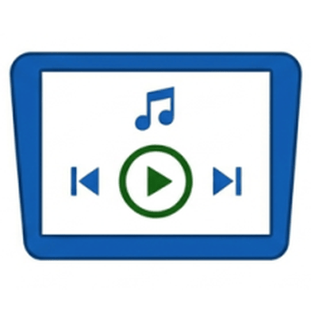

# Panduan Pengaturan

Halaman ini mengikuti layar pengaturan aplikasi dari atas ke bawah: apa fungsi setiap pengaturan, kapan sebaiknya diaktifkan, dan batasan yang tidak disebut dalam ringkasan satu barisnya. Baru memakai aplikasi ini? Mulailah dari [Cara Menggunakan](/docs/id/how-to-use/).

<aside class="sp-aside" aria-label="Layar pengaturan ScreenOnAuto">

Ini adalah layar pengaturan aplikasi. Ketuk baris mana pun untuk melompat ke penjelasannya. Sakelarnya berfungsi, tetapi hanya di halaman ini — tidak ada yang berubah di ponsel Anda.

</aside>

## Layar utama {#main}

### Panel status {#mirror}

Panel gelap di bagian atas. Baris pertamanya menunjukkan apakah Android Auto terhubung dan, jika ya, ukuran layar mobil yang terukur. Di bawahnya ada status saat ini dan tombol Mulai pencerminan / <svg viewBox="0 0 12 12" aria-hidden="true"><rect width="12" height="12" rx="2"/></svg>Hentikan pencerminan. **Mulai pencerminan** memunculkan dialog perekaman layar Android di ponsel; pencerminan dimulai setelah Anda mengetuk **Mulai sekarang**.

Jika ada izin yang belum diberikan, sebuah baris berwarna kuning di bagian bawah panel memberi tahu Anda; ketuk baris itu untuk menggulir ke [Izin](#category_permissions).

### Mulai pencerminan otomatis {#auto_start_mirror}

Jika ini aktif, pencerminan bisa dimulai dari mobil. Inilah yang terjadi (langkah bertanda “Anda” adalah bagian Anda; sisanya berjalan sendiri):

1. Anda Ketuk salah satu entri ScreenOnAuto ( atau ) di layar mobil.
2. Ponsel yang sedang tidur menyalakan layarnya.
3. Layar pengaturan ScreenOnAuto terbuka di ponsel dan mengetuk Mulai pencerminan untuk Anda.
4. Anda Android menampilkan dialog perekaman layar: izinkan dengan **Mulai sekarang**. Jika ponsel dikunci dengan PIN, pola, atau sidik jari, buka kuncinya dulu, lalu dialog akan muncul.
5. Pencerminan dimulai dan layar ponsel tampil di mobil.

> **💡 Tips**
> - **Tidak mau mengizinkan setiap kali?** [Berikan izin pencerminan melalui ADB](/docs/id/grant-mirror-permission-via-adb/) sekali saja dan dialog tidak muncul lagi, sehingga langkah 4 hilang (sampai Anda membuka kunci ponsel, mobil menampilkan layar kuncinya).
> - **Tidak mau layar pengaturan muncul?** Aktifkan [Mulai pencerminan di latar belakang](#silent_car_start) di Lanjutan: pada langkah 3, ponsel langsung menampilkan dialog perekaman tanpa membuka ScreenOnAuto. Dengan keduanya, Anda cukup melakukan langkah 1, dan tidak ada apa pun yang muncul di ponsel.

Jika nonaktif, langkah 3 menjadi bagian Anda: mengetuk entri di mobil hanya menampilkan layar tunggu “Mulai pencerminan di ponsel”, lalu Anda sendiri yang membuka ScreenOnAuto di ponsel dan mengetuk Mulai pencerminan, kemudian langkah 4 seperti di atas.

### Cegah layar tidur {#keep_awake}

Mencegah layar ponsel tidur selama pencerminan. Pencerminan *adalah* layar ponsel, jadi saat layar mati, gambar di mobil juga berhenti. Pengaturan ini hanya menjaga layar tetap menyala — tidak menaikkan kecerahan — sehingga cocok dipasangkan dengan [Redupkan layar otomatis](#auto_dim): layar tetap menyala, dan meredup saat tidak dipakai.

### Hentikan saat terputus {#stop_on_disconnect}

Menghentikan pencerminan saat Android Auto terputus (aktif secara default). Jika nonaktif, pencerminan tetap berjalan di latar belakang setelah Anda meninggalkan mobil sampai Anda menghentikannya.

### Redupkan layar otomatis {#auto_dim}

Selama pencerminan, menurunkan kecerahan ponsel ke minimum jika tidak disentuh beberapa saat — menghemat baterai dan mengurangi silau. Hanya lampu latar ponsel yang meredup; gambar di mobil tetap seterang sebelumnya. Sentuh ponsel dan kecerahannya kembali.

- Memerlukan izin [Tampilkan di atas aplikasi lain](#overlay_access).
- Memakai layar mobil ([penerusan sentuhan](#accessibility_access)) tidak dihitung sebagai menyentuh ponsel, jadi tidak membangunkan ponsel.
- Tidak ada yang meredup selama ponsel berada di layar kunci; hitung mundur dimulai setelah Anda membuka kunci atau menyentuhnya.
- Dengan Shizuku atau root, layar ponsel bisa dimatikan sebagai gantinya: lihat [Matikan layar ponsel](#root_screen_off).

### Redupkan setelah {#auto_dim_delay}

Berapa lama ponsel harus tidak dipakai sebelum meredup: 15, 30 (default), 60, atau 120 detik. Memerlukan [Redupkan layar otomatis](#auto_dim) aktif.

### Luncurkan aplikasi otomatis {#auto_launch_package}

Membuka sebuah aplikasi di ponsel — misalnya peta atau pemutar musik — begitu pencerminan dan Android Auto sama-sama aktif. **Layar utama default**, di bagian atas daftar, membuka aplikasi layar utama apa pun yang Anda pakai, jadi tetap berfungsi jika Anda mengganti peluncur.

### Cerminkan aplikasi ini saja {#single_app_mirror}

Hanya mengirim aplikasi dari [Luncurkan aplikasi otomatis](#auto_launch_package) di atas ke mobil, bukan seluruh layar ponsel. Beralih ke aplikasi lain di ponsel dan layar mobil menjadi kosong sampai Anda kembali — berguna jika penumpang atau notifikasi tidak boleh tampil di mobil.

Baris ini hanya muncul di **Android 15 dan yang lebih baru**, setelah Anda [memberikan izin pencerminan melalui ADB](/docs/id/grant-mirror-permission-via-adb/). Baris ini berwarna abu-abu sampai aplikasi untuk Luncurkan aplikasi otomatis dipilih.

**Kapan Anda memerlukannya:**

- **Tanpa izin ADB, Anda tidak memerlukannya.** Mulai Android 14, dialog perekaman yang muncul setiap kali pencerminan dimulai sudah memungkinkan Anda memilih antara membagikan seluruh layar dan membagikan satu aplikasi; pilih aplikasi di sana dan hanya aplikasi itu yang dicerminkan. Di Android 13 dan yang lebih lama, dialog tidak punya pilihan itu dan selalu mencerminkan seluruh layar.
- **Dengan izin ADB, Anda memerlukannya.** Setelah izin diberikan, dialog tidak muncul lagi, jadi tidak ada tempat untuk memilih aplikasi dan pencerminan selalu seluruh layar. Untuk melewati dialog *sekaligus* mencerminkan satu aplikasi, gunakan sakelar ini: bersama [Luncurkan aplikasi otomatis](#auto_launch_package) di atas, sakelar ini hanya mengirim aplikasi itu ke mobil.
- [Bagikan seluruh layar saja](#full_screen_share_only) di Lanjutan menghapus pilihan satu aplikasi dari dialog; pengaturan itu tidak mengganggu sakelar ini.

### Subhalaman {#subpages}

**Tombol layar**, **Lanjutan**, dan **Fitur istimewa** masing-masing membuka halaman tersendiri, yang dibahas di bab-bab berikut: [Tombol layar](#screen_buttons), [Lanjutan](#advanced), [Fitur istimewa](#root_features).

### Izin {#category_permissions}

Setiap baris membuka halaman setelan sistem yang sesuai; label di sebelah kanan menunjukkan apakah izin sudah diberikan.

#### Akses notifikasi {#notification_access}

Memungkinkan “Pengontrol Media ScreenOnAuto”  mengambil alih apa pun yang sedang diputar di ponsel. **Tombol media di setir** dan layar media Android Auto kemudian bisa mengontrol **pemutar yang tidak mendukung Android Auto sendiri**, seperti YouTube: sebelumnya / berikutnya dan putar / jeda semuanya berfungsi.

- Fitur ini hanya membaca apa yang sedang diputar (sesi media), tidak pernah isi notifikasi Anda.
- Aplikasi musik yang punya dukungan Android Auto sendiri (YouTube Music, Spotify, dan sejenisnya) terhubung langsung ke Android Auto dan dibiarkan saja.
- Tanpa izin ini, tombol-tombol itu diteruskan ke pemutar yang dianggap aktif oleh sistem — jika beberapa pemutar terbuka, bisa jadi yang salah.
- Versi Android Auto yang lebih lama menampilkan entri “Pengontrol Media ScreenOnAuto” tersendiri di peluncur aplikasi; versi yang lebih baru tidak, dan itu normal — kontrol media tetap berfungsi.

#### Tampilkan di atas aplikasi lain {#overlay_access}

Diperlukan oleh [Redupkan layar otomatis](#auto_dim), Kunci orientasi ([Kunci orientasi saat terhubung](#force_landscape) dan [tombolnya di mobil](#map_action_force_landscape)), serta [Peredupan malam](#night_dim).

#### Ubah setelan sistem {#write_settings_access}

Hanya ditampilkan di **Android 16 dan yang lebih baru**. Saat ponsel dalam mode tablet (sisi terpendek 600dp atau lebih — layar dalam ponsel lipat, atau setelah [Kepadatan layar ponsel](#phone_density) diturunkan), Android 16 mengabaikan orientasi layar yang diminta aplikasi, sehingga Kunci orientasi beralih ke kunci rotasi sistem, yang memerlukan izin ini. Setelan putar otomatis Anda sendiri kembali saat penguncian berakhir.

#### Penerusan Sentuhan {#accessibility_access}

Meneruskan ketukan, usapan, dan cubitan di layar mobil ke ponsel, melalui layanan aksesibilitas Android. Kedua pencerminan mendukung gestur yang sama di sini: ketuk, gulir (mengusap daftar), usap cepat, dan cubit untuk zoom.

Dengan Shizuku atau root, Anda bisa memakai [Injeksi sentuh nyata](#root_touch_injection) sebagai gantinya: sentuhan di layar mobil sampai ke ponsel sebagai gerakan jari nyata, jadi terasa seperti memakai ponsel secara langsung. **Tekan lama**, **tekan dan seret** (misalnya memindahkan ikon di layar utama), dan **gestur multi-jari**, yang tidak bisa dilakukan layanan aksesibilitas, juga berfungsi — tetapi hanya di pencerminan “ScreenOnAuto (Legacy)”.

### Tentang {#about}

Versi (ketuk untuk menyalinnya), tautan GitHub dan donasi, Kebijakan Privasi, Ketentuan Penggunaan, dan lisensi pihak ketiga.

## Tombol layar {#screen_buttons}

Semua yang bisa muncul sebagai tombol di layar mobil diatur di halaman ini.

### Pintasan peluncuran {#category_shortcuts}

Hingga 4 pintasan aplikasi di layar mobil. Ketuk salah satunya dan aplikasi terbuka di ponsel — dan dengan demikian di mobil.

- Ketuk baris untuk memilih aplikasi; sakelar di sebelah kanan menampilkan atau menyembunyikannya di mobil. **Layar utama default** juga bisa dipakai di sini, sebagai tombol “kembali ke layar utama”.
- **Tekan lama** pintasan yang sudah diatur untuk mengubah teks yang ditampilkan di mobil (hingga 30 karakter). Kosongkan teksnya dan pencerminan “ScreenOnAuto (Legacy)” hanya menampilkan ikon aplikasi.
- Pintasan muncul di sepanjang **bagian atas** pencerminan; sisinya bergantung pada pencerminan:
  - Pencerminan “ScreenOnAuto”: memakai templat layar peta Android Auto, jadi pintasannya berupa tombol teks yang digambar Android Auto sendiri (tanpa ikon), dan Android Auto yang menentukan letaknya — aplikasi tidak bisa memindahkannya. Pintasan mungkin berpindah sisi mengikuti setelan posisi pengemudi Android Auto, tetapi itu tidak dijamin.
  - Pencerminan “ScreenOnAuto (Legacy)”: aplikasi menggambarnya sendiri sebagai tombol berikon, secara default di **kanan atas**; [Ratakan tombol ke kiri](#legacy_buttons_left) memindahkannya ke kiri atas, dan [jaraknya](#legacy_gaps) menyetel jaraknya dari tepi.
- Pintasan tidak terus tampil di layar: di pencerminan “ScreenOnAuto (Legacy)” pintasan disembunyikan bersama [tombol fungsi](#category_control_buttons) setelah 5 detik tidak ada aktivitas dan muncul kembali saat Anda menyentuh layar mobil; di pencerminan “ScreenOnAuto” Android Auto yang menentukan kapan pintasan disembunyikan.

### Tombol fungsi {#category_control_buttons}

Tombol bundar di atas pencerminan, hingga 4 sekaligus di kedua pencerminan.

- Letaknya bergantung pada pencerminan:
  - Pencerminan “ScreenOnAuto”: tombol ini adalah strip tombol templat layar peta Android Auto, digambar oleh Android Auto di **kanan bawah atau kiri bawah**. Android Auto yang menentukan sisinya — aplikasi tidak bisa memindahkannya; seperti [Pintasan peluncuran](#category_shortcuts), strip ini mungkin berpindah sisi mengikuti setelan posisi pengemudi, tetapi itu tidak dijamin.
  - Pencerminan “ScreenOnAuto (Legacy)”: sebuah kolom yang digambar aplikasi sendiri, secara default di **kanan bawah**; [Ratakan tombol ke kiri](#legacy_buttons_left) memindahkannya ke kiri bawah, dan [jaraknya](#legacy_gaps) menyetel jaraknya dari tepi.
- Sembunyi otomatis: di pencerminan “ScreenOnAuto (Legacy)” tombol fungsi disembunyikan bersama pintasan setelah 5 detik tidak ada aktivitas dan muncul kembali saat Anda menyentuh layar mobil; di pencerminan “ScreenOnAuto” Android Auto yang menentukan kapan tombol disembunyikan.

#### Tombol Kunci orientasi {#map_action_force_landscape}

Menyalakan atau mematikan Kunci orientasi untuk sementara tanpa mengubah pengaturan [Kunci orientasi saat terhubung](#force_landscape); koneksi berikutnya kembali mengikuti pengaturan itu. Aktif secara default.

#### Tombol Peredupan otomatis {#map_action_auto_dim}

Menyalakan atau mematikan [Redupkan layar otomatis](#auto_dim) — sakelar yang sama seperti di pengaturan. Jika layar ponsel sudah [dimatikan](#root_screen_off), inilah cara tercepat untuk menyalakannya kembali.

#### Tombol Peredupan malam {#map_action_night_dim}

Menyalakan atau mematikan [Peredupan malam](#night_dim) untuk sementara — misalnya saat masuk terowongan. Keadaan ini bertahan sampai mobil berikutnya beralih antara siang dan malam; jika [Kapan meredupkan](#night_dim_trigger) diatur ke Selalu, sampai Android Auto terputus. Tingkat redupnya mengikuti pengaturan [Kekuatan](#night_dim_strength).

#### Tombol Kembali, Beranda, dan Aplikasi terbaru {#map_action_nav}

Tiga tombol navigasi ponsel, yang berfungsi baik ponsel memakai gestur maupun tombol. Jika Shizuku atau root terhubung, tombol ini mengirim penekanan tombol sungguhan; jika tidak, tombol ini memerlukan [Penerusan Sentuhan](#accessibility_access).

### Penempatan tombol {#category_button_placement}

Bagian ini hanya berlaku untuk pencerminan “ScreenOnAuto (Legacy)”. Tombol di pencerminan “ScreenOnAuto” digambar oleh Android Auto dan tidak bisa dipindahkan.

#### Ratakan tombol ke kiri {#legacy_buttons_left}

Memindahkan [tombol fungsi](#category_control_buttons) dan [pintasan](#category_shortcuts) ke kiri — untuk mobil bersetir kanan, atau jika kontrol bawaan head unit menutupi sisi kanan.

#### Hindari bilah navigasi ponsel {#legacy_buttons_dodge_nav}

Jika bilah navigasi ponsel tampil di pencerminan, tombol dipindahkan menjauh darinya agar kedua set tombol tidak bertumpuk. Memerlukan Android 11 atau yang lebih baru (ponsel yang lebih lama tidak menampilkan baris ini). Selama aktif, keempat jarak di bawah berwarna abu-abu — pakai salah satu cara penempatan saja.

#### Jarak tombol dan pintasan {#legacy_gaps}

Empat jarak dalam dp (0–400, default 16): tombol fungsi dari tepi samping dan bawah, serta pintasan dari tepi samping dan atas. Gunakan untuk memindahkan tombol ScreenOnAuto agar tidak tertutup tombol bawaan head unit. Jika nilainya terlalu besar untuk muat, tombol tetap berada di dalam layar alih-alih menghilang keluar.

## Lanjutan {#advanced}

### Orientasi layar {#category_orientation}

#### Kunci orientasi saat terhubung {#force_landscape}

Mengunci ponsel pada satu orientasi saat Android Auto terhubung, sehingga pencerminan tidak terbalik saat ponsel diputar, dan ponsel lanskap mengisi layar mobil yang lebar. Pengaturan ini bekerja sekali, pada saat terhubung; setelah itu [Tombol Kunci orientasi](#map_action_force_landscape) di mobil yang melepas atau menerapkannya lagi. Memerlukan izin [Tampilkan di atas aplikasi lain](#overlay_access).

#### Orientasi {#force_orientation_mode}

Arah penguncian: **Lanskap** (default), **Potret**, atau **Deteksi otomatis dari layar mobil** — lanskap jika area yang benar-benar didapat pencerminan di mobil lebih lebar daripada tingginya, potret jika lebih tinggi. Pilihan ini mengikuti layar terpisah yang mengubah bentuk tersebut.

#### Lanskap terbalik {#force_landscape_reverse}

Memutar ponsel lanskap ke arah sebaliknya — untuk dudukan yang memegangnya terbalik. Berwarna abu-abu dalam mode potret.

### Penyesuaian tampilan {#category_display_adjust}

#### Pencerminan digambar aplikasi {#self_draw}

Aplikasi menggambar sendiri gambar ponsel ke mobil, alih-alih membiarkan sistem menskalakannya. Tampilan terpisah tidak lagi mendistorsi gambar, dan penyesuaian lebar/tinggi di bawah bekerja sama saja, baik diatur sebelum maupun selama koneksi. Memakai sedikit lebih banyak baterai.

Perubahan berlaku **saat pencerminan berikutnya dimulai** — sengaja tidak beralih di tengah sesi.

#### Penundaan video {#video_delay}

Jika gambar mendahului suara (misalnya pada head unit Android yang memutar Android Auto lewat aplikasi penerima, sehingga suaranya terlambat), gambar ditahan 0–2000 milidetik agar keduanya selaras. Memerlukan [Pencerminan digambar aplikasi](#self_draw); perubahan langsung berlaku.

- Menahan frame memakai memori dan GPU tambahan. Jika audio dan video tidak sinkron karena ponsel atau head unit sudah kewalahan, hal ini bisa memperburuknya.
- Ketukan tetap berlaku pada layar ponsel **saat ini**, bukan pada gambar yang ditunda.

#### Ukuran pencerminan tetap {#nav_fixed_size}

Hanya untuk pencerminan “ScreenOnAuto”. Pencerminan mempertahankan ukurannya saat mobil beralih ke tampilan terpisah, sehingga tidak terdistorsi — tetapi sebagian mungkin terpotong. Sebaiknya diatur sebelum terhubung.

#### Pencerminan tetap saat tombol muncul {#nav_ignore_strip}

Hanya untuk pencerminan “ScreenOnAuto”, aktif secara default. Strip tombol Android Auto muncul dan bersembunyi sendiri, dan setiap kali muncul ia memakan sedikit ruang. Jika ini aktif, munculnya strip tidak membuat pencerminan berubah ukuran dan melompat; perubahan tata letak yang nyata seperti tampilan terpisah tetap diterapkan. Berwarna abu-abu selama [Ukuran pencerminan tetap](#nav_fixed_size) aktif.

#### Sesuaikan lebar pencerminan, Sesuaikan tinggi pencerminan {#vd_gap}

Area yang diberikan mobil untuk pencerminan (bingkai hijau putus-putus di bawah) jarang punya bentuk yang sama dengan layar ponsel. Gambar ponsel diskalakan secara proporsional agar muat di dalamnya, sehingga sisi yang tidak cocok menyisakan pita hitam: jika gambar **lebih lebar** dari area (misalnya tampilan terpisah membuatnya lebih sempit), pitanya ada **di atas dan bawah**; jika **lebih sempit**, pitanya ada **di kiri dan kanan**.

Kedua pengaturan ini memperbesar atau memperkecil bingkai tempat pencerminan dimuatkan, dalam piksel. Nilai **negatif** memperbesarnya: gambar membesar dan pita mengecil, dengan konsekuensi sebagian gambar meluber melewati area yang bisa dipakai dan terpotong (diarsir pada gambar).

<figure><figcaption>Pita di atas dan bawah</figcaption></figure>
<figure><figcaption><b>Lebar</b> negatif: tanpa pita di atas dan bawah, sisi kanan meluber</figcaption></figure>
<figure><figcaption>Pita di kiri dan kanan</figcaption></figure>
<figure><figcaption><b>Tinggi</b> negatif: tanpa pita di kiri dan kanan, bagian bawah meluber</figcaption></figure>

- **Pita di atas dan bawah → buat *lebar* negatif.** Bingkai yang lebih lebar membuat gambar bisa membesar, dan bertambah tinggi, mengisi pita.
- **Pita di kiri dan kanan → buat *tinggi* negatif.** Bingkai yang lebih tinggi membuat gambar bisa membesar, dan bertambah lebar, mengisi pita.
- Pencerminan berjangkar di **sudut kiri atas** area, jadi bagian yang meluber keluar melewati tepi **kanan** (lebar) atau **bawah** (tinggi) — tidak dibagi ke kedua sisi. Apa pun yang terpotong di sana, termasuk tombol, tidak bisa diketuk, jadi berhentilah pada nilai saat pita baru saja hilang.
- Nilai **positif** melakukan kebalikannya: memperkecil bingkai, untuk head unit yang memotong tepi gambar, sehingga tepi yang terpotong kembali terlihat (dengan sedikit pita hitam).
- Paling akurat jika [Pencerminan digambar aplikasi](#self_draw) aktif. Tanpanya, sesuaikan nilainya **selama terhubung**: di pencerminan “ScreenOnAuto”, nilai negatif yang sudah diatur saat pencerminan dimulai bisa memipihkan gambar alih-alih memperbesarnya.

Ketuk teksnya untuk memasukkan nilai (menyimpan nilai selain nol akan mengaktifkan sakelar); sakelar di seberang garis pemisah mematikannya sejenak sambil tetap menyimpan nilainya, sehingga Anda bisa membandingkan.

> **💡 Agar tidak ada pita hitam sama sekali**
>
> Dengan Shizuku atau root, aktifkan [Samakan layar ponsel dengan mobil](#root_display_override). Fitur ini mengubah bentuk layar ponsel mengikuti proporsi area itu sendiri, sehingga pencerminan mengisinya dengan pas — tanpa pita, tanpa yang terpotong. Selama fitur ini aktif, kedua penyesuaian ini dijeda.

<figure><figcaption>Samakan layar ponsel dengan mobil: pas persis</figcaption></figure>

### Peredupan malam {#category_night_dim}

#### Redupkan layar mobil {#night_dim}

Menggelapkan pencerminan di mobil pada malam hari, agar aplikasi ponsel yang putih terang tidak menyilaukan dalam gelap.

- Di pencerminan “ScreenOnAuto (Legacy)”, atau jika [Pencerminan digambar aplikasi](#self_draw) aktif, hanya gambar di mobil yang meredup.
- Di pencerminan “ScreenOnAuto” tanpa Pencerminan digambar aplikasi, peredupannya berupa lapisan gelap di atas layar ponsel, sehingga **ponsel juga ikut redup**. Cara ini memerlukan izin [Tampilkan di atas aplikasi lain](#overlay_access).
- Untuk mematikan atau menyalakannya sejenak, gunakan [Tombol Peredupan malam](#map_action_night_dim) di mobil.

#### Kapan meredupkan {#night_dim_trigger}

**Saat mobil beralih ke mode malam** (default): meredup di malam hari, kembali normal di siang hari. **Selalu**: meredup selama Android Auto terhubung.

#### Kekuatan {#night_dim_strength}

Seberapa gelap: 10%–80% (default 50%). [Tombol Peredupan malam](#map_action_night_dim) juga memakai nilai ini.

### Memulai dari mobil {#category_car_start}

#### Mulai pencerminan di latar belakang {#silent_car_start}

Saat pencerminan [dimulai dari mobil](#auto_start_mirror), layar pengaturan ScreenOnAuto tidak muncul ke depan di ponsel dan tidak tertinggal di Aplikasi terbaru. Dialog perekaman tetap muncul.

> **💡 Tips**
>
> Tambahkan [izin pencerminan yang diberikan melalui ADB](/docs/id/grant-mirror-permission-via-adb/) dan dialog perekaman juga hilang: ketuk entri di mobil dan tidak ada apa pun yang muncul di ponsel — pencerminan langsung dimulai, tanpa menyentuh ponsel. Sampai Anda membuka kunci ponsel, mobil menampilkan layar kuncinya.

#### Bagikan seluruh layar saja {#full_screen_share_only}

Mulai Android 14, dialog perekaman lebih dulu menanyakan apakah membagikan satu aplikasi atau seluruh layar, dan Anda harus membuka menu itu setiap kali. Jika ini aktif, dialog hanya menawarkan seluruh layar. Ditampilkan di Android 14 dan yang lebih baru. Jika Anda mencerminkan satu aplikasi dengan memilihnya di dialog itu (cara melakukannya tanpa izin ADB), biarkan ini nonaktif; dengan izin ADB, gunakan [Cerminkan aplikasi ini saja](#single_app_mirror) sebagai gantinya.

Masih melihat kedua pilihan? Android 16 punya penggantian kompatibilitas di Opsi developer (`OVERRIDE_DISABLE_MEDIA_PROJECTION_SINGLE_APP_OPTION`) yang memunculkannya kembali; pastikan itu tidak aktif.

## Fitur istimewa {#root_features}

Fitur di halaman ini memerlukan [Shizuku](https://shizuku.rikka.app/) atau root, karena fitur-fitur ini mengubah setelan sistem yang tidak bisa disentuh aplikasi biasa. Masing-masing mengembalikan setelan ponsel ke semula saat pencerminan berakhir.

### Koneksi {#root_status}

Kotak di bagian atas menunjukkan apakah Shizuku atau root terhubung; tombolnya akan **Berikan akses**, **Hubungkan**, atau **Putuskan**. Koneksi yang terputus (misalnya saat Shizuku dimulai ulang) tersambung kembali dengan sendirinya.

Server Shizuku yang dijalankan lewat ADB akan dimatikan saat ponsel dicolokkan ke mobil dengan USB — lihat [Pemecahan masalah](/docs/id/how-to-use/#fitur-istimewa-shizuku--root).

### Root tidak terdeteksi? {#root_force}

Jika pengelola root disembunyikan atau diganti namanya, aplikasi tidak bisa melihat root, dan kotak koneksi tidak pernah menawarkannya. Mengetuk baris ini meminta root langsung ke su. Baris ini hanya tampil selama root tidak terdeteksi dan tidak ada yang terhubung.

### Fitur {#category_root_features}

#### Matikan layar ponsel {#root_screen_off}

Saat [Redupkan layar otomatis](#auto_dim) bekerja, lampu latar ponsel dimatikan alih-alih diredupkan. Memerlukan Redupkan layar otomatis aktif.

Hanya layarnya yang mati — **ponsel tidak tidur**: aplikasi dan sistem tetap berjalan, pencerminan tetap tampil di mobil, dan memakai ponsel dari mobil tetap berfungsi. Namun layar sentuh ikut mati bersama layar, jadi **menyentuh layar ponsel tidak berpengaruh apa pun** dan tidak akan menyalakannya kembali.

Untuk menyalakan layar kembali: ketuk [Tombol Peredupan otomatis](#map_action_auto_dim) di mobil, hentikan pencerminan atau putuskan Android Auto, atau tekan tombol daya **dua kali** (tekanan pertama justru membuat sistem tidur).

#### Injeksi sentuh nyata {#root_touch_injection}

Mengirim sentuhan di layar mobil ke ponsel sebagai gerakan jari nyata, sehingga tekan lama, seret, dan gestur multi-jari berfungsi — dan layanan aksesibilitas [Penerusan Sentuhan](#accessibility_access) tidak diperlukan. Efek penuhnya ada di pencerminan “ScreenOnAuto (Legacy)”: dari Android Auto, pencerminan “ScreenOnAuto” hanya menerima ketukan, guliran, usapan cepat, dan cubitan — itu batasan Android Auto.

#### Layar sentuh virtual {#root_virtual_touch}

Menyalurkan sentuhan tersebut lewat perangkat layar sentuh virtual, sehingga aplikasi gestur yang membaca layar sentuh secara langsung (seperti GMD Gestures) juga menerimanya. Memerlukan [Injeksi sentuh nyata](#root_touch_injection) aktif.

#### Ikuti mode siang/malam mobil {#root_follow_car_night}

Selama pencerminan, tema terang/gelap ponsel berganti mengikuti mode siang/malam Android Auto, lalu kembali ke setelan ponsel sendiri sesudahnya. Android 10 dan yang lebih baru.

#### Baca mode dari Android Auto {#root_car_night_from_aa}

Muncul setelah sakelar sebelumnya aktif, dan berlaku untuk pencerminan “ScreenOnAuto”. Di beberapa ponsel (misalnya beberapa model Samsung) mode siang/malam yang dilaporkan ke aplikasi salah, sehingga ponsel tidak pernah berganti bersama mobil; pengaturan ini membaca status siang/malam Android Auto sendiri sebagai gantinya. Biarkan nonaktif jika ponsel sudah mengikuti mobil.

#### Ukuran font saat pencerminan {#root_mirror_font_scale}

Memakai ukuran font lain selama pencerminan — misalnya teks lebih besar di mobil — lalu mengembalikan ukuran font ponsel sesudahnya. Pilihannya adalah tingkatan yang ada di Setelan ponsel itu sendiri.

#### Mode navigasi saat pencerminan {#root_mirror_nav_mode}

Beralih ke navigasi gestur, navigasi 2 tombol, atau navigasi 3 tombol selama pencerminan, lalu kembali sesudahnya (Android 10 dan yang lebih baru). Misalnya, pada layar terpisah head unit potret, gestur menyisakan lebih banyak ruang untuk aplikasi. Mode yang tidak dimiliki ponsel ditandai tidak tersedia.

#### Layar utama saat pencerminan {#root_mirror_home}

Menjadikan peluncur lain sebagai layar utama default ponsel selama pencerminan, lalu mengembalikan milik Anda sesudahnya. Untuk layar utama yang ditata khusus untuk mobil, atau untuk ponsel yang peluncur bawaannya menata ulang ikon saat [bentuk layar](#category_root_display) berubah (beberapa model Xiaomi HyperOS).

### Bentuk layar {#category_root_display}

#### Samakan layar ponsel dengan mobil {#root_display_override}

Selama pencerminan, bentuk layar ponsel diubah mengikuti rasio aspek mobil, sehingga pencerminan mengisi layar mobil tanpa pita hitam dan tidak terdistorsi di tampilan terpisah. Langsung berlaku, tanpa perlu menghubungkan ulang.

<figure><figcaption>Sebelum: bentuk ponsel berbeda dari mobil, menyisakan pita di mobil</figcaption></figure>
<figure><figcaption>Sesudah: ponsel mengambil bentuk mobil, dan layar mobil terisi pas</figcaption></figure>
<figure><figcaption>Sebelum: area yang lebih sempit di mobil (misalnya tampilan terpisah) menyisakan pita di atas dan bawah</figcaption></figure>
<figure><figcaption>Sesudah: ponsel mengambil bentuk mobil, dan layar mobil terisi pas</figcaption></figure>
<figure><figcaption>Sebelum: head unit potret besar, ponsel tegak, pita di kiri dan kanan di mobil</figcaption></figure>
<figure><figcaption>Sesudah: ponsel mengambil bentuk potret mobil, dan layar mobil terisi pas</figcaption></figure>

Fitur ini bekerja baik saat mobil menampilkan pita di kiri dan kanan (pasangan pertama) maupun di atas dan bawah (pasangan kedua), dan juga pada head unit potret yang besar (pasangan ketiga — ponsel berdiri tegak; jika [Orientasi](#force_orientation_mode) diatur ke deteksi otomatis, ponsel terkunci ke potret dengan sendirinya). Layar fisik ponsel tetap berbentuk sama, jadi setelah ini aktif **ponsel itu sendiri** menampilkan pita ke arah sebaliknya (di atas dan bawah jika mobil menampilkannya di kiri dan kanan, dan sebaliknya) — itu wajar; pencerminan di mobil mengisinya dengan pas.

- Ini adalah perubahan tingkat sistem yang **tetap bertahan setelah dimulai ulang** sampai dibatalkan. Biasanya menghentikan pencerminan atau memutuskan koneksi membatalkannya secara otomatis.
- Selama bentuk layar ponsel diubah, pemberitahuan berwarna kuning dengan tombol **Pulihkan** muncul di bagian atas bagian ini.
- Jika layar ponsel suatu saat tersangkut dalam bentuk yang salah dan Anda tidak bisa membuka aplikasi, jalankan `adb shell wm size reset` dan `adb shell wm density reset` dari komputer.

#### Tambahkan pintasan pemulihan ke layar utama {#root_display_shortcut}

Menaruh pintasan “Pulihkan layar” di layar utama, sehingga sekali ketuk mengembalikan layar ponsel tanpa membuka aplikasi.

#### Yang akan diterapkan {#root_display_derived}

Ukuran yang akan diterapkan ke layar ponsel, dihitung dari ukuran mobil, serta apa yang benar-benar diterima sistem. Selama mobil belum diukur, ini menunggu sampai pencerminan dibuka lagi di Android Auto.

#### Ukuran layar mobil {#car_size}

Satu untuk setiap pencerminan (mobil memberi kedua pencerminan area dengan ukuran berbeda). Secara default nilainya adalah ukuran yang terdeteksi, ditandai **Otomatis**. Ubah hanya jika deteksinya salah: lebar dan tinggi ada dalam satu dialog, dan kolom yang kosong memakai nilai yang terdeteksi (160–8192).

#### Kepadatan layar ponsel {#phone_density}

Opsional, satu untuk setiap pencerminan (72–640 dpi). Angka lebih tinggi memperbesar teks dan tombol di layar mobil; angka lebih rendah memuat lebih banyak sekaligus. Jika diatur begitu rendah hingga sisi terpendek ponsel melewati 600dp, sebagian besar aplikasi dan sistem beralih ke tata letak tablet (dua kolom, navigasi samping) — dialog memberi tahu Anda saat mengetik apakah hal itu akan terjadi. Biarkan kosong agar tidak diubah.

