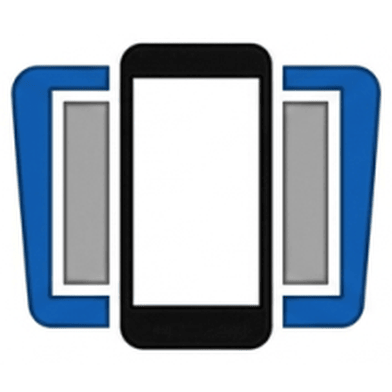
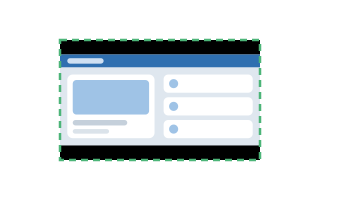
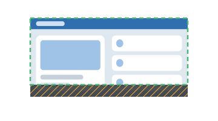

# Guida alle impostazioni

Questa pagina segue la schermata delle impostazioni dell'app dall'alto in basso: cosa fa ogni impostazione, quando attivarla e i limiti che il suo riepilogo di una riga non dice. Sei nuovo dell'app? Inizia da [Come si usa](/docs/it/how-to-use/).

<aside class="sp-aside" aria-label="Schermata delle impostazioni di ScreenOnAuto">

Questa è la schermata delle impostazioni dell'app. Tocca una riga qualsiasi per passare alla sua spiegazione. Gli interruttori funzionano, ma solo in questa pagina: sul tuo telefono non cambia nulla.

</aside>

## Schermata principale {#main}

### Pannello di stato {#mirror}

Il pannello scuro in alto. La prima riga dice se Android Auto è connesso e, quando lo è, le dimensioni dello schermo dell'auto che ha misurato. Sotto ci sono lo stato attuale e il pulsante Avvia mirroring / <svg viewBox="0 0 12 12" aria-hidden="true"><rect width="12" height="12" rx="2"/></svg>Interrompi mirroring. **Avvia mirroring** apre sul telefono la finestra di acquisizione dello schermo di Android; il mirroring inizia quando tocchi **Avvia adesso**.

Quando manca un'autorizzazione, una riga ambra in fondo al pannello lo segnala; toccala per scorrere fino ad [Autorizzazioni](#category_permissions).

### Avvio automatico {#auto_start_mirror}

Con questa opzione attiva, il mirroring si può avviare dall'auto. Ecco cosa succede (i passaggi segnati con «Tu» spettano a te; gli altri avvengono da soli):

1. Tu Tocca una delle voci di ScreenOnAuto ( o ) sullo schermo dell'auto.
2. Se il telefono è in standby, lo schermo si accende.
3. La schermata delle impostazioni di ScreenOnAuto si apre sul telefono e tocca Avvia mirroring al posto tuo.
4. Tu Android mostra la finestra di acquisizione dello schermo: consenti con **Avvia adesso**. Se il telefono è bloccato con PIN, sequenza o impronta, sbloccalo prima e la finestra comparirà.
5. Il mirroring parte e lo schermo del telefono compare in auto.

> **💡 Suggerimento**
> - **Non vuoi consentirlo ogni volta?** [Concedi il permesso di mirroring via ADB](/docs/it/grant-mirror-permission-via-adb/) una volta sola e la finestra non compare più, eliminando il passaggio 4 (finché non sblocchi il telefono, l'auto mostra la sua schermata di blocco).
> - **Non vuoi che compaia la schermata delle impostazioni?** Attiva [Avvia il mirroring in background](#silent_car_start) in Avanzate: al passaggio 3 il telefono va direttamente alla finestra di acquisizione senza aprire ScreenOnAuto. Con entrambe, il passaggio 1 è l'unica cosa da fare e sul telefono non compare nulla.

Con l'opzione disattivata, il passaggio 3 spetta a te: toccando una voce in auto compare solo la schermata di attesa «Avvia il mirroring sul telefono», e sei tu ad aprire ScreenOnAuto sul telefono e toccare Avvia mirroring; poi segue il passaggio 4 come sopra.

### Impedisci sospensione {#keep_awake}

Impedisce allo schermo del telefono di andare in standby durante il mirroring. Il mirroring *è* lo schermo del telefono, quindi quando lo schermo si spegne si ferma anche l'immagine in auto. Mantiene solo lo schermo acceso — non alza la luminosità —, perciò si abbina bene a [Oscuramento automatico](#auto_dim): lo schermo resta acceso e si scurisce quando è inattivo.

### Interrompi alla disconnessione {#stop_on_disconnect}

Interrompe il mirroring quando Android Auto si disconnette (attivo per impostazione predefinita). Se la disattivi, il mirroring continua in background dopo che hai lasciato l'auto, finché non lo interrompi.

### Oscuramento automatico {#auto_dim}

Durante il mirroring, abbassa al minimo la luminosità del telefono quando nessuno lo tocca per un po' — risparmia batteria e riduce i riflessi. Si abbassa solo la retroilluminazione del telefono; l'immagine in auto resta luminosa come prima. Tocca il telefono e la luminosità torna.

- Richiede l'autorizzazione [Mostra sopra le altre app](#overlay_access).
- Usare lo schermo dell'auto ([Inoltro tocco](#accessibility_access)) non conta come toccare il telefono, quindi non lo riattiva.
- Non si oscura nulla finché il telefono è sulla schermata di blocco; il conto alla rovescia parte quando lo sblocchi o lo tocchi.
- Con Shizuku o root, lo schermo del telefono può essere spento invece che oscurato: vedi [Spegni lo schermo del telefono](#root_screen_off).

### Oscura dopo {#auto_dim_delay}

Per quanto tempo il telefono deve restare inattivo prima di oscurarsi: 15, 30 (predefinito), 60 o 120 secondi. Richiede [Oscuramento automatico](#auto_dim) attivo.

### Avvio automatico app {#auto_launch_package}

Apre un'app sul telefono — per esempio una mappa o un lettore musicale — appena il mirroring e Android Auto sono entrambi attivi. **Schermata Home predefinita**, in cima all'elenco, apre l'app della schermata Home che usi, quindi continua a funzionare anche se cambi launcher.

### Esegui il mirroring solo di questa app {#single_app_mirror}

Invia all'auto solo l'app di [Avvio automatico app](#auto_launch_package) qui sopra, invece dell'intero schermo del telefono. Se passi a un'altra app sul telefono, lo schermo dell'auto resta vuoto finché non torni indietro: utile quando passeggeri o notifiche non devono comparire in auto.

La riga compare solo su **Android 15 e versioni successive**, dopo che hai [concesso il permesso di mirroring via ADB](/docs/it/grant-mirror-permission-via-adb/). Resta disattivata (in grigio) finché non scegli un'app in Avvio automatico app.

**Quando ti serve:**

- **Senza il permesso via ADB non ti serve.** Da Android 14, la finestra di acquisizione che compare a ogni avvio del mirroring permette già di scegliere tra condividere l'intero schermo o una sola app; scegli lì un'app e solo quella viene trasmessa. Su Android 13 e versioni precedenti la finestra non offre questa scelta e trasmette sempre l'intero schermo.
- **Con il permesso via ADB ti serve.** Una volta concesso, la finestra non compare più, quindi non c'è dove scegliere un'app e il mirroring è sempre dell'intero schermo. Per saltare la finestra *e* trasmettere una sola app, usa questo interruttore: insieme ad [Avvio automatico app](#auto_launch_package) qui sopra, invia all'auto solo quell'app.
- [Condividi solo l'intero schermo](#full_screen_share_only), in Avanzate, toglie dalla finestra la scelta della singola app; non interferisce con questo interruttore.

### Sottopagine {#subpages}

**Pulsanti sullo schermo**, **Avanzate** e **Funzioni privilegiate** aprono ciascuna una propria pagina, descritta nei capitoli che seguono: [Pulsanti sullo schermo](#screen_buttons), [Avanzate](#advanced), [Funzioni privilegiate](#root_features).

### Autorizzazioni {#category_permissions}

Ogni riga apre la pagina corrispondente delle impostazioni di sistema; l'etichetta a destra dice se l'autorizzazione è concessa.

#### Accesso alle notifiche {#notification_access}

Permette a «ScreenOnAuto Controller multimediale»  di prendere il controllo di ciò che è in riproduzione sul telefono. **I tasti multimediali sul volante** e la schermata multimediale di Android Auto possono così controllare **i lettori che non supportano Android Auto da soli**, come YouTube: precedente / successivo e riproduci / pausa funzionano tutti.

- Legge solo ciò che è in riproduzione (sessioni multimediali), mai il contenuto delle tue notifiche.
- Le app musicali con supporto proprio per Android Auto (YouTube Music, Spotify e simili) si collegano direttamente ad Android Auto e non vengono toccate.
- Senza l'autorizzazione i tasti vanno al lettore che il sistema considera attivo — con più lettori aperti, può essere quello sbagliato.
- Le versioni meno recenti di Android Auto mostrano una voce separata «ScreenOnAuto Controller multimediale» nel launcher delle app; quelle più recenti no, ed è normale: il controllo multimediale funziona in entrambi i casi.

#### Mostra sopra le altre app {#overlay_access}

Serve a [Oscuramento automatico](#auto_dim), Blocca orientamento ([Blocca automaticamente l'orientamento](#force_landscape) e il suo [pulsante in auto](#map_action_force_landscape)) e [Oscuramento notturno](#night_dim).

#### Modifica impostazioni di sistema {#write_settings_access}

Compare solo su **Android 16 e versioni successive**. Quando il telefono è in modalità tablet (lato corto di 600dp o più — lo schermo interno di un pieghevole, oppure dopo aver abbassato la [Densità del telefono](#phone_density)), Android 16 ignora l'orientamento dello schermo richiesto dalle app, quindi Blocca orientamento passa al blocco della rotazione di sistema, che richiede questa autorizzazione. La tua impostazione di rotazione automatica torna quando il blocco finisce.

#### Inoltro tocco {#accessibility_access}

Passa al telefono tocchi, scorrimenti e pizzichi fatti sullo schermo dell'auto, tramite un servizio di accessibilità di Android. Qui entrambi i mirroring supportano gli stessi gesti: tocco, scorrimento (in un elenco), scorrimento rapido e pizzico per lo zoom.

Con Shizuku o root puoi usare invece [Iniezione tocco reale](#root_touch_injection): i tocchi sullo schermo dell'auto arrivano al telefono come veri movimenti del dito, e sembra di usare direttamente il telefono. Funzionano anche **pressione prolungata**, **tieni premuto e trascina** (per spostare un'icona della schermata Home, per esempio) e **gesti con più dita**, che il servizio di accessibilità non sa fare — solo nel mirroring «ScreenOnAuto (Legacy)».

### Informazioni {#about}

La versione (toccala per copiarla), i link a GitHub e alle donazioni, l'Informativa sulla privacy, i Termini di utilizzo e le licenze di terze parti.

## Pulsanti sullo schermo {#screen_buttons}

Tutto ciò che può comparire come pulsante sullo schermo dell'auto si configura in questa pagina.

### Scorciatoie di avvio {#category_shortcuts}

Fino a 4 scorciatoie di app sullo schermo dell'auto. Toccane una e l'app si apre sul telefono — e quindi in auto.

- Tocca una riga per scegliere l'app; l'interruttore a destra la mostra o la nasconde in auto. Anche qui funziona **Schermata Home predefinita**, come pulsante «torna alla Home».
- **Tieni premuta** una scorciatoia impostata per cambiare il testo mostrato in auto (fino a 30 caratteri). Se lo cancelli, il mirroring «ScreenOnAuto (Legacy)» mostra solo l'icona dell'app.
- Le scorciatoie compaiono lungo il bordo **superiore** del mirroring; il lato dipende dal mirroring:
  - Mirroring «ScreenOnAuto»: usa il modello di schermata mappa di Android Auto, quindi le scorciatoie sono pulsanti di testo disegnati da Android Auto stesso (senza icone), ed è Android Auto a decidere dove vanno — l'app non può spostarle. Possono cambiare lato in base all'impostazione della posizione del conducente di Android Auto, ma non è garantito.
  - Mirroring «ScreenOnAuto (Legacy)»: l'app le disegna da sé come pulsanti con icone, **in alto a destra** per impostazione predefinita; [Allinea i pulsanti a sinistra](#legacy_buttons_left) le sposta in alto a sinistra, e [le distanze](#legacy_gaps) regolano con precisione quanto sono lontane dai bordi.
- Le scorciatoie non restano sempre sullo schermo: nel mirroring «ScreenOnAuto (Legacy)» si nascondono insieme ai [pulsanti funzione](#category_control_buttons) dopo 5 secondi di inattività e tornano quando tocchi lo schermo dell'auto; nel mirroring «ScreenOnAuto» è Android Auto a decidere quando nasconderle.

### Pulsanti funzione {#category_control_buttons}

Pulsanti rotondi sopra il mirroring, fino a 4 alla volta in entrambi i mirroring.

- La posizione dipende dal mirroring:
  - Mirroring «ScreenOnAuto»: sono la barra dei pulsanti del modello di schermata mappa di Android Auto, disegnata da Android Auto **in basso a destra o in basso a sinistra**. Il lato lo decide Android Auto — l'app non può spostarla; come per le [Scorciatoie di avvio](#category_shortcuts), può cambiare lato in base all'impostazione della posizione del conducente, ma non è garantito.
  - Mirroring «ScreenOnAuto (Legacy)»: una colonna disegnata dall'app stessa, **in basso a destra** per impostazione predefinita; [Allinea i pulsanti a sinistra](#legacy_buttons_left) la sposta in basso a sinistra, e [le distanze](#legacy_gaps) regolano con precisione quanto è lontana dai bordi.
- Nascondimento automatico: nel mirroring «ScreenOnAuto (Legacy)» i pulsanti funzione si nascondono insieme alle scorciatoie dopo 5 secondi di inattività e tornano quando tocchi lo schermo dell'auto; nel mirroring «ScreenOnAuto» è Android Auto a decidere quando nasconderli.

#### Pulsante Blocca orientamento {#map_action_force_landscape}

Attiva o disattiva Blocca orientamento per il momento, senza cambiare l'impostazione [Blocca automaticamente l'orientamento](#force_landscape); alla connessione successiva vale di nuovo l'impostazione. Attivo per impostazione predefinita.

#### Pulsante Oscura {#map_action_auto_dim}

Attiva o disattiva [Oscuramento automatico](#auto_dim) — lo stesso interruttore delle impostazioni. Quando lo schermo del telefono è stato [spento](#root_screen_off), è il modo più rapido per riaccenderlo.

#### Pulsante Oscuramento notturno {#map_action_night_dim}

Attiva o disattiva momentaneamente l'[Oscuramento notturno](#night_dim) — entrando in una galleria, per esempio. Vale finché l'auto non passa di nuovo tra giorno e notte; con [Quando oscurare](#night_dim_trigger) impostato su Sempre, finché Android Auto non si disconnette. Oscura secondo l'impostazione [Intensità](#night_dim_strength).

#### Pulsanti Indietro, Home e App recenti {#map_action_nav}

I tre tasti di navigazione del telefono, che funzionano sia che il telefono usi i gesti sia i pulsanti. Con Shizuku o root connesso inviano vere pressioni di tasti; altrimenti richiedono [Inoltro tocco](#accessibility_access).

### Posizione dei pulsanti {#category_button_placement}

Questa sezione riguarda solo il mirroring «ScreenOnAuto (Legacy)». I pulsanti del mirroring «ScreenOnAuto» sono disegnati da Android Auto e non si possono spostare.

#### Allinea i pulsanti a sinistra {#legacy_buttons_left}

Sposta a sinistra i [pulsanti funzione](#category_control_buttons) e le [scorciatoie](#category_shortcuts) — per le auto con guida a destra, o quando i comandi propri dell'autoradio coprono il lato destro.

#### Evita la barra di navigazione del telefono {#legacy_buttons_dodge_nav}

Quando la barra di navigazione del telefono compare nel mirroring, allontana i pulsanti da essa così che non si sovrappongano. Richiede Android 11 o versioni successive (i telefoni più vecchi non mostrano la barra). Finché è attiva, le quattro distanze qui sotto sono disattivate (in grigio): o un posizionamento o l'altro.

#### Distanze di pulsanti e scorciatoie {#legacy_gaps}

Quattro distanze in dp (0–400, predefinito 16): i pulsanti funzione dal bordo laterale e da quello inferiore, e le scorciatoie dal bordo laterale e da quello superiore. Usale per spostare i pulsanti di ScreenOnAuto da sotto quelli dell'autoradio. Se un valore è troppo grande, i pulsanti restano dentro lo schermo invece di uscirne.

## Avanzate {#advanced}

### Orientamento dello schermo {#category_orientation}

#### Blocca automaticamente l'orientamento {#force_landscape}

Blocca il telefono in un orientamento quando Android Auto si collega, così il mirroring non si capovolge quando il telefono ruota e un telefono in orizzontale riempie uno schermo dell'auto largo. Agisce una sola volta, al momento della connessione; dopo, il [Pulsante Blocca orientamento](#map_action_force_landscape) in auto rilascia o riapplica il blocco. Richiede l'autorizzazione [Mostra sopra le altre app](#overlay_access).

#### Orientamento {#force_orientation_mode}

In che verso bloccare: **Orizzontale** (predefinito), **Verticale** oppure **Rileva dallo schermo dell'auto** — orizzontale quando l'area che il mirroring ottiene davvero in auto è più larga che alta, verticale quando è più alta. Segue uno schermo diviso che cambia quella forma.

#### Modalità orizzontale invertita {#force_landscape_reverse}

Gira dall'altro lato un telefono in orizzontale — per un supporto che lo tiene capovolto. Disattivata (in grigio) in verticale.

### Regolazione schermo {#category_display_adjust}

#### Immagine del mirroring disegnata dall'app {#self_draw}

L'app disegna da sé l'immagine del telefono sull'auto invece di lasciare che il sistema la ridimensioni. Così lo schermo diviso non deforma più l'immagine, e le regolazioni di larghezza/altezza qui sotto funzionano allo stesso modo sia che le imposti prima sia durante una connessione. Consuma un po' più di batteria.

Una modifica ha effetto al **prossimo avvio del mirroring** — di proposito non cambia a sessione in corso.

#### Ritardo video {#video_delay}

Quando l'immagine è in anticipo sul suono (per esempio su un autoradio Android che riproduce Android Auto tramite un'app ricevitore, dove l'audio arriva in ritardo), trattiene l'immagine di 0–2000 millisecondi per allineare i due. Richiede [Immagine del mirroring disegnata dall'app](#self_draw); una modifica ha effetto subito.

- Trattenere i fotogrammi richiede memoria e GPU in più. Se audio e video si sfasano perché il telefono o l'autoradio sono già al limite, può peggiorare la situazione.
- I tocchi agiscono sempre sullo schermo del telefono così com'è **adesso**, non sull'immagine ritardata.

#### Dimensione fissa del mirroring {#nav_fixed_size}

Solo per il mirroring «ScreenOnAuto». Il mirroring mantiene le sue dimensioni quando l'auto passa allo schermo diviso, quindi non si deforma — ma una parte può risultare tagliata. Meglio impostarla prima di collegarsi.

#### Mantieni fermo il mirroring con i pulsanti {#nav_ignore_strip}

Solo per il mirroring «ScreenOnAuto», attiva per impostazione predefinita. La barra dei pulsanti di Android Auto compare e scompare da sola, e ogni volta occupa un po' di spazio. Con questa opzione attiva, la comparsa della barra non fa ridimensionare e saltare il mirroring; i veri cambi di layout, come lo schermo diviso, si applicano comunque. Disattivata (in grigio) finché [Dimensione fissa del mirroring](#nav_fixed_size) è attiva.

#### Regola larghezza del mirroring, Regola altezza del mirroring {#vd_gap}

L'area che l'auto dà al mirroring (la cornice verde tratteggiata qui sotto) raramente ha la stessa forma dello schermo del telefono. L'immagine del telefono viene ridimensionata in modo uniforme per starci dentro, quindi sul lato che non combacia restano bande nere: quando l'immagine è **più larga** dell'area (per esempio perché lo schermo diviso l'ha ristretta), le bande sono **sopra e sotto**; quando è **più stretta**, sono **a sinistra e a destra**.

Queste due impostazioni ingrandiscono o rimpiccioliscono, in pixel, la cornice in cui viene adattato il mirroring. Un valore **negativo** la ingrandisce: l'immagine cresce e le bande si riducono, a costo che una parte dell'immagine esca dall'area utilizzabile e venga tagliata (tratteggiata nelle figure).

<figure><figcaption>Bande sopra e sotto</figcaption></figure>
<figure><figcaption><b>Larghezza</b> negativa: niente bande sopra e sotto, il lato destro esce</figcaption></figure>
<figure><figcaption>Bande a sinistra e a destra</figcaption></figure>
<figure><figcaption><b>Altezza</b> negativa: niente bande a sinistra e a destra, il fondo esce</figcaption></figure>

- **Bande sopra e sotto → rendi negativa la *larghezza*.** Una cornice più larga lascia crescere l'immagine, anche in altezza, riempiendo le bande.
- **Bande a sinistra e a destra → rendi negativa l'*altezza*.** Una cornice più alta lascia crescere l'immagine, anche in larghezza, riempiendo le bande.
- Il mirroring è ancorato all'**angolo in alto a sinistra** dell'area, quindi ciò che esce supera il bordo **destro** (larghezza) o quello **inferiore** (altezza) — non viene diviso tra i due lati. Ciò che viene tagliato lì, pulsanti compresi, non si può toccare, quindi fermati al valore in cui le bande spariscono appena.
- Un valore **positivo** fa il contrario: rimpicciolisce la cornice, per gli autoradio che tagliano i bordi dell'immagine, riportando in vista un bordo tagliato (con una piccola banda nera).
- È più precisa con [Immagine del mirroring disegnata dall'app](#self_draw) attiva. Senza, regola i valori **mentre sei connesso**: nel mirroring «ScreenOnAuto», un valore negativo già impostato all'avvio del mirroring può schiacciare l'immagine invece di ingrandirla.

Tocca il testo per inserire un valore (salvare un valore diverso da zero attiva l'interruttore); l'interruttore oltre il divisore la disattiva per un momento mantenendo il valore, così puoi confrontare.

> **💡 Per non avere nessuna banda nera**
>
> Con Shizuku o root, attiva [Adattare lo schermo del telefono a quello dell'auto](#root_display_override). Dà allo schermo del telefono le stesse proporzioni dell'area, così il mirroring la riempie esattamente — niente bande, niente di tagliato. Finché è attiva, queste due regolazioni sono sospese.

<figure><figcaption>Adattare lo schermo del telefono a quello dell'auto: corrispondenza esatta</figcaption></figure>

### Oscuramento notturno {#category_night_dim}

#### Oscura lo schermo dell'auto {#night_dim}

Scurisce il mirroring in auto di notte, così un'app del telefono tutta bianca non abbaglia al buio.

- Nel mirroring «ScreenOnAuto (Legacy)», o con [Immagine del mirroring disegnata dall'app](#self_draw) attiva, si scurisce solo l'immagine in auto.
- Nel mirroring «ScreenOnAuto» senza Immagine del mirroring disegnata dall'app, l'oscuramento è un livello scuro sopra lo schermo del telefono, quindi **si scurisce anche il telefono**. Per questo serve l'autorizzazione [Mostra sopra le altre app](#overlay_access).
- Per disattivarlo o attivarlo per un momento, usa il [Pulsante Oscuramento notturno](#map_action_night_dim) in auto.

#### Quando oscurare {#night_dim_trigger}

**Quando l'auto passa alla modalità notturna** (predefinito): oscura di notte e torna normale di giorno. **Sempre**: oscura finché Android Auto è connesso.

#### Intensità {#night_dim_strength}

Quanto scurire: 10%–80% (predefinito 50%). La usa anche il [Pulsante Oscuramento notturno](#map_action_night_dim).

### Avvio dall'auto {#category_car_start}

#### Avvia il mirroring in background {#silent_car_start}

Quando il mirroring [parte dall'auto](#auto_start_mirror), la schermata delle impostazioni di ScreenOnAuto non passa in primo piano sul telefono e non resta tra le App recenti. La finestra di acquisizione compare comunque.

> **💡 Suggerimento**
>
> Aggiungi il [permesso di mirroring concesso via ADB](/docs/it/grant-mirror-permission-via-adb/) e sparisce anche la finestra di acquisizione: tocca una voce in auto e sul telefono non compare nulla — il mirroring parte e basta, senza toccare il telefono. Finché non sblocchi il telefono, l'auto mostra la sua schermata di blocco.

#### Condividi solo l'intero schermo {#full_screen_share_only}

Da Android 14, la finestra di acquisizione chiede prima se condividere un'app o l'intero schermo, e devi aprire quel menu ogni volta. Con questa opzione attiva, la finestra offre solo l'intero schermo. Compare su Android 14 e versioni successive. Se trasmetti una sola app scegliendola in quella finestra (il modo per farlo senza il permesso via ADB), lasciala disattivata; con il permesso via ADB, usa invece [Esegui il mirroring solo di questa app](#single_app_mirror).

Vedi ancora entrambe le scelte? Android 16 ha, nelle Opzioni sviluppatore, un override di compatibilità (`OVERRIDE_DISABLE_MEDIA_PROJECTION_SINGLE_APP_OPTION`) che le fa ricomparire; controlla che non sia attivo.

## Funzioni privilegiate {#root_features}

Le funzioni di questa pagina richiedono [Shizuku](https://shizuku.rikka.app/) o root, perché modificano impostazioni di sistema che un'app normale non può toccare. Ognuna ripristina l'impostazione originale del telefono quando il mirroring finisce.

### Connessione {#root_status}

Il riquadro in alto dice se Shizuku o root è connesso; il suo pulsante, a seconda dei casi, è **Concedi accesso**, **Connetti** o **Disconnetti**. Una connessione che cade (perché Shizuku si riavvia, per esempio) si ristabilisce da sola.

Un server Shizuku avviato via ADB si spegne quando il telefono viene collegato all'auto via USB — vedi [Risoluzione dei problemi](/docs/it/how-to-use/#funzioni-privilegiate-shizuku--root).

### Root non rilevato? {#root_force}

Se il gestore root è nascosto o rinominato, l'app non vede il root e il riquadro di connessione non lo propone mai. Toccando questa riga si chiede il root direttamente a su. Compare solo finché il root non viene rilevato e nulla è connesso.

### Funzioni {#category_root_features}

#### Spegni lo schermo del telefono {#root_screen_off}

Quando interviene [Oscuramento automatico](#auto_dim), spegne la retroilluminazione del telefono invece di abbassarla. Richiede Oscuramento automatico attivo.

Si spegne solo lo schermo — **il telefono non va in standby**: app e sistema continuano a funzionare, il mirroring resta in auto e puoi ancora usare il telefono dall'auto. Però il touchscreen si spegne insieme allo schermo, quindi **toccare lo schermo del telefono non fa nulla** e non lo riaccende.

Per riaccendere lo schermo: tocca il [Pulsante Oscura](#map_action_auto_dim) in auto, interrompi il mirroring o disconnetti Android Auto, oppure premi il tasto di accensione **due volte** (la prima pressione è quella che manda il sistema in standby).

#### Iniezione tocco reale {#root_touch_injection}

Invia al telefono i tocchi sullo schermo dell'auto come veri movimenti del dito, così pressione prolungata, trascinamento e gesti con più dita funzionano — e il servizio di accessibilità di [Inoltro tocco](#accessibility_access) non serve più. L'effetto completo si ha nel mirroring «ScreenOnAuto (Legacy)»: da Android Auto, il mirroring «ScreenOnAuto» riceve solo tocchi, scorrimenti, scorrimenti rapidi e pizzichi, un limite di Android Auto.

#### Touchscreen virtuale {#root_virtual_touch}

Consegna quei tocchi tramite un dispositivo touchscreen virtuale, così anche le app di gesti che leggono direttamente il touchscreen (come GMD Gestures) li ricevono. Richiede [Iniezione tocco reale](#root_touch_injection) attiva.

#### Segui la modalità giorno/notte dell'auto {#root_follow_car_night}

Durante il mirroring, il tema chiaro/scuro del telefono cambia con la modalità giorno/notte di Android Auto, e dopo torna all'impostazione propria del telefono. Android 10 e versioni successive.

#### Leggi la modalità da Android Auto {#root_car_night_from_aa}

Compare quando l'interruttore precedente è attivo e vale per il mirroring «ScreenOnAuto». Su alcuni telefoni (alcuni modelli Samsung, per esempio) la modalità giorno/notte comunicata all'app è sbagliata, quindi il telefono non cambia mai insieme all'auto; questa opzione legge invece lo stato giorno/notte di Android Auto stesso. Lasciala disattivata se il telefono segue già l'auto.

#### Dimensione carattere durante il mirroring {#root_mirror_font_scale}

Usa un'altra dimensione del carattere durante il mirroring — testo più grande in auto, per esempio — e poi ripristina quella del telefono. Le scelte sono gli stessi livelli delle Impostazioni del telefono.

#### Modalità di navigazione durante il mirroring {#root_mirror_nav_mode}

Passa alla navigazione tramite gesti, con due pulsanti o con tre pulsanti durante il mirroring e poi torna indietro (Android 10 e versioni successive). Sullo schermo diviso di un autoradio verticale, per esempio, i gesti lasciano più spazio alle app. Le modalità che il telefono non ha sono indicate come non disponibili.

#### Schermata Home durante il mirroring {#root_mirror_home}

Rende un altro launcher la schermata Home predefinita del telefono durante il mirroring, e poi rimette la tua. Per avere una schermata Home organizzata per l'auto, o per i telefoni il cui launcher di serie riordina le icone quando la [forma dello schermo](#category_root_display) cambia (alcuni modelli Xiaomi con HyperOS).

### Forma dello schermo {#category_root_display}

#### Adattare lo schermo del telefono a quello dell'auto {#root_display_override}

Durante il mirroring, dà allo schermo del telefono le proporzioni di quello dell'auto, così il mirroring riempie l'auto senza bande nere e non si deforma nello schermo diviso. Si applica dal vivo, senza riconnettersi.

<figure><figcaption>Prima: la forma del telefono è diversa da quella dell'auto, e in auto restano bande</figcaption></figure>
<figure><figcaption>Dopo: il telefono prende la forma dell'auto, e l'auto è riempita esattamente</figcaption></figure>
<figure><figcaption>Prima: un'area più stretta in auto (schermo diviso, per esempio) lascia bande sopra e sotto</figcaption></figure>
<figure><figcaption>Dopo: il telefono prende la forma dell'auto, e l'auto è riempita esattamente</figcaption></figure>
<figure><figcaption>Prima: un grande autoradio verticale, telefono in verticale, bande a sinistra e a destra in auto</figcaption></figure>
<figure><figcaption>Dopo: il telefono prende la forma verticale dell'auto, e l'auto è riempita esattamente</figcaption></figure>

Funziona sia quando l'auto mostra bande a sinistra e a destra (prima coppia) sia sopra e sotto (seconda coppia), e anche su un grande autoradio verticale (terza coppia — il telefono sta in verticale; con [Orientamento](#force_orientation_mode) impostato sul rilevamento dallo schermo dell'auto si blocca da solo in verticale). Lo schermo fisico del telefono mantiene la sua forma, quindi con questa opzione attiva **il telefono stesso** mostra bande nel verso opposto (sopra e sotto quando l'auto le aveva a sinistra e a destra, e viceversa) — è previsto; il mirroring in auto la riempie esattamente.

- È una modifica a livello di sistema che **resta anche dopo un riavvio** finché non viene annullata. Di norma, interrompere il mirroring o disconnettersi la annulla automaticamente.
- Mentre lo schermo del telefono ha la forma modificata, in cima a questa sezione compare un avviso ambra con un pulsante **Ripristina**.
- Se lo schermo del telefono resta bloccato nella forma sbagliata e non riesci ad aprire l'app, esegui `adb shell wm size reset` e `adb shell wm density reset` da un computer.

#### Aggiungi una scorciatoia di ripristino alla schermata Home {#root_display_shortcut}

Mette nella schermata Home una scorciatoia «Ripristina schermo», così con un tocco lo schermo del telefono torna com'era senza aprire l'app.

#### Cosa verrà applicato {#root_display_derived}

La dimensione a cui verrà portato lo schermo del telefono, calcolata dalle dimensioni dell'auto, e ciò che il sistema ha effettivamente accettato. Finché l'auto non è stata misurata, resta in attesa della prossima volta che il mirroring si apre in Android Auto.

#### Dimensioni dello schermo dell'auto {#car_size}

Una per mirroring (l'auto dà ai due mirroring aree di dimensioni diverse). Per impostazione predefinita è la dimensione rilevata, indicata come **Automatico**. Modificala solo se il rilevamento è sbagliato: larghezza e altezza condividono un'unica finestra, e un campo vuoto usa il valore rilevato (160–8192).

#### Densità del telefono {#phone_density}

Facoltativa, una per mirroring (72–640 dpi). Numeri più alti ingrandiscono testo e pulsanti sullo schermo dell'auto; numeri più bassi fanno stare più contenuti alla volta. Se la abbassi tanto che il lato corto del telefono supera i 600dp, la maggior parte delle app e il sistema passano ai layout per tablet (due colonne, navigazione laterale) — la finestra ti dice mentre scrivi se succederà. Lascia vuoto per non modificarla.

