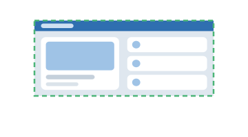

# Guia de configurações

Esta página percorre a tela de configurações do app de cima para baixo: o que cada configuração faz, quando ativá-la e os limites que o resumo de uma linha não menciona. Ainda não conhece o app? Comece por [Como Usar](/docs/pt-BR/how-to-use/).

<aside class="sp-aside" aria-label="Tela de configurações do ScreenOnAuto">

Esta é a tela de configurações do app. Toque em qualquer linha para ir à explicação dela. As chaves funcionam, mas só nesta página — nada muda no seu celular.

</aside>

## Tela principal {#main}

### Painel de status {#mirror}

O painel escuro no topo. A primeira linha diz se o Android Auto está conectado e, quando está, o tamanho da tela do carro que foi medido. Abaixo ficam o estado atual e o botão Iniciar espelhamento / <svg viewBox="0 0 12 12" aria-hidden="true"><rect width="12" height="12" rx="2"/></svg>Parar espelhamento. **Iniciar espelhamento** abre no celular o diálogo de captura de tela do Android; o espelhamento começa quando você toca em **Começar agora** (Start now).

Quando falta alguma permissão, uma linha âmbar na parte de baixo do painel avisa; toque nela para rolar até [Permissões](#category_permissions).

### Início automático {#auto_start_mirror}

Com esta opção ativada, o espelhamento pode ser iniciado pelo carro. Veja o que acontece (as etapas marcadas com “Você” são suas; as demais acontecem sozinhas):

1. Você Toque em qualquer uma das entradas do ScreenOnAuto ( ou ) na tela do carro.
2. Se o celular estiver em repouso, a tela dele acende.
3. A tela de configurações do ScreenOnAuto abre no celular e toca em Iniciar espelhamento por você.
4. Você O Android mostra o diálogo de captura de tela: permita com **Começar agora**. Se o celular estiver bloqueado com PIN, padrão ou impressão digital, desbloqueie-o primeiro para o diálogo aparecer.
5. O espelhamento começa e a tela do celular aparece no carro.

> **💡 Dica**
> - **Não quer permitir toda vez?** [Conceda a permissão de espelhamento via ADB](/docs/pt-BR/grant-mirror-permission-via-adb/) uma vez e o diálogo deixa de aparecer, o que elimina a etapa 4 (até você desbloquear o celular, o carro mostra a tela de bloqueio).
> - **Não quer que a tela de configurações apareça?** Ative [Iniciar o espelhamento em segundo plano](#silent_car_start) em Avançado: na etapa 3, o celular vai direto para o diálogo de captura sem abrir o ScreenOnAuto. Com as duas coisas, a etapa 1 é tudo o que você faz, e nada aparece no celular.

Com a opção desativada, a etapa 3 fica por sua conta: tocar numa entrada no carro só mostra a tela de espera “Inicie o espelhamento no celular”, e você abre o ScreenOnAuto no celular e toca em Iniciar espelhamento; depois vem a etapa 4, como acima.

### Evitar suspensão {#keep_awake}

Impede que a tela do celular entre em repouso durante o espelhamento. O espelhamento *é* a tela do celular, então, quando a tela apaga, a imagem no carro também para. A opção só mantém a tela ligada — não aumenta o brilho —, por isso combina com [Escurecimento automático](#auto_dim): a tela continua ligada e escurece quando ninguém a usa.

### Parar ao desconectar {#stop_on_disconnect}

Para o espelhamento quando o Android Auto desconecta (ativado por padrão). Desativado, o espelhamento continua rodando em segundo plano depois que você sai do carro, até você pará-lo.

### Escurecimento automático {#auto_dim}

Durante o espelhamento, reduz o brilho do celular ao mínimo quando ninguém toca nele por um tempo — economiza bateria e evita reflexo. Só a luz de fundo do celular escurece; a imagem no carro continua tão clara quanto antes. Toque no celular e o brilho volta.

- Precisa da permissão [Exibir sobre outros apps](#overlay_access).
- Usar a tela do carro ([Encaminhamento de toque](#accessibility_access)) não conta como tocar no celular, então não o acorda.
- Nada escurece enquanto o celular está na tela de bloqueio; a contagem começa quando você o desbloqueia ou toca nele.
- Com Shizuku ou root, a tela do celular pode ser desligada em vez de escurecida: veja [Desligar a tela do telefone](#root_screen_off).

### Diminuir após {#auto_dim_delay}

Quanto tempo o celular precisa ficar sem uso antes de escurecer: 15, 30 (padrão), 60 ou 120 segundos. Precisa de [Escurecimento automático](#auto_dim) ativado.

### Lançar app automaticamente {#auto_launch_package}

Abre um app no celular — um mapa ou um player de música, por exemplo — assim que o espelhamento e o Android Auto estiverem ativos. **Tela inicial padrão**, no topo da lista, abre o app de tela inicial que você usa, então continua funcionando se você trocar de launcher.

### Espelhar apenas este app {#single_app_mirror}

Envia ao carro só o app de [Lançar app automaticamente](#auto_launch_package), acima, em vez da tela inteira do celular. Se você mudar para outro app no celular, a tela do carro fica em branco até você voltar — útil quando passageiros ou notificações não devem aparecer no carro.

A linha só aparece no **Android 15 e mais recentes**, depois que você [concedeu a permissão de espelhamento via ADB](/docs/pt-BR/grant-mirror-permission-via-adb/). Ela fica acinzentada até um app ser escolhido em Lançar app automaticamente.

**Quando você precisa dela:**

- **Sem a permissão via ADB, não precisa.** A partir do Android 14, o diálogo de captura que aparece a cada início do espelhamento já deixa escolher entre compartilhar a tela inteira ou um único app; escolha um app ali e só ele é espelhado. No Android 13 e anteriores, o diálogo não tem essa escolha e sempre espelha a tela inteira.
- **Com a permissão via ADB, precisa.** Depois de concedida, o diálogo deixa de aparecer, então não há onde escolher um app e o espelhamento é sempre da tela inteira. Para pular o diálogo *e* espelhar um só app, use esta chave: junto com [Lançar app automaticamente](#auto_launch_package), acima, ela envia só esse app ao carro.
- [Compartilhar só a tela inteira](#full_screen_share_only), em Avançado, remove do diálogo a opção de um único app; não atrapalha esta chave.

### Subpáginas {#subpages}

**Botões na tela**, **Avançado** e **Recursos privilegiados** abrem cada um sua própria página, explicada nos capítulos abaixo: [Botões na tela](#screen_buttons), [Avançado](#advanced), [Recursos privilegiados](#root_features).

### Permissões {#category_permissions}

Cada linha abre a página correspondente das configurações do sistema; a etiqueta à direita diz se a permissão foi concedida.

#### Acesso a notificações {#notification_access}

Permite que o “ScreenOnAuto Controlador de mídia”  assuma o que estiver tocando no celular. **Os botões de mídia do volante** e a tela de mídia do Android Auto passam então a controlar **players que não têm suporte próprio ao Android Auto**, como o YouTube: anterior / próxima e reproduzir / pausar funcionam.

- Só lê o que está tocando (sessões de mídia), nunca o conteúdo das suas notificações.
- Apps de música com suporte próprio ao Android Auto (YouTube Music, Spotify e similares) se conectam direto ao Android Auto e não são afetados.
- Sem a permissão, os botões vão para o player que o sistema considera ativo — com vários players abertos, pode ser o errado.
- Versões mais antigas do Android Auto mostram uma entrada separada “ScreenOnAuto Controlador de mídia” no launcher de apps; as mais novas não, o que é normal — o controle de mídia funciona de qualquer forma.

#### Exibir sobre outros apps {#overlay_access}

Necessária para [Escurecimento automático](#auto_dim), Travar orientação ([Travar orientação ao conectar](#force_landscape) e o [botão no carro](#map_action_force_landscape)) e [Escurecimento noturno](#night_dim).

#### Modificar configurações do sistema {#write_settings_access}

Aparece só no **Android 16 e mais recentes**. Quando o celular está no modo tablet (lado menor de 600dp ou mais — a tela interna de um dobrável, ou depois de diminuir a [Densidade do telefone](#phone_density)), o Android 16 ignora a orientação de tela pedida pelos apps, então Travar orientação passa a usar o bloqueio de rotação do sistema, que precisa desta permissão. Sua própria configuração de girar automaticamente volta quando o bloqueio termina.

#### Encaminhamento de toque {#accessibility_access}

Repassa ao celular os toques, deslizes e gestos de pinça feitos na tela do carro, por meio de um serviço de acessibilidade do Android. Os dois espelhamentos aceitam os mesmos gestos aqui: toque, rolagem (deslizar por uma lista), deslize rápido e pinça para zoom.

Com Shizuku ou root, você pode usar [Injeção de toque real](#root_touch_injection) no lugar: os toques na tela do carro chegam ao celular como movimentos reais do dedo, e a sensação é de usar o celular diretamente. **Toque longo**, **tocar e arrastar** (mover um ícone da tela inicial, por exemplo) e **gestos com vários dedos**, que o serviço de acessibilidade não consegue fazer, também funcionam — apenas no espelhamento “ScreenOnAuto (Legacy)”.

### Sobre {#about}

A versão (toque para copiá-la), os links do GitHub e de doação, a Política de Privacidade, os Termos de Uso e as licenças de terceiros.

## Botões na tela {#screen_buttons}

Tudo o que pode aparecer como botão na tela do carro é configurado nesta página.

### Atalhos de início {#category_shortcuts}

Até 4 atalhos de apps na tela do carro. Toque em um e o app abre no celular — e, portanto, no carro.

- Toque numa linha para escolher o app; a chave à direita mostra ou oculta o atalho no carro. **Tela inicial padrão** também funciona aqui, como botão “ir para o início”.
- **Toque e segure** um atalho configurado para mudar o texto mostrado no carro (até 30 caracteres). Se deixar vazio, o espelhamento “ScreenOnAuto (Legacy)” mostra só o ícone do app.
- Os atalhos aparecem na parte **de cima** do espelhamento; o lado depende do espelhamento:
  - Espelhamento “ScreenOnAuto”: usa o modelo de tela de mapa do Android Auto, então os atalhos são botões de texto que o próprio Android Auto desenha (sem ícones), e é o Android Auto que decide onde ficam — o app não consegue movê-los. Eles podem trocar de lado conforme a configuração de posição do motorista do Android Auto, mas isso não é garantido.
  - Espelhamento “ScreenOnAuto (Legacy)”: o próprio app os desenha como botões com ícones, no **canto superior direito** por padrão; [Alinhar os botões à esquerda](#legacy_buttons_left) os leva para o canto superior esquerdo, e [as distâncias](#legacy_gaps) ajustam o afastamento das bordas.
- Os atalhos não ficam sempre na tela: no espelhamento “ScreenOnAuto (Legacy)”, somem junto com os [botões de função](#category_control_buttons) após 5 segundos sem uso e voltam quando você toca na tela do carro; no espelhamento “ScreenOnAuto”, o Android Auto decide quando eles somem.

### Botões de função {#category_control_buttons}

Botões redondos sobre o espelhamento, até 4 ao mesmo tempo em qualquer um dos espelhamentos.

- A posição depende do espelhamento:
  - Espelhamento “ScreenOnAuto”: são a faixa de botões do modelo de tela de mapa do Android Auto, desenhada pelo Android Auto no **canto inferior direito ou inferior esquerdo**. O Android Auto decide o lado — o app não consegue mudá-lo; como nos [Atalhos de início](#category_shortcuts), pode trocar de lado conforme a configuração de posição do motorista, mas isso não é garantido.
  - Espelhamento “ScreenOnAuto (Legacy)”: uma coluna que o próprio app desenha, no **canto inferior direito** por padrão; [Alinhar os botões à esquerda](#legacy_buttons_left) a leva para o canto inferior esquerdo, e [as distâncias](#legacy_gaps) ajustam o afastamento das bordas.
- Ocultação automática: no espelhamento “ScreenOnAuto (Legacy)”, os botões de função somem junto com os atalhos após 5 segundos sem uso e voltam quando você toca na tela do carro; no espelhamento “ScreenOnAuto”, o Android Auto decide quando eles somem.

#### Botão Travar orientação {#map_action_force_landscape}

Liga ou desliga Travar orientação por enquanto, sem mudar a configuração [Travar orientação ao conectar](#force_landscape); a próxima conexão volta a seguir a configuração. Ativado por padrão.

#### Botão Escurecimento automático {#map_action_auto_dim}

Liga ou desliga [Escurecimento automático](#auto_dim) — a mesma chave das configurações. Quando a tela do celular foi [desligada](#root_screen_off), é o jeito mais rápido de trazê-la de volta.

#### Botão Escurecimento noturno {#map_action_night_dim}

Liga ou desliga o [Escurecimento noturno](#night_dim) momentaneamente — ao entrar num túnel, por exemplo. Vale até o carro mudar de novo entre dia e noite; com [Quando escurecer](#night_dim_trigger) em Sempre, até o Android Auto desconectar. Escurece conforme a configuração de [Intensidade](#night_dim_strength).

#### Botões Voltar, Início e Apps recentes {#map_action_nav}

As três teclas de navegação do celular, funcionando quer o celular use gestos ou botões. Com Shizuku ou root conectado, elas enviam pressionamentos de tecla reais; caso contrário, precisam de [Encaminhamento de toque](#accessibility_access).

### Posição dos botões {#category_button_placement}

Esta seção afeta só o espelhamento “ScreenOnAuto (Legacy)”. Os botões do espelhamento “ScreenOnAuto” são desenhados pelo Android Auto e não podem ser movidos.

#### Alinhar os botões à esquerda {#legacy_buttons_left}

Leva os [botões de função](#category_control_buttons) e os [atalhos](#category_shortcuts) para a esquerda — para carros com volante à direita, ou quando os controles da própria central multimídia cobrem o lado direito.

#### Evitar a barra de navegação do telefone {#legacy_buttons_dodge_nav}

Quando a barra de navegação do celular aparece no espelhamento, afasta os botões dela para que os dois conjuntos não se sobreponham. Precisa do Android 11 ou mais recente (celulares mais antigos não mostram a linha). Enquanto está ativada, as quatro distâncias abaixo ficam acinzentadas — é uma forma de posicionar ou a outra.

#### Distâncias dos botões e atalhos {#legacy_gaps}

Quatro distâncias em dp (0–400, padrão 16): os botões de função em relação à lateral e à parte de baixo, e os atalhos em relação à lateral e ao topo. Use-as para tirar os botões do ScreenOnAuto de baixo dos botões da própria central multimídia. Se um valor for grande demais, os botões ficam dentro da tela em vez de sumir para fora dela.

## Avançado {#advanced}

### Orientação da tela {#category_orientation}

#### Travar orientação ao conectar {#force_landscape}

Trava o celular numa orientação quando o Android Auto conecta, para que o espelhamento não vire quando o celular gira e para que um celular na horizontal preencha uma tela larga no carro. Age uma vez, no momento da conexão; depois disso, o [Botão Travar orientação](#map_action_force_landscape) no carro libera ou reaplica a trava. Precisa da permissão [Exibir sobre outros apps](#overlay_access).

#### Orientação {#force_orientation_mode}

Para que lado travar: **Paisagem** (padrão), **Retrato** ou **Detectar pela tela do carro** — paisagem quando a área que o espelhamento realmente recebe no carro é mais larga que alta, retrato quando é mais alta. Acompanha uma tela dividida que mude esse formato.

#### Paisagem invertida {#force_landscape_reverse}

Vira o celular na horizontal para o outro lado — para um suporte que o segura de cabeça para baixo. Fica acinzentada no modo retrato.

### Ajuste da tela {#category_display_adjust}

#### Espelhamento desenhado pelo app {#self_draw}

O próprio app desenha a imagem do celular no carro, em vez de deixar o sistema redimensioná-la. Assim a tela dividida não distorce mais a imagem, e os ajustes de largura/altura abaixo funcionam igual, quer você os defina antes ou durante uma conexão. Gasta um pouco mais de bateria.

Uma mudança vale a partir do **próximo início do espelhamento** — de propósito, ela não troca no meio da sessão.

#### Atraso de vídeo {#video_delay}

Quando a imagem está adiantada em relação ao som (por exemplo, numa central multimídia Android que roda o Android Auto por um app receptor, em que o som atrasa), segura a imagem por 0–2000 milissegundos para os dois ficarem alinhados. Precisa de [Espelhamento desenhado pelo app](#self_draw); uma mudança vale na hora.

- Segurar quadros usa memória e GPU extras. Se o áudio e o vídeo se desencontram porque o celular ou a central multimídia já estão no limite, isso pode piorar as coisas.
- Os toques continuam agindo na tela do celular como ela está **agora**, não na imagem atrasada.

#### Tamanho fixo do espelhamento {#nav_fixed_size}

Só no espelhamento “ScreenOnAuto”. O espelhamento mantém o tamanho quando o carro muda para a tela dividida, então não distorce — mas parte dele pode ficar cortada. O ideal é definir antes de conectar.

#### Manter o espelhamento ao exibir botões {#nav_ignore_strip}

Só no espelhamento “ScreenOnAuto”, ativado por padrão. A faixa de botões do Android Auto aparece e some sozinha, e cada vez ocupa um pouco de espaço. Com esta opção ativada, a faixa aparecer não faz o espelhamento mudar de tamanho e pular; mudanças reais de layout, como a tela dividida, continuam valendo. Fica acinzentada enquanto [Tamanho fixo do espelhamento](#nav_fixed_size) está ativado.

#### Ajustar largura do espelhamento, Ajustar altura do espelhamento {#vd_gap}

A área que o carro reserva para o espelhamento (a moldura verde tracejada abaixo) raramente tem o mesmo formato da tela do celular. A imagem do celular é redimensionada por igual para caber nela, então o lado que não bate fica com faixas pretas: quando a imagem é **mais larga** que a área (digamos, porque a tela dividida a estreitou), as faixas ficam **em cima e embaixo**; quando é **mais estreita**, ficam **à esquerda e à direita**.

Estas duas configurações aumentam ou diminuem a moldura em que o espelhamento é encaixado, em pixels. Um valor **negativo** a aumenta: a imagem cresce e as faixas encolhem, ao custo de parte da imagem passar da área utilizável e ser cortada (hachurado nas figuras).

<figure><figcaption>Faixas em cima e embaixo</figcaption></figure>
<figure><figcaption><b>Largura</b> negativa: sem faixas em cima e embaixo, o lado direito transborda</figcaption></figure>
<figure><figcaption>Faixas à esquerda e à direita</figcaption></figure>
<figure><figcaption><b>Altura</b> negativa: sem faixas à esquerda e à direita, a parte de baixo transborda</figcaption></figure>

- **Faixas em cima e embaixo → deixe a *largura* negativa.** Uma moldura mais larga deixa a imagem crescer, e crescer em altura, preenchendo as faixas.
- **Faixas à esquerda e à direita → deixe a *altura* negativa.** Uma moldura mais alta deixa a imagem crescer, e crescer em largura, preenchendo as faixas.
- O espelhamento fica ancorado no **canto superior esquerdo** da área, então o que transborda passa da borda **direita** (largura) ou da parte **de baixo** (altura) — não é dividido entre os dois lados. O que for cortado ali, inclusive botões, não pode ser tocado; por isso, pare no valor em que as faixas acabam de sumir.
- Um valor **positivo** faz o contrário: encolhe a moldura, para centrais multimídia que cortam as bordas da imagem, trazendo de volta uma borda cortada (com uma pequena faixa preta).
- Fica mais preciso com [Espelhamento desenhado pelo app](#self_draw) ativado. Sem ele, ajuste os valores **com o carro conectado**: no espelhamento “ScreenOnAuto”, um valor negativo já definido quando o espelhamento começa pode achatar a imagem em vez de aumentá-la.

Toque no texto para digitar um valor (salvar um valor diferente de zero ativa a chave); a chave depois do divisor o desativa por um momento mantendo o valor, para você comparar.

> **💡 Para não ter nenhuma faixa preta**
>
> Com Shizuku ou root, ative [Ajustar a tela do telefone à do carro](#root_display_override). Isso dá à tela do celular as mesmas proporções da área, então o espelhamento a preenche exatamente — sem faixas, sem nada cortado. Enquanto estiver ativado, estes dois ajustes ficam em pausa.

<figure><figcaption>Ajustar a tela do telefone à do carro: encaixe exato</figcaption></figure>

### Escurecimento noturno {#category_night_dim}

#### Escurecer a tela do carro {#night_dim}

Escurece o espelhamento no carro à noite, para que um app de celular todo branco não ofusque no escuro.

- No espelhamento “ScreenOnAuto (Legacy)”, ou com [Espelhamento desenhado pelo app](#self_draw) ativado, só a imagem do carro escurece.
- No espelhamento “ScreenOnAuto” sem Espelhamento desenhado pelo app, o escurecimento é uma camada escura sobre a tela do celular, então **o celular também escurece**. Isso precisa da permissão [Exibir sobre outros apps](#overlay_access).
- Para desligar ou ligar por um momento, use o [Botão Escurecimento noturno](#map_action_night_dim) no carro.

#### Quando escurecer {#night_dim_trigger}

**Quando o carro muda para o modo noturno** (padrão): escurece à noite e volta ao normal de dia. **Sempre**: escurece enquanto o Android Auto estiver conectado.

#### Intensidade {#night_dim_strength}

O quanto escurece: 10%–80% (padrão 50%). O [Botão Escurecimento noturno](#map_action_night_dim) também usa este valor.

### Início pelo carro {#category_car_start}

#### Iniciar o espelhamento em segundo plano {#silent_car_start}

Quando o espelhamento [começa pelo carro](#auto_start_mirror), a tela de configurações do ScreenOnAuto não vem para a frente no celular e não fica em Apps recentes. O diálogo de captura continua aparecendo.

> **💡 Dica**
>
> Some a isso a [permissão de espelhamento concedida via ADB](/docs/pt-BR/grant-mirror-permission-via-adb/) e o diálogo de captura também some: toque numa entrada no carro e nada aparece no celular — o espelhamento simplesmente começa, sem você mexer no celular. Até você desbloquear o celular, o carro mostra a tela de bloqueio.

#### Compartilhar só a tela inteira {#full_screen_share_only}

A partir do Android 14, o diálogo de captura primeiro pergunta se é para compartilhar um app ou a tela inteira, e você precisa abrir esse menu toda vez. Com esta opção ativada, o diálogo oferece só a tela inteira. Aparece no Android 14 e mais recentes. Se você espelha um único app escolhendo-o nesse diálogo (o jeito de fazer isso sem a permissão via ADB), deixe esta opção desativada; com a permissão via ADB, use [Espelhar apenas este app](#single_app_mirror).

Ainda vê as duas opções? O Android 16 tem uma substituição de compatibilidade nas Opções do desenvolvedor (`OVERRIDE_DISABLE_MEDIA_PROJECTION_SINGLE_APP_OPTION`) que as traz de volta; confira se ela não está ativada.

## Recursos privilegiados {#root_features}

Os recursos desta página precisam do [Shizuku](https://shizuku.rikka.app/) ou de root, porque alteram configurações do sistema que um app comum não pode mexer. Cada um devolve a configuração original do celular quando o espelhamento termina.

### Conexão {#root_status}

O quadro no topo diz se o Shizuku ou o root está conectado; o botão dele serve para **Conceder acesso**, **Conectar** ou **Desconectar**. Uma conexão que cai (o Shizuku reiniciando, por exemplo) se reconecta sozinha.

Um servidor Shizuku iniciado via ADB é encerrado quando o celular é ligado ao carro por USB — veja [Solução de problemas](/docs/pt-BR/how-to-use/#recursos-privilegiados-shizuku--root).

### Root não detectado? {#root_force}

Se o gerenciador de root estiver oculto ou renomeado, o app não enxerga o root, e o quadro de conexão nunca o oferece. Tocar nesta linha pede root diretamente ao su. Ela só aparece enquanto o root não é detectado e nada está conectado.

### Recursos {#category_root_features}

#### Desligar a tela do telefone {#root_screen_off}

Quando [Escurecimento automático](#auto_dim) entra em ação, desliga a luz de fundo do celular em vez de escurecê-la. Precisa de Escurecimento automático ativado.

Só a tela apaga — **o celular não entra em repouso**: os apps e o sistema continuam rodando, o espelhamento continua no carro e usar o celular pelo carro continua funcionando. Mas o touch desliga junto com a tela, então **tocar na tela do celular não faz nada** e não a liga de volta.

Para trazer a tela de volta: toque no [Botão Escurecimento automático](#map_action_auto_dim) no carro, pare o espelhamento ou desconecte o Android Auto, ou aperte o botão liga/desliga **duas vezes** (o primeiro aperto é o que coloca o sistema em repouso).

#### Injeção de toque real {#root_touch_injection}

Envia os toques na tela do carro ao celular como movimentos reais do dedo, então toque longo, arrastar e gestos com vários dedos funcionam — e o serviço de acessibilidade do [Encaminhamento de toque](#accessibility_access) deixa de ser necessário. O efeito completo é no espelhamento “ScreenOnAuto (Legacy)”: vindo do Android Auto, o espelhamento “ScreenOnAuto” só recebe toques, rolagens, deslizes rápidos e pinças, o que é um limite do Android Auto.

#### Tela touch virtual {#root_virtual_touch}

Entrega esses toques por meio de um dispositivo de tela touch virtual, para que apps de gestos que leem a tela sensível ao toque diretamente (como o GMD Gestures) também os recebam. Precisa de [Injeção de toque real](#root_touch_injection) ativada.

#### Seguir o modo dia/noite do carro {#root_follow_car_night}

Durante o espelhamento, o tema claro/escuro do celular muda junto com o modo dia/noite do Android Auto e depois volta à configuração do próprio celular. Android 10 e mais recentes.

#### Ler o modo do Android Auto {#root_car_night_from_aa}

Aparece quando a chave anterior está ativada e vale para o espelhamento “ScreenOnAuto”. Em alguns celulares (alguns modelos Samsung, por exemplo), o modo dia/noite informado ao app está errado, e o celular nunca muda junto com o carro; esta opção lê o próprio estado dia/noite do Android Auto. Deixe desativada se o celular já acompanha o carro.

#### Tamanho da fonte durante o espelhamento {#root_mirror_font_scale}

Usa outro tamanho de fonte durante o espelhamento — texto maior no carro, por exemplo — e devolve o do celular depois. As opções são os mesmos níveis das Configurações do próprio celular.

#### Modo de navegação durante o espelhamento {#root_mirror_nav_mode}

Muda para navegação por gestos, com dois botões ou com três botões durante o espelhamento e volta depois (Android 10 e mais recentes). Na tela dividida de uma central multimídia em retrato, por exemplo, os gestos deixam mais espaço para os apps. Os modos que o celular não tem aparecem como não disponíveis.

#### Tela inicial durante o espelhamento {#root_mirror_home}

Torna outro launcher a tela inicial padrão do celular durante o espelhamento e devolve o seu depois. Serve para ter uma tela inicial organizada para o carro, ou para celulares cujo launcher de fábrica reorganiza os ícones quando o [formato da tela](#category_root_display) muda (alguns modelos Xiaomi com HyperOS).

### Formato da tela {#category_root_display}

#### Ajustar a tela do telefone à do carro {#root_display_override}

Durante o espelhamento, dá à tela do celular a proporção da tela do carro, para que o espelhamento preencha o carro sem faixas pretas e não distorça na tela dividida. Aplica-se na hora, sem reconectar.

<figure><figcaption>Antes: o formato do celular é diferente do carro, deixando faixas no carro</figcaption></figure>
<figure><figcaption>Depois: o celular assume o formato do carro, e o carro fica preenchido exatamente</figcaption></figure>
<figure><figcaption>Antes: uma área mais estreita no carro (tela dividida, por exemplo) deixa faixas em cima e embaixo</figcaption></figure>
<figure><figcaption>Depois: o celular assume o formato do carro, e o carro fica preenchido exatamente</figcaption></figure>
<figure><figcaption>Antes: central multimídia grande em retrato, celular em pé, faixas à esquerda e à direita no carro</figcaption></figure>
<figure><figcaption>Depois: o celular assume o formato em retrato do carro, e o carro fica preenchido exatamente</figcaption></figure>

Funciona quer o carro mostre faixas à esquerda e à direita (primeiro par) ou em cima e embaixo (segundo par), e também numa central multimídia grande em retrato (terceiro par — o celular fica em pé; com [Orientação](#force_orientation_mode) em detectar pela tela do carro, ele trava em retrato sozinho). A tela física do celular mantém o formato, então, com esta opção ativada, **o próprio celular** mostra faixas no sentido inverso (em cima e embaixo quando o carro as tinha à esquerda e à direita, e vice-versa) — isso é esperado; o espelhamento no carro o preenche exatamente.

- É uma alteração no nível do sistema que **persiste após reiniciar** até ser desfeita. Normalmente, parar o espelhamento ou desconectar a desfaz automaticamente.
- Enquanto a tela do celular estiver com o formato alterado, um aviso âmbar com o botão **Restaurar** aparece no topo desta seção.
- Se a tela do celular ficar presa no formato errado e você não conseguir abrir o app, execute `adb shell wm size reset` e `adb shell wm density reset` num computador.

#### Adicionar um atalho de restauração à tela inicial {#root_display_shortcut}

Coloca na tela inicial um atalho “Restaurar tela”, para que um toque devolva a tela do celular ao normal sem abrir o app.

#### O que será aplicado {#root_display_derived}

O tamanho para o qual a tela do celular será alterada, calculado a partir do tamanho do carro, e o que o sistema realmente aceitou. Enquanto o carro não tiver sido medido, isso espera a próxima vez que o espelhamento abrir no Android Auto.

#### Tamanho da tela do carro {#car_size}

Um por espelhamento (o carro dá aos dois espelhamentos áreas de tamanhos diferentes). Por padrão é o tamanho detectado, marcado como **Automático**. Mude só se a detecção estiver errada: largura e altura ficam no mesmo diálogo, e um campo em branco usa o valor detectado (160–8192).

#### Densidade do telefone {#phone_density}

Opcional, uma por espelhamento (72–640 dpi). Números maiores deixam o texto e os botões maiores na tela do carro; menores mostram mais conteúdo de uma vez. Se for tão baixa que o lado menor do celular passe de 600dp, a maioria dos apps e o sistema mudam para layouts de tablet (duas colunas, navegação lateral) — o diálogo avisa enquanto você digita se isso vai acontecer. Deixe em branco para não alterar.

