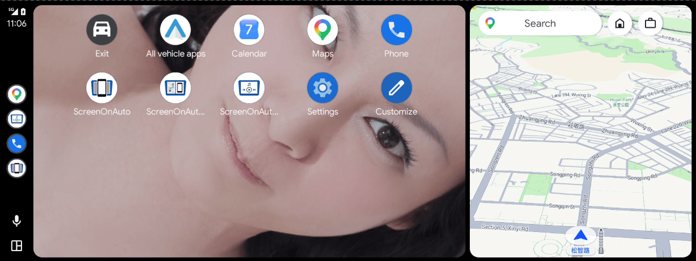
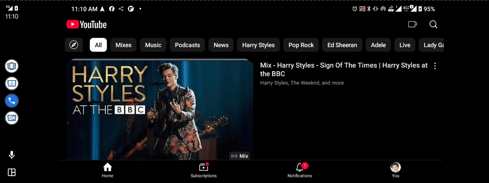
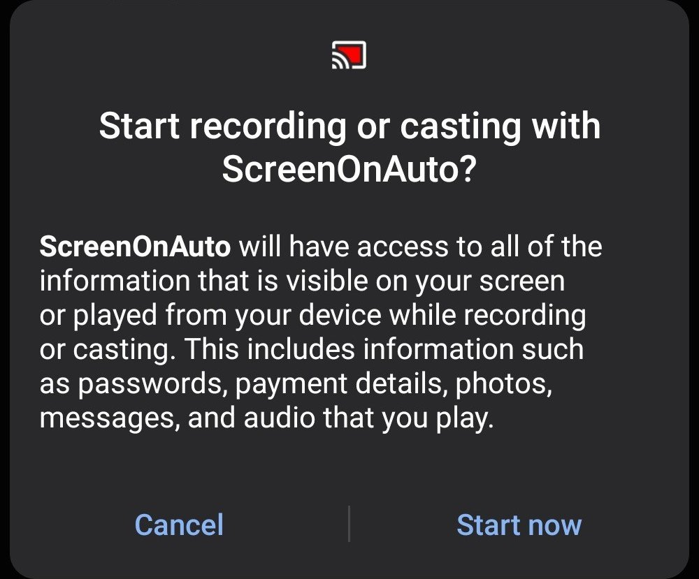
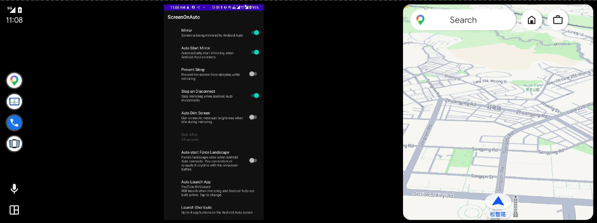

# วิธีใช้

> **ℹ️ หมายเหตุ**
> **ก่อนเริ่ม** ตรวจสอบให้แน่ใจว่า:
> - ติดตั้ง ScreenOnAuto แล้ว และรายการทั้งสองของแอป ( **ScreenOnAuto** และ  **ScreenOnAuto (Legacy)**) ปรากฏใน Launcher ของ Android Auto
> - เปิดแอปบนโทรศัพท์แล้วอย่างน้อยหนึ่งครั้ง และให้สิทธิ์ที่แอปขอครบแล้ว

## รายการสะท้อนหน้าจอสองรายการ

Launcher ของ Android Auto แสดงรายการสะท้อนหน้าจอ**สองรายการ** ( **ScreenOnAuto** และ  **ScreenOnAuto (Legacy)**) ทั้งสองสะท้อนหน้าจอโทรศัพท์เดียวกัน — ต่างกันที่*วิธี*แสดงภาพสะท้อนบนหน้าจอรถ:

<table class="entry-pair" role="presentation">
<tr>
<td width="50%" valign="top">
 <b>ScreenOnAuto</b> 

เต็มจอ — แทนที่พื้นที่แผนที่
</td>
<td width="50%" valign="top">
 <b>ScreenOnAuto (Legacy)</b> 

บน<b>หน้าจอรถที่ใหญ่พอ</b> จะแสดง<b>คู่กับแผนที่</b>ในมุมมองแยกหน้าจอได้ บนหน้าจอที่เล็กกว่า แผนที่จะไปอยู่เบื้องหลังและแสดงเฉพาะภาพสะท้อน (<b>ไม่ได้</b>แทนที่แผนที่)
</td>
</tr>
</table>

ลองทั้งสองแบบแล้วใช้แบบที่เหมาะกับเครื่องเสียงรถของคุณมากกว่า ทั้งสองแสดงภาพสะท้อนเดียวกัน และสลับไปมาได้ทุกเมื่อ — เมื่อการสะท้อนหน้าจอทำงานอยู่ การเปิดอีกรายการจะแสดงภาพทันทีโดยไม่ขอสิทธิ์อีก

> **💡 เคล็ดลับ**
> หากเคยเปิด  **ScreenOnAuto** (รายการแบบเต็มจอ) มาก่อน และตอนนี้ต้องการใช้  **ScreenOnAuto (Legacy)** ให้เปิดแอปแผนที่ (เช่น Google Maps) บนหน้าจอรถก่อน แล้วจึงเริ่มการสะท้อนแบบ Legacy วิธีนี้จะตั้งแอปแผนที่กลับเป็นแผนที่เริ่มต้นของหน้าจอรถ เพื่อไม่ให้ฟังก์ชันที่เกี่ยวกับแผนที่ถูกการสะท้อนแบบเต็มจอแย่งไป

## เริ่มสะท้อนหน้าจอ

### เมื่อเปิด “เริ่มสะท้อนหน้าจออัตโนมัติ” (แนะนำ)

1. ในแอปบนโทรศัพท์ เปิด [**เริ่มสะท้อนหน้าจออัตโนมัติ**](/docs/th/settings/#auto_start_mirror) (ตั้งค่าครั้งเดียว)
2. เชื่อมต่อโทรศัพท์กับรถ แล้วแตะรายการของ ScreenOnAuto ( หรือ ) ใน Launcher ของ Android Auto
3. โทรศัพท์จะแสดงกล่องโต้ตอบขอสิทธิ์บันทึกหน้าจอโดยอัตโนมัติ — หยิบโทรศัพท์ขึ้นมาแล้วแตะ **เริ่มเลย**:

   

   หากโทรศัพท์อยู่ในโหมดสลีป หน้าจอจะเปิดขึ้นเอง หากล็อกด้วย PIN รูปแบบ หรือลายนิ้วมือ ให้ปลดล็อกก่อน แล้วกล่องโต้ตอบจะปรากฏ หากให้สิทธิ์ล่วงหน้าด้วย ADB แล้วจะไม่มีกล่องโต้ตอบ: การสะท้อนหน้าจอเริ่มทันที และรถจะแสดงหน้าจอล็อกจนกว่าคุณจะปลดล็อกโทรศัพท์

4. หน้าจอโทรศัพท์ของคุณจะปรากฏบนเครื่องเสียงรถ:

   

> **ℹ️ หมายเหตุ**
> กล่องโต้ตอบขอสิทธิ์เป็นข้อกำหนดของ Android — จะปรากฏหนึ่งครั้งทุกครั้งที่เริ่มสะท้อนหน้าจอ ไม่ใช่ทุกครั้งที่เปลี่ยนหน้าจอ หากปิด*เริ่มสะท้อนหน้าจออัตโนมัติ* การแตะรายการจะแค่เปิดหน้าจอสะท้อน และจะไม่มีการบันทึกใดๆ จนกว่าคุณจะเริ่มเอง

### เริ่มด้วยตัวเอง

หากต้องการปิด **เริ่มสะท้อนหน้าจออัตโนมัติ** ไว้:

1. เปิด ScreenOnAuto บนโทรศัพท์แล้วแตะ **เริ่มสะท้อนหน้าจอ** จากนั้นแตะ **เริ่มเลย** ในกล่องโต้ตอบขอสิทธิ์
2. บนหน้าจอรถ เปิดรายการใดรายการหนึ่งของ ScreenOnAuto — การสะท้อนหน้าจอทำงานอยู่แล้วและแสดงทันที

(ลำดับไม่สำคัญ — จะเปิดรายการก่อนแล้วค่อยแตะ **เริ่มสะท้อนหน้าจอ** ทีหลังก็ได้)

### ข้ามกล่องโต้ตอบขอสิทธิ์

เบื่อที่กล่องโต้ตอบขึ้นทุกครั้ง? คุณให้สิทธิ์ล่วงหน้าเพียงครั้งเดียวผ่าน ADB ได้ — ดู[ให้สิทธิ์สะท้อนหน้าจอผ่าน ADB](/docs/th/grant-mirror-permission-via-adb/) เมื่อเปิด [**เริ่มสะท้อนหน้าจอในเบื้องหลัง**](/docs/th/settings/#silent_car_start) ด้วย หน้าการตั้งค่าของ ScreenOnAuto ก็จะไม่ขึ้นบนโทรศัพท์เช่นกัน แตะรายการบนรถแล้วโทรศัพท์จะไม่แสดงอะไรเลย และการสะท้อนหน้าจอจะเริ่มทันที

## หยุดสะท้อนหน้าจอ

ใช้วิธีใดก็ได้:

- **ตัดการเชื่อมต่อจากรถ** — การสะท้อนหน้าจอจะหยุดโดยอัตโนมัติ (การตั้งค่าเริ่มต้น [*หยุดเมื่อตัดการเชื่อมต่อ*](/docs/th/settings/#stop_on_disconnect))
- แตะ **หยุดสะท้อนหน้าจอ** ในการแจ้งเตือนถาวรบนโทรศัพท์
- แตะ **หยุดสะท้อนหน้าจอ** ในแอป

## คู่มือการตั้งค่า

การตั้งค่าแต่ละรายการทำอะไร ควรเปิดเมื่อไร และมีข้อจำกัดอะไร อธิบายไว้ใน[คู่มือการตั้งค่า](/docs/th/settings/) พร้อมหน้าการตั้งค่าจำลองที่กดลองได้

## การแก้ปัญหา

### การสะท้อนหน้าจอและการแสดงผล

#### เปิดรายการแล้วแต่หน้าจอว่างเปล่า

การสะท้อนหน้าจอยังไม่เริ่ม ตรวจสอบกล่องโต้ตอบขอสิทธิ์บนโทรศัพท์ หรือเริ่มด้วยปุ่ม **เริ่มสะท้อนหน้าจอ** ในแอป

#### มีแถบสีดำรอบภาพ

หน้าจอโทรศัพท์กับหน้าจอรถมีอัตราส่วนต่างกัน ใช้ปุ่ม [**ล็อกการวางแนว**](/docs/th/settings/#map_action_force_landscape) บนหน้าจอสะท้อน (หรือ [**ล็อกการวางแนวเมื่อเชื่อมต่อ**](/docs/th/settings/#force_landscape) ในการตั้งค่า) หากต้องการให้พอดีกับพื้นที่ใช้งานของรถทุกประการ ให้เปิด [**ปรับหน้าจอโทรศัพท์ให้เข้ากับรถ**](/docs/th/settings/#root_display_override) ในฟีเจอร์สิทธิ์พิเศษ (Shizuku หรือ root) หรือใช้ [**ปรับความกว้างภาพ ปรับความสูงภาพ**](/docs/th/settings/#vd_gap) ขยายภาพให้ทับแถบดำก็ได้ แต่ขอบภาพจะถูกตัดไปเล็กน้อย ดูภาพประกอบได้ในคู่มือการตั้งค่า

#### ภาพดูยืดหรือผิดรูปหลังเลย์เอาต์เปลี่ยน

เกิดขึ้นเมื่อพื้นที่ที่มองเห็นขยายหรือหดในมุมมองแยกหน้าจอ การหมุนโทรศัพท์ให้หน้าจอสลับระหว่างแนวตั้งกับแนวนอนจะทำให้กลับมาปกติ (หากเปิด **ล็อกการวางแนว** อยู่ ให้ปลดด้วยปุ่มบนหน้าจอก่อน) มีการตั้งค่าสองอย่างที่แก้ได้เช่นกัน:

- เปิด [**การตั้งค่า → ขั้นสูง → ล็อกขนาดภาพ**](/docs/th/settings/#nav_fixed_size) ภาพสะท้อนจะคงขนาดไว้แทนที่จะผิดรูป (บางส่วนอาจถูกซ่อน) ใช้ได้เฉพาะกับรายการ  **ScreenOnAuto** แบบเต็มจอ
- เปิด [**การตั้งค่า → ขั้นสูง → วาดภาพเอง (ทดลอง)**](/docs/th/settings/#self_draw) แอปจะวาดภาพสะท้อนเองแทนการให้ระบบย่อขยาย ภาพจึงไม่ผิดรูปเมื่อแยกหน้าจออีก ใช้แบตเตอรี่มากขึ้นเล็กน้อย และมีผลเมื่อเริ่มสะท้อนหน้าจอครั้งถัดไป [**ปรับหน้าจอโทรศัพท์ให้เข้ากับรถ**](/docs/th/settings/#root_display_override) (ฟีเจอร์สิทธิ์พิเศษ) แก้ปัญหาเดียวกันด้วยวิธีอื่น และเปิดพร้อมกันได้

#### Google Maps ของ Android Auto เป็นสีดำขณะสะท้อนหน้าจอ

บน Android 15 ขึ้นไป ขณะที่มีแอปใดบันทึกหน้าจอ (ซึ่งแอปสะท้อนหน้าจอทุกแอปต้องทำ) Android จะซ่อนแอปที่ถือว่ามีข้อมูลละเอียดอ่อน และอาจนับ Google Maps เป็นหนึ่งในนั้น แผนที่ของ Android Auto จะเป็นสีดำจนกว่าจะหยุดสะท้อนหน้าจอ และแอปสะท้อนหน้าจออื่นกับแอปแผนที่อื่นก็ได้รับผลแบบเดียวกัน วิธีแก้คือเปิด **การตั้งค่า → ตัวเลือกสำหรับนักพัฒนาซอฟต์แวร์ → ปิดใช้การปกป้องการแชร์หน้าจอ** หากไม่เห็นตัวเลือกสำหรับนักพัฒนาซอฟต์แวร์ ให้ค้นหา **หมายเลขบิลด์** ในการตั้งค่าแล้วแตะ 7 ครั้ง การตั้งค่านี้ยังทำให้ Android ไม่ซ่อนการแจ้งเตือนที่มีรหัสแบบใช้ครั้งเดียวระหว่างที่คุณแชร์หน้าจอ หากเรื่องนี้สำคัญกับคุณก็ปิดไว้ หลังเปิดแล้ว ให้หยุดสะท้อนหน้าจอแล้วเริ่มใหม่: การตั้งค่านี้มีผลเฉพาะตอนเริ่มสะท้อนหน้าจอ

#### แถบนำทางของ Android Auto อยู่บนหน้าจอตลอด

**แถบนำทางของ Android Auto** บนหน้าจอรถวาดโดย Android Auto เอง แอปจึงซ่อนไม่ได้

### ฟีเจอร์สิทธิ์พิเศษ (Shizuku / root)

#### เซิร์ฟเวอร์ Shizuku ที่เริ่มผ่าน ADB ปิดตัวเมื่อเสียบสายเข้ารถ

การเสียบหรือถอดสาย USB ทำให้ ADB รีสตาร์ทและ Shizuku หยุดไปด้วย เริ่ม Shizuku ใหม่แล้ว ScreenOnAuto จะเชื่อมต่อกลับเอง สาเหตุและวิธีให้ Shizuku-Next เริ่มใหม่ให้อัตโนมัติ ดู[**ฟีเจอร์สิทธิ์พิเศษ → การเชื่อมต่อ**](/docs/th/settings/#root_status)ในคู่มือการตั้งค่า

#### ปลุกหน้าจออีกครั้ง

เมื่อเปิด [**ปิดหน้าจอโทรศัพท์**](/docs/th/settings/#root_screen_off) หน้าจอสัมผัสจะปิดไปพร้อมกับหน้าจอ การแตะโทรศัพท์จึงไม่มีผล ให้แตะปุ่ม [**หรี่อัตโนมัติ**](/docs/th/settings/#map_action_auto_dim) บนหน้าจอรถ — การสลับหรี่อัตโนมัติจะปลุกหน้าจอ (เปิดปุ่มนี้ก่อนใน [**ปุ่มบนหน้าจอ → ปุ่มควบคุม**](/docs/th/settings/#category_control_buttons) ค่าเริ่มต้นปิดอยู่) หรือกดปุ่มเปิด/ปิดของโทรศัพท์**สองครั้ง** เพราะการกดครั้งแรกคือสิ่งที่ทำให้ระบบเข้าสู่โหมดสลีป การหยุดสะท้อนหน้าจอหรือตัดการเชื่อมต่อ Android Auto ก็ทำให้หน้าจอกลับมาเช่นกัน
