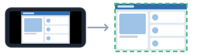
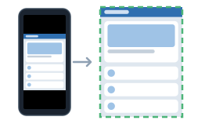

# คู่มือการตั้งค่า

หน้านี้ไล่ตามหน้าการตั้งค่าของแอปจากบนลงล่าง: การตั้งค่าแต่ละรายการทำอะไร ควรเปิดเมื่อใด และข้อจำกัดที่คำอธิบายบรรทัดเดียวในแอปไม่ได้บอกไว้ หากเพิ่งเริ่มใช้แอป ให้เริ่มจาก[วิธีใช้](/docs/th/how-to-use/)

<aside class="sp-aside" aria-label="หน้าการตั้งค่าของ ScreenOnAuto">

นี่คือหน้าการตั้งค่าของแอป แตะแถวใดก็ได้เพื่อข้ามไปยังคำอธิบายของแถวนั้น สวิตช์ใช้งานได้ แต่เปลี่ยนเฉพาะในหน้านี้เท่านั้น — ไม่มีอะไรเปลี่ยนบนโทรศัพท์ของคุณ

</aside>

## หน้าหลัก {#main}

### แผงสถานะ {#mirror}

แผงสีเข้มที่อยู่ด้านบนสุด บรรทัดแรกบอกว่า Android Auto เชื่อมต่ออยู่หรือไม่ และเมื่อเชื่อมต่ออยู่ จะบอกขนาดหน้าจอรถที่วัดได้ด้วย ด้านล่างเป็นสถานะปัจจุบันและปุ่ม เริ่มสะท้อนหน้าจอ / <svg viewBox="0 0 12 12" aria-hidden="true"><rect width="12" height="12" rx="2"/></svg>หยุดสะท้อนหน้าจอ การแตะ **เริ่มสะท้อนหน้าจอ** จะเปิดกล่องโต้ตอบบันทึกหน้าจอของ Android บนโทรศัพท์ และการสะท้อนหน้าจอจะเริ่มเมื่อคุณแตะ **เริ่มเลย**

เมื่อยังขาดสิทธิ์ใด จะมีบรรทัดสีเหลืองอำพันบอกไว้ที่ด้านล่างของแผง แตะเพื่อเลื่อนไปที่[สิทธิ์](#category_permissions)

### เริ่มสะท้อนหน้าจออัตโนมัติ {#auto_start_mirror}

เมื่อเปิดไว้ คุณจะเริ่มสะท้อนหน้าจอจากรถได้ ขั้นตอนเป็นดังนี้ (ขั้นตอนที่มีป้าย “ทำเอง” คือสิ่งที่คุณต้องทำ ที่เหลือจะเกิดขึ้นเอง):

1. ทำเอง แตะรายการ ScreenOnAuto รายการใดก็ได้ ( หรือ ) บนหน้าจอรถ
2. หากโทรศัพท์อยู่ในโหมดสลีป หน้าจอจะเปิดขึ้น
3. หน้าการตั้งค่าของ ScreenOnAuto จะเปิดบนโทรศัพท์และแตะ เริ่มสะท้อนหน้าจอ ให้คุณ
4. ทำเอง Android จะแสดงกล่องโต้ตอบบันทึกหน้าจอ: อนุญาตด้วย **เริ่มเลย** หากโทรศัพท์ล็อกด้วย PIN รูปแบบ หรือลายนิ้วมือ ให้ปลดล็อกก่อนแล้วกล่องโต้ตอบจะปรากฏ
5. การสะท้อนหน้าจอเริ่มขึ้น และหน้าจอโทรศัพท์จะปรากฏบนรถ

> **💡 เคล็ดลับ**
> - **ไม่อยากกดอนุญาตทุกครั้ง?** [ให้สิทธิ์สะท้อนหน้าจอผ่าน ADB](/docs/th/grant-mirror-permission-via-adb/) เพียงครั้งเดียว แล้วกล่องโต้ตอบจะไม่ปรากฏอีก ขั้นตอนที่ 4 จึงหายไป (จนกว่าคุณจะปลดล็อกโทรศัพท์ รถจะแสดงหน้าจอล็อก)
> - **ไม่อยากให้หน้าการตั้งค่าเด้งขึ้นมา?** เปิด [เริ่มสะท้อนหน้าจอในเบื้องหลัง](#silent_car_start) ในส่วนขั้นสูง: ในขั้นตอนที่ 3 โทรศัพท์จะไปที่กล่องโต้ตอบบันทึกหน้าจอทันทีโดยไม่เปิด ScreenOnAuto เมื่อใช้ทั้งสองอย่างร่วมกัน คุณทำแค่ขั้นตอนที่ 1 และไม่มีอะไรปรากฏบนโทรศัพท์เลย

เมื่อปิดไว้ ขั้นตอนที่ 3 จะเป็นหน้าที่ของคุณ: การแตะรายการบนรถจะแสดงแค่หน้าจอรอ “เริ่มสะท้อนหน้าจอบนโทรศัพท์” แล้วคุณต้องเปิด ScreenOnAuto บนโทรศัพท์และแตะ เริ่มสะท้อนหน้าจอ เอง จากนั้นทำขั้นตอนที่ 4 ตามด้านบน

### ไม่ให้หน้าจอดับ {#keep_awake}

ไม่ให้หน้าจอโทรศัพท์ดับระหว่างสะท้อนหน้าจอ ภาพสะท้อน*ก็คือ*หน้าจอโทรศัพท์ เมื่อหน้าจอดับ ภาพบนรถก็หยุดไปด้วย การตั้งค่านี้แค่ทำให้หน้าจอเปิดค้างไว้ — ไม่ได้เพิ่มความสว่าง — จึงใช้คู่กับ [หรี่หน้าจออัตโนมัติ](#auto_dim) ได้: หน้าจอเปิดค้างไว้ และหรี่ลงเมื่อไม่มีการใช้งาน

### หยุดเมื่อตัดการเชื่อมต่อ {#stop_on_disconnect}

หยุดสะท้อนหน้าจอเมื่อ Android Auto ตัดการเชื่อมต่อ (เปิดเป็นค่าเริ่มต้น) เมื่อปิดไว้ การสะท้อนหน้าจอจะทำงานต่อในเบื้องหลังหลังจากคุณลงจากรถ จนกว่าคุณจะหยุดเอง

### หรี่หน้าจออัตโนมัติ {#auto_dim}

ระหว่างสะท้อนหน้าจอ เมื่อไม่มีใครแตะโทรศัพท์สักพัก จะลดความสว่างของโทรศัพท์ลงต่ำสุด — ประหยัดแบตเตอรี่และลดแสงจ้า หรี่เฉพาะไฟหน้าจอของโทรศัพท์เท่านั้น ภาพบนรถยังสว่างเท่าเดิม แตะโทรศัพท์แล้วความสว่างจะกลับมา

- ต้องมีสิทธิ์ [แสดงทับแอปอื่น](#overlay_access)
- การใช้หน้าจอรถ ([ส่งต่อการสัมผัส](#accessibility_access)) ไม่นับเป็นการแตะโทรศัพท์ จึงไม่ทำให้โทรศัพท์สว่างขึ้น
- ขณะที่โทรศัพท์อยู่ที่หน้าจอล็อก จะไม่มีการหรี่ การนับถอยหลังเริ่มเมื่อคุณปลดล็อกหรือแตะโทรศัพท์
- หากมี Shizuku หรือ root จะปิดหน้าจอโทรศัพท์แทนได้: ดู [ปิดหน้าจอโทรศัพท์](#root_screen_off)

### หรี่หลังจาก {#auto_dim_delay}

ระยะเวลาที่โทรศัพท์ต้องไม่มีการใช้งานก่อนหรี่: 15, 30 (ค่าเริ่มต้น), 60 หรือ 120 วินาที ต้องเปิด [หรี่หน้าจออัตโนมัติ](#auto_dim) ไว้

### เปิดแอปอัตโนมัติ {#auto_launch_package}

เปิดแอปบนโทรศัพท์ — เช่น แผนที่หรือเครื่องเล่นเพลง — ทันทีที่ทั้งการสะท้อนหน้าจอและ Android Auto ทำงานอยู่ **หน้าจอหลักเริ่มต้น** ที่อยู่บนสุดของรายการจะเปิดแอปหน้าจอหลักที่คุณใช้อยู่ จึงยังใช้ได้แม้คุณเปลี่ยน Launcher

### สะท้อนเฉพาะแอปนี้ {#single_app_mirror}

ส่งเฉพาะ [เปิดแอปอัตโนมัติ](#auto_launch_package) ด้านบนไปยังรถแทนที่จะส่งทั้งหน้าจอโทรศัพท์ หากสลับไปแอปอื่นบนโทรศัพท์ หน้าจอรถจะว่างเปล่าจนกว่าคุณจะกลับมา — มีประโยชน์เมื่อไม่ต้องการให้สิ่งที่ผู้โดยสารใช้หรือการแจ้งเตือนขึ้นบนรถ

แถวนี้ปรากฏเฉพาะบน **Android 15 ขึ้นไป** หลังจากคุณ[ให้สิทธิ์สะท้อนหน้าจอผ่าน ADB](/docs/th/grant-mirror-permission-via-adb/) แล้ว และจะเป็นสีเทาจนกว่าจะเลือกแอปใน เปิดแอปอัตโนมัติ

**เมื่อใดที่ต้องใช้:**

- **หากไม่ได้ให้สิทธิ์ผ่าน ADB ก็ไม่ต้องใช้** ตั้งแต่ Android 14 กล่องโต้ตอบบันทึกหน้าจอที่ปรากฏทุกครั้งที่เริ่มสะท้อนหน้าจอให้เลือกได้อยู่แล้วว่าจะแชร์ทั้งหน้าจอหรือแชร์แอปเดียว เลือกแอปตรงนั้นแล้วจะสะท้อนเฉพาะแอปนั้น บน Android 13 และต่ำกว่า กล่องโต้ตอบไม่มีตัวเลือกนี้และสะท้อนทั้งหน้าจอเสมอ
- **หากให้สิทธิ์ผ่าน ADB แล้วก็ต้องใช้** เมื่อให้สิทธิ์แล้ว กล่องโต้ตอบจะไม่ปรากฏอีก จึงไม่มีที่ให้เลือกแอป และจะสะท้อนทั้งหน้าจอเสมอ หากต้องการข้ามกล่องโต้ตอบ*และ*สะท้อนแอปเดียว ให้ใช้สวิตช์นี้: เมื่อใช้ร่วมกับ [เปิดแอปอัตโนมัติ](#auto_launch_package) ด้านบน จะส่งแค่แอปนั้นไปยังรถ
- [แชร์ทั้งหน้าจอเท่านั้น](#full_screen_share_only) ในส่วนขั้นสูงจะเอาตัวเลือกแอปเดียวออกจากกล่องโต้ตอบ แต่ไม่ขัดขวางสวิตช์นี้

### หน้าย่อย {#subpages}

**ปุ่มบนหน้าจอ** **ขั้นสูง** และ **ฟีเจอร์สิทธิ์พิเศษ** แต่ละรายการเปิดหน้าของตัวเอง ซึ่งอธิบายในบทด้านล่าง: [ปุ่มบนหน้าจอ](#screen_buttons) [ขั้นสูง](#advanced) [ฟีเจอร์สิทธิ์พิเศษ](#root_features)

### สิทธิ์ {#category_permissions}

แต่ละแถวจะเปิดหน้าการตั้งค่าระบบที่ตรงกัน ป้ายทางขวาบอกว่าได้รับสิทธิ์แล้วหรือยัง

#### การเข้าถึงการแจ้งเตือน {#notification_access}

ให้ “ตัวควบคุมสื่อ ScreenOnAuto”  รับช่วงควบคุมสิ่งที่กำลังเล่นบนโทรศัพท์ จากนั้น **ปุ่มสื่อบนพวงมาลัย** และหน้าจอสื่อของ Android Auto จะควบคุม **เครื่องเล่นที่ไม่รองรับ Android Auto เอง** เช่น YouTube ได้: ก่อนหน้า / ถัดไป และเล่น / หยุดชั่วคราวใช้ได้ทั้งหมด

- อ่านเฉพาะสิ่งที่กำลังเล่น (เซสชันสื่อ) ไม่อ่านเนื้อหาการแจ้งเตือนของคุณเลย
- แอปเพลงที่รองรับ Android Auto เอง (YouTube Music, Spotify และอื่นๆ) เชื่อมต่อกับ Android Auto โดยตรง และจะไม่ถูกยุ่งเกี่ยว
- หากไม่มีสิทธิ์นี้ ปุ่มจะส่งไปยังเครื่องเล่นที่ระบบถือว่ากำลังทำงานอยู่ — หากเปิดเครื่องเล่นไว้หลายตัว อาจไปผิดตัวได้
- Android Auto เวอร์ชันเก่าจะแสดงรายการ “ตัวควบคุมสื่อ ScreenOnAuto” แยกต่างหากใน Launcher ของแอป เวอร์ชันใหม่ไม่แสดง ซึ่งเป็นเรื่องปกติ — การควบคุมสื่อใช้ได้ทั้งสองแบบ

#### แสดงทับแอปอื่น {#overlay_access}

จำเป็นสำหรับ [หรี่หน้าจออัตโนมัติ](#auto_dim) ล็อกการวางแนว ([ล็อกการวางแนวเมื่อเชื่อมต่อ](#force_landscape) และ[ปุ่มบนรถ](#map_action_force_landscape)) และ [หรี่ตอนกลางคืน](#night_dim)

#### แก้ไขการตั้งค่าระบบ {#write_settings_access}

แสดงเฉพาะบน **Android 16 ขึ้นไป** เมื่อโทรศัพท์อยู่ในโหมดแท็บเล็ต (ด้านที่สั้นที่สุด 600dp ขึ้นไป — หน้าจอด้านในของโทรศัพท์พับได้ หรือหลังจากลด [ความหนาแน่นของโทรศัพท์](#phone_density)) Android 16 จะไม่สนใจการวางแนวหน้าจอที่แอปขอ ล็อกการวางแนวจึงเปลี่ยนไปใช้การล็อกการหมุนของระบบแทน ซึ่งต้องใช้สิทธิ์นี้ การตั้งค่าหมุนอัตโนมัติของคุณจะกลับมาเมื่อการล็อกสิ้นสุด

#### ส่งต่อการสัมผัส {#accessibility_access}

ส่งต่อการแตะ การปัด และการจีบนิ้วบนหน้าจอรถไปยังโทรศัพท์ ผ่านบริการการช่วยเหลือพิเศษของ Android ภาพสะท้อนทั้งสองแบบรองรับท่าทางเดียวกันในส่วนนี้: แตะ เลื่อน (ปัดผ่านรายการ) ปัดเร็ว และจีบนิ้วเพื่อซูม

หากมี Shizuku หรือ root คุณใช้ [ส่งการสัมผัสจริง](#root_touch_injection) แทนได้: การสัมผัสบนหน้าจอรถจะถึงโทรศัพท์เป็นการเคลื่อนไหวของนิ้วจริง จึงรู้สึกเหมือนใช้โทรศัพท์โดยตรง **กดค้าง** **กดแล้วลาก** (เช่น ย้ายไอคอนบนหน้าจอหลัก) และ **ท่าทางหลายนิ้ว** ซึ่งบริการการช่วยเหลือพิเศษทำไม่ได้ ก็ใช้ได้ด้วย — เฉพาะในหน้าจอสะท้อน “ScreenOnAuto (Legacy)”เท่านั้น

### เกี่ยวกับ {#about}

เวอร์ชัน (แตะเพื่อคัดลอก) ลิงก์ GitHub และลิงก์บริจาค นโยบายความเป็นส่วนตัว ข้อกำหนดการใช้งาน และสัญญาอนุญาตของบุคคลที่สาม

## ปุ่มบนหน้าจอ {#screen_buttons}

ทุกอย่างที่ปรากฏเป็นปุ่มบนหน้าจอรถได้ ตั้งค่าในหน้านี้

### ทางลัดเปิดแอป {#category_shortcuts}

ทางลัดแอปบนหน้าจอรถได้สูงสุด 4 รายการ แตะแล้วแอปจะเปิดบนโทรศัพท์ — และจึงปรากฏบนรถด้วย

- แตะแถวเพื่อเลือกแอป สวิตช์ทางขวาใช้แสดงหรือซ่อนทางลัดบนรถ **หน้าจอหลักเริ่มต้น** ก็ใช้ที่นี่ได้ เป็นปุ่ม “กลับหน้าหลัก”
- **แตะค้าง** ทางลัดที่ตั้งไว้เพื่อเปลี่ยนข้อความที่รถแสดง (สูงสุด 30 ตัวอักษร) หากลบข้อความออก หน้าจอสะท้อน “ScreenOnAuto (Legacy)” จะแสดงแค่ไอคอนแอป
- ทางลัดจะปรากฏเรียงตาม **ด้านบน** ของภาพสะท้อน ส่วนจะอยู่ฝั่งไหนขึ้นอยู่กับภาพสะท้อน:
  - หน้าจอสะท้อน “ScreenOnAuto”: ใช้เทมเพลตหน้าจอแผนที่ของ Android Auto ทางลัดจึงเป็นปุ่มข้อความที่ Android Auto วาดเอง (ไม่มีไอคอน) และ Android Auto เป็นผู้กำหนดตำแหน่ง — แอปย้ายไม่ได้ อาจสลับฝั่งตามการตั้งค่าตำแหน่งคนขับของ Android Auto แต่ไม่รับประกัน
  - หน้าจอสะท้อน “ScreenOnAuto (Legacy)”: แอปวาดเองเป็นปุ่มที่มีไอคอน อยู่ที่ **มุมขวาบน** เป็นค่าเริ่มต้น [จัดปุ่มชิดซ้าย](#legacy_buttons_left) ย้ายไปที่มุมซ้ายบน และ[ระยะห่าง](#legacy_gaps)ใช้ปรับระยะจากขอบอย่างละเอียด
- ทางลัดไม่ได้อยู่บนหน้าจอตลอด: ในหน้าจอสะท้อน “ScreenOnAuto (Legacy)” ทางลัดจะซ่อนพร้อมกับ[ปุ่มควบคุม](#category_control_buttons)หลังจากไม่มีการใช้งาน 5 วินาที และกลับมาเมื่อคุณแตะหน้าจอรถ ในหน้าจอสะท้อน “ScreenOnAuto” Android Auto เป็นผู้กำหนดว่าจะซ่อนเมื่อใด

### ปุ่มควบคุม {#category_control_buttons}

ปุ่มกลมที่อยู่บนภาพสะท้อน เปิดได้สูงสุด 4 ปุ่มพร้อมกันในภาพสะท้อนทั้งสองแบบ

- ตำแหน่งขึ้นอยู่กับภาพสะท้อน:
  - หน้าจอสะท้อน “ScreenOnAuto”: เป็นแถบปุ่มของเทมเพลตหน้าจอแผนที่ของ Android Auto ซึ่ง Android Auto วาดไว้ที่ **มุมขวาล่างหรือซ้ายล่าง** Android Auto เป็นผู้กำหนดฝั่ง — แอปย้ายไม่ได้ เช่นเดียวกับ [ทางลัดเปิดแอป](#category_shortcuts) อาจสลับฝั่งตามการตั้งค่าตำแหน่งคนขับ แต่ไม่รับประกัน
  - หน้าจอสะท้อน “ScreenOnAuto (Legacy)”: เป็นคอลัมน์ที่แอปวาดเอง อยู่ที่ **มุมขวาล่าง** เป็นค่าเริ่มต้น [จัดปุ่มชิดซ้าย](#legacy_buttons_left) ย้ายไปที่มุมซ้ายล่าง และ[ระยะห่าง](#legacy_gaps)ใช้ปรับระยะจากขอบอย่างละเอียด
- ซ่อนอัตโนมัติ: ในหน้าจอสะท้อน “ScreenOnAuto (Legacy)” ปุ่มควบคุมจะซ่อนพร้อมกับทางลัดหลังจากไม่มีการใช้งาน 5 วินาที และกลับมาเมื่อคุณแตะหน้าจอรถ ในหน้าจอสะท้อน “ScreenOnAuto” Android Auto เป็นผู้กำหนดว่าจะซ่อนเมื่อใด

#### ปุ่มล็อกการวางแนว {#map_action_force_landscape}

เปิดหรือปิดล็อกการวางแนวชั่วคราวโดยไม่เปลี่ยนการตั้งค่า [ล็อกการวางแนวเมื่อเชื่อมต่อ](#force_landscape) การเชื่อมต่อครั้งถัดไปจะกลับไปใช้ตามการตั้งค่าอีกครั้ง เปิดเป็นค่าเริ่มต้น

#### ปุ่มหรี่อัตโนมัติ {#map_action_auto_dim}

เปิดหรือปิด [หรี่หน้าจออัตโนมัติ](#auto_dim) — เป็นสวิตช์เดียวกับในการตั้งค่า เมื่อหน้าจอโทรศัพท์ถูก[ปิด](#root_screen_off)อยู่ นี่คือวิธีที่เร็วที่สุดในการทำให้หน้าจอกลับมา

#### ปุ่มหรี่ตอนกลางคืน {#map_action_night_dim}

เปิดหรือปิด [หรี่ตอนกลางคืน](#night_dim) ชั่วคราว — เช่น ตอนเข้าอุโมงค์ ผลจะคงอยู่จนกว่ารถจะสลับระหว่างกลางวันกับกลางคืนครั้งถัดไป หากตั้ง [หรี่เมื่อใด](#night_dim_trigger) เป็น ตลอดเวลา จะคงอยู่จนกว่า Android Auto จะตัดการเชื่อมต่อ ความมืดเป็นไปตามการตั้งค่า [ระดับ](#night_dim_strength)

#### ปุ่มกลับ ปุ่มหน้าแรก และปุ่มแอปล่าสุด {#map_action_nav}

ปุ่มนำทางสามปุ่มของโทรศัพท์ ใช้ได้ไม่ว่าโทรศัพท์จะใช้การนำทางด้วยท่าทางสัมผัสหรือด้วยปุ่ม เมื่อเชื่อมต่อ Shizuku หรือ root อยู่ ปุ่มเหล่านี้จะส่งการกดปุ่มจริง มิฉะนั้นต้องใช้ [ส่งต่อการสัมผัส](#accessibility_access)

### ตำแหน่งปุ่ม {#category_button_placement}

ส่วนนี้มีผลเฉพาะกับหน้าจอสะท้อน “ScreenOnAuto (Legacy)” ปุ่มของหน้าจอสะท้อน “ScreenOnAuto”วาดโดย Android Auto และย้ายไม่ได้

#### จัดปุ่มชิดซ้าย {#legacy_buttons_left}

ย้าย[ปุ่มควบคุม](#category_control_buttons)และ[ทางลัด](#category_shortcuts)ไปทางซ้าย — สำหรับรถพวงมาลัยขวา หรือเมื่อปุ่มของเครื่องเสียงรถเองบังด้านขวา

#### หลบแถบนำทางของโทรศัพท์ {#legacy_buttons_dodge_nav}

เมื่อแถบนำทางของโทรศัพท์แสดงในภาพสะท้อน จะย้ายปุ่มออกจากแถบนั้นเพื่อไม่ให้ปุ่มสองชุดซ้อนกัน ต้องใช้ Android 11 ขึ้นไป (โทรศัพท์รุ่นเก่ากว่าจะไม่แสดงแถวนี้) ขณะเปิดอยู่ ระยะห่างทั้งสี่ด้านล่างจะเป็นสีเทา — ใช้ได้แค่การจัดวางแบบใดแบบหนึ่ง

#### ระยะห่างของปุ่มและทางลัด {#legacy_gaps}

ระยะสี่ค่าในหน่วย dp (0–400 ค่าเริ่มต้น 16): ปุ่มควบคุมห่างจากขอบด้านข้างและขอบด้านล่าง และทางลัดห่างจากขอบด้านข้างและขอบด้านบน ใช้เพื่อย้ายปุ่มของ ScreenOnAuto ออกมาจากใต้ปุ่มของเครื่องเสียงรถเอง หากค่าใหญ่เกินกว่าจะพอดี ปุ่มจะยังอยู่ในหน้าจอแทนที่จะหายออกไป

## ขั้นสูง {#advanced}

### การวางแนวหน้าจอ {#category_orientation}

#### ล็อกการวางแนวเมื่อเชื่อมต่อ {#force_landscape}

ล็อกโทรศัพท์ไว้ในแนวเดียวเมื่อ Android Auto เชื่อมต่อ ภาพสะท้อนจึงไม่พลิกเมื่อโทรศัพท์หมุน และโทรศัพท์แนวนอนจะเต็มหน้าจอรถที่กว้าง ทำงานครั้งเดียวในตอนที่เชื่อมต่อ หลังจากนั้น[ปุ่มล็อกการวางแนว](#map_action_force_landscape)บนรถจะปลดหรือล็อกอีกครั้ง ต้องมีสิทธิ์ [แสดงทับแอปอื่น](#overlay_access)

#### การวางแนว {#force_orientation_mode}

จะล็อกไปทางไหน: **แนวนอน** (ค่าเริ่มต้น) **แนวตั้ง** หรือ **ตรวจจับจากหน้าจอรถ** — แนวนอนเมื่อพื้นที่ที่ภาพสะท้อนได้รับจริงบนรถกว้างกว่าสูง แนวตั้งเมื่อสูงกว่า และจะเปลี่ยนตามเมื่อการแบ่งหน้าจอทำให้รูปทรงนั้นเปลี่ยนไป

#### แนวนอนกลับด้าน {#force_landscape_reverse}

หมุนโทรศัพท์แนวนอนไปอีกด้าน — สำหรับที่ยึดที่จับโทรศัพท์กลับหัว เป็นสีเทาเมื่อเป็นแนวตั้ง

### การปรับภาพ {#category_display_adjust}

#### วาดภาพเอง {#self_draw}

แอปวาดภาพของโทรศัพท์ลงบนรถเองแทนที่จะให้ระบบย่อขยาย มุมมองแยกหน้าจอจึงไม่ทำให้ภาพบิดเบี้ยวอีก และการปรับความกว้าง/ความสูงด้านล่างจะให้ผลเหมือนกันไม่ว่าจะตั้งก่อนหรือระหว่างการเชื่อมต่อ ใช้แบตเตอรี่มากขึ้นเล็กน้อย

การเปลี่ยนแปลงจะมีผล **เมื่อเริ่มสะท้อนหน้าจอครั้งถัดไป** — ตั้งใจไม่ให้สลับกลางคัน

#### หน่วงเวลาวิดีโอ {#video_delay}

เมื่อภาพมาก่อนเสียง (เช่น บนเครื่องเสียงรถ Android ที่เล่น Android Auto ผ่านแอปรับสัญญาณ ซึ่งเสียงจะช้ากว่า) จะหน่วงภาพไว้ 0–2000 มิลลิวินาทีเพื่อให้ตรงกัน ต้องใช้ [วาดภาพเอง](#self_draw) การเปลี่ยนแปลงมีผลทันที

- การหน่วงเฟรมใช้หน่วยความจำและ GPU เพิ่มขึ้น หากภาพและเสียงไม่ตรงกันเพราะโทรศัพท์หรือเครื่องเสียงรถทำงานหนักอยู่แล้ว อาจทำให้แย่ลง
- การแตะยังคงมีผลกับหน้าจอโทรศัพท์ที่เป็นอยู่ **ตอนนี้** ไม่ใช่ภาพที่หน่วงไว้

#### ล็อกขนาดภาพ {#nav_fixed_size}

เฉพาะหน้าจอสะท้อน “ScreenOnAuto” ภาพสะท้อนจะคงขนาดไว้เมื่อรถสลับไปมุมมองแยกหน้าจอ จึงไม่บิดเบี้ยว — แต่บางส่วนอาจถูกตัดออก ควรตั้งก่อนเชื่อมต่อ

#### ไม่ขยับภาพเมื่อปุ่มปรากฏ {#nav_ignore_strip}

เฉพาะหน้าจอสะท้อน “ScreenOnAuto” และเปิดเป็นค่าเริ่มต้น แถบปุ่มของ Android Auto ปรากฏและซ่อนเอง และแต่ละครั้งจะกินพื้นที่ไปเล็กน้อย เมื่อเปิดไว้ การที่แถบปรากฏจะไม่ทำให้ภาพสะท้อนเปลี่ยนขนาดและกระตุก ส่วนการเปลี่ยนเลย์เอาต์จริงอย่างมุมมองแยกหน้าจอยังคงมีผล เป็นสีเทาขณะเปิด [ล็อกขนาดภาพ](#nav_fixed_size)

#### ปรับความกว้างภาพ ปรับความสูงภาพ {#vd_gap}

พื้นที่ที่รถให้กับภาพสะท้อน (กรอบเส้นประสีเขียวด้านล่าง) แทบไม่เคยมีรูปทรงเดียวกับหน้าจอโทรศัพท์ ภาพของโทรศัพท์จะถูกย่อขยายตามสัดส่วนให้พอดีอยู่ในพื้นที่นั้น ด้านที่ไม่ตรงกันจึงเหลือแถบดำ: เมื่อภาพ **กว้างกว่า** พื้นที่ (เช่น การแบ่งหน้าจอทำให้พื้นที่แคบลง) แถบจะอยู่ **บนและล่าง** เมื่อภาพ **แคบกว่า** แถบจะอยู่ **ซ้ายและขวา**

การตั้งค่าทั้งสองนี้ทำให้กรอบที่ใส่ภาพสะท้อนใหญ่ขึ้นหรือเล็กลง เป็นพิกเซล ค่า **ลบ** จะขยายกรอบ: ภาพใหญ่ขึ้นและแถบเล็กลง แลกกับการที่ภาพบางส่วนล้นออกนอกพื้นที่ใช้งานและถูกตัด (ส่วนที่แรเงาในภาพ)

<figure><figcaption>แถบบนและล่าง</figcaption></figure>
<figure><figcaption><b>ความกว้าง</b>ติดลบ: ไม่มีแถบบนและล่าง ด้านขวาล้นออก</figcaption></figure>
<figure><figcaption>แถบซ้ายและขวา</figcaption></figure>
<figure><figcaption><b>ความสูง</b>ติดลบ: ไม่มีแถบซ้ายและขวา ด้านล่างล้นออก</figcaption></figure>

- **แถบบนและล่าง → ตั้ง*ความกว้าง*เป็นค่าลบ** กรอบที่กว้างขึ้นทำให้ภาพขยายและสูงขึ้นด้วย จนเต็มแถบ
- **แถบซ้ายและขวา → ตั้ง*ความสูง*เป็นค่าลบ** กรอบที่สูงขึ้นทำให้ภาพขยายและกว้างขึ้นด้วย จนเต็มแถบ
- ภาพสะท้อนยึดไว้ที่ **มุมซ้ายบน** ของพื้นที่ ส่วนที่ล้นจึงออกไปทางขอบ **ขวา** (ความกว้าง) หรือ **ล่าง** (ความสูง) — ไม่ได้แบ่งไปทั้งสองฝั่ง สิ่งที่ถูกตัดตรงนั้น รวมถึงปุ่ม จะแตะไม่ได้ จึงควรหยุดที่ค่าที่แถบเพิ่งหายไปพอดี
- ค่า **บวก** ทำตรงกันข้าม: ย่อกรอบลง สำหรับเครื่องเสียงรถที่ตัดขอบภาพ ทำให้ขอบที่ถูกตัดกลับมาให้เห็น (มีแถบดำเล็กน้อย)
- แม่นยำที่สุดเมื่อเปิด [วาดภาพเอง](#self_draw) หากไม่เปิด ให้ปรับค่า **ขณะเชื่อมต่ออยู่**: ในหน้าจอสะท้อน “ScreenOnAuto” ค่าลบที่ตั้งไว้แล้วตอนเริ่มสะท้อนหน้าจออาจทำให้ภาพถูกบีบแทนที่จะขยาย

แตะข้อความเพื่อป้อนค่า (การบันทึกค่าที่ไม่ใช่ศูนย์จะเปิดสวิตช์) สวิตช์ที่อยู่หลังเส้นแบ่งใช้ปิดชั่วคราวโดยยังเก็บค่าไว้ คุณจึงเปรียบเทียบได้

> **💡 หากไม่ต้องการแถบดำเลย**
>
> หากมี Shizuku หรือ root ให้เปิด [ปรับหน้าจอโทรศัพท์ให้เข้ากับรถ](#root_display_override) การตั้งค่านี้เปลี่ยนรูปทรงหน้าจอโทรศัพท์ให้มีสัดส่วนเดียวกับพื้นที่ ภาพสะท้อนจึงเต็มพอดี — ไม่มีแถบ ไม่มีส่วนที่ถูกตัด ขณะเปิดอยู่ การปรับทั้งสองนี้จะหยุดไว้ชั่วคราว

<figure><figcaption>ปรับหน้าจอโทรศัพท์ให้เข้ากับรถ: พอดีทุกด้าน</figcaption></figure>

### หรี่ตอนกลางคืน {#category_night_dim}

#### หรี่หน้าจอรถ {#night_dim}

ทำให้ภาพสะท้อนบนรถมืดลงตอนกลางคืน เพื่อไม่ให้แอปโทรศัพท์ที่ขาวสว่างแยงตาในความมืด

- ในหน้าจอสะท้อน “ScreenOnAuto (Legacy)” หรือเมื่อเปิด [วาดภาพเอง](#self_draw) จะหรี่เฉพาะภาพบนรถ
- ในหน้าจอสะท้อน “ScreenOnAuto” ที่ไม่ได้เปิดวาดภาพเอง การหรี่คือชั้นสีเข้มที่ซ้อนทับหน้าจอโทรศัพท์ **โทรศัพท์จึงมืดลงด้วย** ซึ่งต้องมีสิทธิ์ [แสดงทับแอปอื่น](#overlay_access)
- หากต้องการปิดหรือเปิดชั่วคราว ให้ใช้[ปุ่มหรี่ตอนกลางคืน](#map_action_night_dim)บนรถ

#### หรี่เมื่อใด {#night_dim_trigger}

**เมื่อรถเปลี่ยนเป็นโหมดกลางคืน** (ค่าเริ่มต้น): หรี่ตอนกลางคืน กลับเป็นปกติตอนกลางวัน **ตลอดเวลา**: หรี่ตลอดที่ Android Auto เชื่อมต่ออยู่

#### ระดับ {#night_dim_strength}

มืดแค่ไหน: 10%–80% (ค่าเริ่มต้น 50%) [ปุ่มหรี่ตอนกลางคืน](#map_action_night_dim)ก็ใช้ค่านี้ด้วย

### การเริ่มจากรถ {#category_car_start}

#### เริ่มสะท้อนหน้าจอในเบื้องหลัง {#silent_car_start}

เมื่อการสะท้อนหน้าจอ[เริ่มจากรถ](#auto_start_mirror) หน้าการตั้งค่าของ ScreenOnAuto จะไม่ขึ้นมาอยู่ด้านหน้าของโทรศัพท์ และไม่ค้างอยู่ในแอปล่าสุด กล่องโต้ตอบบันทึกหน้าจอยังคงปรากฏ

> **💡 เคล็ดลับ**
>
> เพิ่ม[สิทธิ์สะท้อนหน้าจอที่ให้ผ่าน ADB](/docs/th/grant-mirror-permission-via-adb/) แล้วกล่องโต้ตอบบันทึกหน้าจอก็จะหายไปด้วย: แตะรายการบนรถแล้วไม่มีอะไรขึ้นบนโทรศัพท์เลย — การสะท้อนหน้าจอเริ่มทันทีโดยไม่ต้องแตะโทรศัพท์ จนกว่าคุณจะปลดล็อกโทรศัพท์ รถจะแสดงหน้าจอล็อก

#### แชร์ทั้งหน้าจอเท่านั้น {#full_screen_share_only}

ตั้งแต่ Android 14 กล่องโต้ตอบบันทึกหน้าจอจะถามก่อนว่าจะแชร์แอปเดียวหรือทั้งหน้าจอ และคุณต้องเปิดเมนูนั้นทุกครั้ง เมื่อเปิดการตั้งค่านี้ กล่องโต้ตอบจะเสนอเฉพาะทั้งหน้าจอ แสดงบน Android 14 ขึ้นไป หากคุณสะท้อนแอปเดียวด้วยการเลือกในกล่องโต้ตอบนั้น (วิธีที่ใช้เมื่อไม่ได้ให้สิทธิ์ผ่าน ADB) ให้ปิดไว้ หากให้สิทธิ์ผ่าน ADB แล้ว ให้ใช้ [สะท้อนเฉพาะแอปนี้](#single_app_mirror) แทน

ยังเห็นทั้งสองตัวเลือกอยู่? Android 16 มีการลบล้างความเข้ากันได้ในตัวเลือกสำหรับนักพัฒนาซอฟต์แวร์ (`OVERRIDE_DISABLE_MEDIA_PROJECTION_SINGLE_APP_OPTION`) ที่ทำให้ตัวเลือกกลับมา ตรวจสอบว่าไม่ได้เปิดไว้

## ฟีเจอร์สิทธิ์พิเศษ {#root_features}

ฟีเจอร์ในหน้านี้ต้องใช้ [Shizuku](https://shizuku.rikka.app/) หรือ root เพราะเปลี่ยนการตั้งค่าระบบที่แอปทั่วไปแตะต้องไม่ได้ ทุกฟีเจอร์จะคืนค่าการตั้งค่าเดิมของโทรศัพท์เมื่อการสะท้อนหน้าจอสิ้นสุด

### การเชื่อมต่อ {#root_status}

กล่องด้านบนบอกว่าเชื่อมต่อ Shizuku หรือ root อยู่หรือไม่ ปุ่มของกล่องใช้ **ให้สิทธิ์เข้าถึง** **เชื่อมต่อ** หรือ **ยกเลิกการเชื่อมต่อ** หากการเชื่อมต่อหลุด (เช่น Shizuku รีสตาร์ท) จะเชื่อมต่อใหม่เอง

เซิร์ฟเวอร์ Shizuku ที่เริ่มผ่าน ADB จะถูกปิดเมื่อเสียบโทรศัพท์เข้ากับรถด้วย USB — ดู[การแก้ปัญหา](/docs/th/how-to-use/#ฟีเจอร์สิทธิ์พิเศษ-shizuku--root)

### ตรวจไม่พบ root ใช่ไหม {#root_force}

หากตัวจัดการรูทถูกซ่อนหรือเปลี่ยนชื่อ แอปจะมองไม่เห็นรูท และกล่องการเชื่อมต่อจะไม่เสนอรูทเลย การแตะแถวนี้จะขอสิทธิ์รูทจาก su โดยตรง แถวนี้แสดงเฉพาะเมื่อยังตรวจไม่พบรูทและยังไม่ได้เชื่อมต่ออะไร

### ฟีเจอร์ {#category_root_features}

#### ปิดหน้าจอโทรศัพท์ {#root_screen_off}

เมื่อ [หรี่หน้าจออัตโนมัติ](#auto_dim) ทำงาน จะปิดไฟหน้าจอของโทรศัพท์แทนการหรี่ ต้องเปิดหรี่หน้าจออัตโนมัติไว้

ปิดแค่หน้าจอ — **โทรศัพท์ไม่ได้เข้าสู่โหมดสลีป**: แอปและระบบยังทำงานต่อ ภาพสะท้อนยังอยู่บนรถ และการใช้โทรศัพท์จากรถยังใช้ได้ แต่หน้าจอสัมผัสจะปิดไปพร้อมกับหน้าจอ **การแตะหน้าจอโทรศัพท์จึงไม่มีผล** และไม่ทำให้หน้าจอกลับมา

วิธีทำให้หน้าจอกลับมา: แตะ[ปุ่มหรี่อัตโนมัติ](#map_action_auto_dim)บนรถ หยุดสะท้อนหน้าจอหรือตัดการเชื่อมต่อ Android Auto หรือกดปุ่มเปิด/ปิด **สองครั้ง** (การกดครั้งแรกคือสิ่งที่ทำให้ระบบเข้าสู่โหมดสลีป)

#### ส่งการสัมผัสจริง {#root_touch_injection}

ส่งการสัมผัสบนหน้าจอรถไปยังโทรศัพท์เป็นการเคลื่อนไหวของนิ้วจริง การกดค้าง การลาก และท่าทางหลายนิ้วจึงใช้ได้ — และไม่ต้องใช้บริการการช่วยเหลือพิเศษของ [ส่งต่อการสัมผัส](#accessibility_access) ได้ผลเต็มที่ในหน้าจอสะท้อน “ScreenOnAuto (Legacy)” ส่วนหน้าจอสะท้อน “ScreenOnAuto”ได้รับจาก Android Auto แค่การแตะ การเลื่อน การปัดเร็ว และการจีบนิ้ว ซึ่งเป็นข้อจำกัดของ Android Auto

#### หน้าจอสัมผัสเสมือน {#root_virtual_touch}

ส่งการสัมผัสเหล่านั้นผ่านอุปกรณ์หน้าจอสัมผัสเสมือน แอปท่าทางที่อ่านหน้าจอสัมผัสโดยตรง (เช่น GMD Gestures) จึงเห็นการสัมผัสด้วย ต้องเปิด [ส่งการสัมผัสจริง](#root_touch_injection) ไว้

#### ทำตามโหมดกลางวัน/กลางคืนของรถ {#root_follow_car_night}

ระหว่างสะท้อนหน้าจอ ธีมสว่าง/มืดของโทรศัพท์จะสลับตามโหมดกลางวัน/กลางคืนของ Android Auto และกลับไปใช้การตั้งค่าเดิมของโทรศัพท์หลังจากนั้น Android 10 ขึ้นไป

#### อ่านโหมดจาก Android Auto {#root_car_night_from_aa}

ปรากฏเมื่อเปิดสวิตช์ก่อนหน้า และใช้กับหน้าจอสะท้อน “ScreenOnAuto” ในโทรศัพท์บางรุ่น (เช่น Samsung บางรุ่น) โหมดกลางวัน/กลางคืนที่รายงานให้แอปไม่ถูกต้อง โทรศัพท์จึงไม่เคยสลับตามรถ การตั้งค่านี้จะอ่านสถานะกลางวัน/กลางคืนของ Android Auto เองแทน หากโทรศัพท์สลับตามรถอยู่แล้วก็ปิดไว้

#### ขนาดตัวอักษรขณะสะท้อนหน้าจอ {#root_mirror_font_scale}

ใช้ขนาดตัวอักษรอื่นระหว่างสะท้อนหน้าจอ — เช่น ตัวอักษรใหญ่ขึ้นบนรถ — และคืนขนาดเดิมของโทรศัพท์หลังจากนั้น ตัวเลือกคือระดับเดียวกับในแอปการตั้งค่าของโทรศัพท์

#### โหมดการนำทางขณะสะท้อนหน้าจอ {#root_mirror_nav_mode}

สลับไปใช้การนำทางด้วยท่าทางสัมผัส แบบ 2 ปุ่ม หรือแบบ 3 ปุ่มระหว่างสะท้อนหน้าจอ แล้วสลับกลับหลังจากนั้น (Android 10 ขึ้นไป) ตัวอย่างเช่น บนการแบ่งหน้าจอของเครื่องเสียงรถแนวตั้ง การนำทางด้วยท่าทางสัมผัสจะเหลือพื้นที่ให้แอปมากขึ้น โหมดที่โทรศัพท์ไม่มีจะถูกระบุว่าไม่พร้อมใช้งาน

#### หน้าจอหลักขณะสะท้อนหน้าจอ {#root_mirror_home}

ทำให้ Launcher อื่นเป็นหน้าจอหลักเริ่มต้นของโทรศัพท์ระหว่างสะท้อนหน้าจอ และคืนของคุณกลับมาหลังจากนั้น สำหรับหน้าจอหลักที่จัดไว้สำหรับรถ หรือสำหรับโทรศัพท์ที่ Launcher มาตรฐานจัดเรียงไอคอนใหม่เมื่อ[รูปทรงหน้าจอ](#category_root_display)เปลี่ยน (Xiaomi HyperOS บางรุ่น)

### รูปทรงหน้าจอ {#category_root_display}

#### ปรับหน้าจอโทรศัพท์ให้เข้ากับรถ {#root_display_override}

ระหว่างสะท้อนหน้าจอ จะเปลี่ยนรูปทรงหน้าจอโทรศัพท์ให้เป็นสัดส่วนภาพของรถ ภาพสะท้อนจึงเต็มหน้าจอรถโดยไม่มีแถบดำ และไม่บิดเบี้ยวในมุมมองแยกหน้าจอ มีผลทันทีโดยไม่ต้องเชื่อมต่อใหม่

<figure><figcaption>ก่อน: รูปทรงของโทรศัพท์ต่างจากรถ จึงเหลือแถบบนรถ</figcaption></figure>
<figure><figcaption>หลัง: โทรศัพท์เปลี่ยนเป็นรูปทรงของรถ และเต็มหน้าจอรถพอดี</figcaption></figure>
<figure><figcaption>ก่อน: พื้นที่บนรถที่แคบกว่า (เช่น แบ่งหน้าจอ) ทำให้เหลือแถบบนและล่าง</figcaption></figure>
<figure><figcaption>หลัง: โทรศัพท์เปลี่ยนเป็นรูปทรงของรถ และเต็มหน้าจอรถพอดี</figcaption></figure>
<figure><figcaption>ก่อน: เครื่องเสียงรถจอใหญ่แนวตั้ง โทรศัพท์ตั้งตรง มีแถบซ้ายและขวาบนรถ</figcaption></figure>
<figure><figcaption>หลัง: โทรศัพท์เปลี่ยนเป็นรูปทรงแนวตั้งของรถ และเต็มหน้าจอรถพอดี</figcaption></figure>

ใช้ได้ทั้งเมื่อรถมีแถบซ้ายและขวา (คู่แรก) หรือบนและล่าง (คู่ที่สอง) และบนเครื่องเสียงรถจอใหญ่แนวตั้งด้วย (คู่ที่สาม — โทรศัพท์ตั้งตรง หากตั้ง [การวางแนว](#force_orientation_mode) เป็นตรวจจับอัตโนมัติ จะล็อกเป็นแนวตั้งเอง) หน้าจอจริงของโทรศัพท์ยังคงรูปทรงเดิม เมื่อเปิดการตั้งค่านี้ **ตัวโทรศัพท์เอง** จึงแสดงแถบในทิศกลับกัน (บนและล่างเมื่อรถมีแถบซ้ายและขวา และกลับกัน) — เป็นเรื่องปกติ ภาพสะท้อนบนรถจะเต็มพอดี

- นี่คือการเปลี่ยนแปลงระดับระบบที่ **คงอยู่แม้รีสตาร์ท** จนกว่าจะคืนค่า ปกติการหยุดสะท้อนหน้าจอหรือตัดการเชื่อมต่อจะคืนค่าให้อัตโนมัติ
- ขณะที่หน้าจอโทรศัพท์ถูกเปลี่ยนรูปทรงอยู่ จะมีประกาศสีเหลืองอำพันพร้อมปุ่ม **คืนค่า** ปรากฏที่ด้านบนของส่วนนี้
- หากหน้าจอโทรศัพท์ค้างอยู่ในรูปทรงที่ผิดและเปิดแอปไม่ได้ ให้เรียกใช้ `adb shell wm size reset` และ `adb shell wm density reset` จากคอมพิวเตอร์

#### เพิ่มทางลัดคืนค่าไปยังหน้าจอหลัก {#root_display_shortcut}

วางทางลัด “คืนค่าหน้าจอ” บนหน้าจอหลัก แตะครั้งเดียวก็คืนค่าหน้าจอโทรศัพท์ได้โดยไม่ต้องเปิดแอป

#### ขนาดที่จะใช้จริง {#root_display_derived}

ขนาดที่หน้าจอโทรศัพท์จะถูกเปลี่ยนไป ซึ่งคำนวณจากขนาดของรถ และค่าที่ระบบยอมรับจริง หากยังไม่ได้วัดขนาดรถ ส่วนนี้จะรอจนกว่าภาพสะท้อนจะเปิดใน Android Auto ครั้งถัดไป

#### ขนาดหน้าจอรถ {#car_size}

มีหนึ่งค่าต่อภาพสะท้อนแต่ละแบบ (รถให้พื้นที่ขนาดต่างกันกับภาพสะท้อนทั้งสองแบบ) ค่าเริ่มต้นคือขนาดที่ตรวจพบ และมีป้าย **อัตโนมัติ** เปลี่ยนเฉพาะเมื่อการตรวจจับผิดพลาด: ความกว้างและความสูงอยู่ในกล่องโต้ตอบเดียวกัน และช่องที่เว้นว่างจะใช้ค่าที่ตรวจพบ (160–8192)

#### ความหนาแน่นของโทรศัพท์ {#phone_density}

ไม่บังคับ มีหนึ่งค่าต่อภาพสะท้อนแต่ละแบบ (72–640 dpi) ตัวเลขยิ่งมาก ตัวอักษรและปุ่มบนหน้าจอรถยิ่งใหญ่ ตัวเลขยิ่งน้อย ยิ่งแสดงได้มากในครั้งเดียว หากตั้งต่ำจนด้านที่สั้นที่สุดของโทรศัพท์เกิน 600dp แอปส่วนใหญ่และระบบจะเปลี่ยนเป็นเลย์เอาต์แท็บเล็ต (สองคอลัมน์ การนำทางด้านข้าง) — กล่องโต้ตอบจะบอกขณะที่คุณพิมพ์ว่าจะเป็นเช่นนั้นหรือไม่ เว้นว่างไว้เพื่อไม่ให้เปลี่ยน

