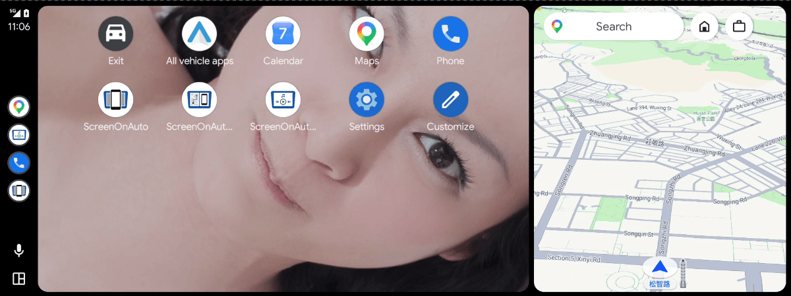
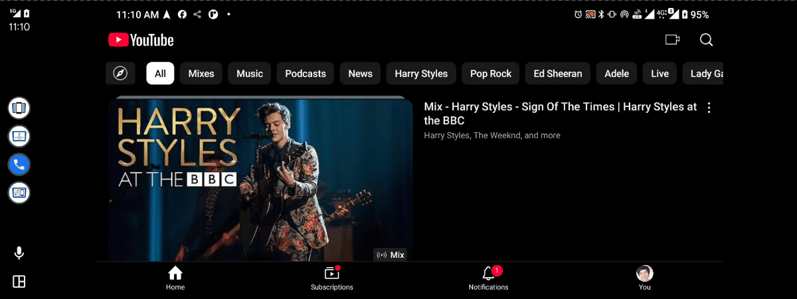
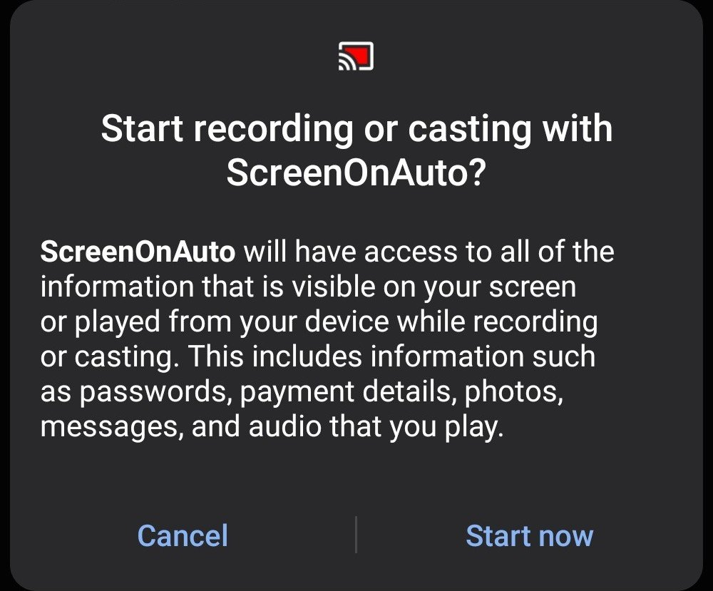
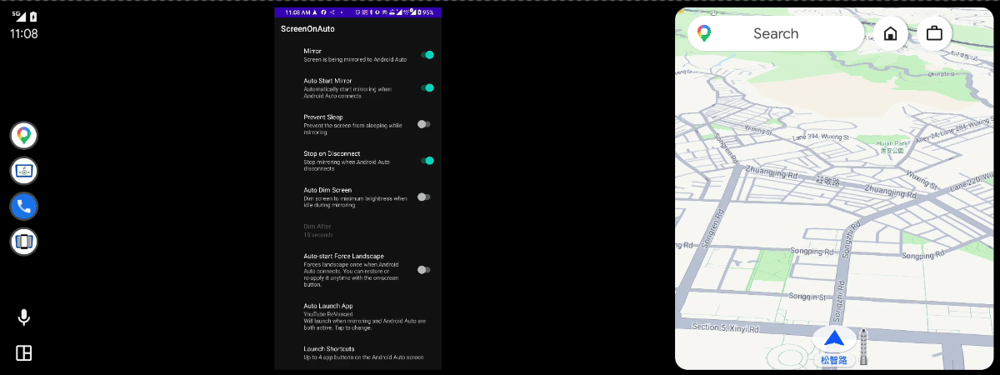

# Nasıl Kullanılır

> **ℹ️ Not**
> **Başlamadan önce** şunlardan emin olun:
> - ScreenOnAuto yüklü ve girişleri Android Auto başlatıcısında görünüyor.
> - Uygulamayı telefonda bir kez açıp istediği izinleri verdiniz.

## İki yansıtma girişi

Android Auto'nun uygulama başlatıcısında **iki** yansıtma girişi görünür. İkisi de
aynı telefon ekranını yansıtır — fark, yansıtmanın araç ekranında *nasıl*
gösterildiğidir:

<table class="entry-pair" role="presentation">
<tr>
<td width="50%" valign="top">
 <b>ScreenOnAuto</b> 

Tam ekran — harita alanının yerini alır
</td>
<td width="50%" valign="top">
 <b>ScreenOnAuto (Legacy)</b> 

<b>Yeterince büyük bir araç ekranında</b> bölünmüş görünümde <b>haritayla yan yana</b> durabilir; daha küçük ekranlarda harita arka plana geçer ve yalnızca yansıtma gösterilir (haritanın yerini <b>almaz</b>)
</td>
</tr>
</table>

İkisini de deneyin ve araç ekranınızda hangisi daha iyi çalışıyorsa onu kullanın.
İkisi de aynı yansıtmayı gösterir ve aralarında istediğiniz an geçiş yapabilirsiniz —
yansıtma çalışırken diğer girişi açmak, yeniden izin istemeden yansıtmayı hemen
gösterir.

> **💡 İpucu**
> Daha önce  **ScreenOnAuto**'yu (tam ekran girişini) açtıysanız ve şimdi
>  **ScreenOnAuto (Legacy)**'yi kullanmak istiyorsanız, önce araç ekranında harita
> uygulamanızı (ör. Google Haritalar) açın, sonra Legacy yansıtmayı başlatın. Böylece
> harita uygulaması araç ekranının varsayılan haritası olarak geri ayarlanır ve
> haritayla ilgili işlevler tam ekran yansıtma tarafından devralınmaz.

## Yansıtmayı başlatma

### Yansıtmayı otomatik başlat AÇIK (önerilir)

1. Telefondaki uygulamada [**Yansıtmayı otomatik başlat**](/docs/tr/settings/#auto_start_mirror)'ı açın (tek seferlik ayar).
2. Telefonu arabaya bağlayın ve Android Auto başlatıcısında bir ScreenOnAuto
   girişine ( veya
   ) dokunun.
3. Telefon, ekran kaydı izin penceresini otomatik olarak açar — telefonu elinize
   alın ve **Şimdi başlat**'a dokunun:

   

   Telefon uyku modundaysa ekran kendiliğinden açılır. PIN, desen veya parmak iziyle kilitliyse önce kilidi açın; ardından izin penceresi görünür. İzni ADB ile önceden verdiyseniz pencere çıkmaz: yansıtma hemen başlar ve telefonun kilidini açana kadar araç ekranında kilit ekranı görünür.

4. Telefon ekranınız araç ekranında görünür:

   

> **ℹ️ Not**
> İzin penceresi bir Android gerekliliğidir — her ekran değişiminde değil, yansıtma
> her başladığında bir kez görünür. *Yansıtmayı otomatik başlat* kapalıyken girişe
> dokunmak yalnızca yansıtma ekranını açar; siz başlatana kadar hiçbir şey
> kaydedilmez.

### Elle başlatma

**Yansıtmayı otomatik başlat**'ı kapalı tutmayı tercih ediyorsanız:

1. Telefonda ScreenOnAuto'yu açın ve **Yansıtmayı başlat**'a, ardından izin penceresinde **Şimdi başlat**'a dokunun.
2. Araç ekranında ScreenOnAuto girişlerinden birini açın — yansıtma zaten çalışıyordur
   ve hemen görünür.

(Sıra önemli değildir — önce girişi açıp **Yansıtmayı başlat**'a sonra da dokunabilirsiniz.)

### İzin penceresini atlama

Pencerenin her seferinde çıkmasından sıkıldınız mı? İzni ADB ile bir kez önceden
verebilirsiniz — bkz. [ADB ile Yansıtma İzni Verme](/docs/tr/grant-mirror-permission-via-adb/). Buna ek olarak [**Yansıtmayı arka planda başlat**](/docs/tr/settings/#silent_car_start) seçeneğini açarsanız ScreenOnAuto'nun ayarlar ekranı da telefonda açılmaz: araçta girişe dokunursunuz, telefonda hiçbir şey görünmez ve yansıtma başlar.

## Yansıtmayı durdurma

Şunlardan herhangi biri işe yarar:

- **Arabayla bağlantıyı kesin** — yansıtma otomatik olarak durur (varsayılan
  [*Bağlantı kesilince durdur*](/docs/tr/settings/#stop_on_disconnect) ayarı).
- Telefondaki kalıcı bildirimde **Yansıtmayı durdur**'a dokunun.
- Uygulamada **Yansıtmayı durdur**'a dokunun.

## Ayarlar Rehberi

Her ayarın ne işe yaradığı, ne zaman açılması gerektiği ve sınırları [Ayarlar Rehberi](/docs/tr/settings/) sayfasında anlatılıyor; yanında kullanılabilir bir ayarlar ekranı kopyası da var.

## Sorun Giderme

### Yansıtma ve görüntü

#### Giriş açılıyor ama boş kalıyor

Yansıtma henüz başlamamıştır; telefonda izin penceresini kontrol edin veya uygulamada **Yansıtmayı başlat**'a dokunarak başlatın.

#### Görüntünün etrafında siyah bantlar var

Telefon ve araç ekranlarının en-boy oranları farklıdır. Yansıtma ekranındaki [**Yönü
kilitle**](/docs/tr/settings/#map_action_force_landscape) düğmesini (veya ayarlardaki [**Yönü otomatik olarak kilitle**](/docs/tr/settings/#force_landscape) seçeneğini)
kullanın. Aracın kullanılabilir alanını tam olarak doldurmak için Ayrıcalıklı
özellikler'deki [**Telefon ekranını arabaya uydur**](/docs/tr/settings/#root_display_override) seçeneğini açın (Shizuku veya root). [**Yansıtma genişliğini ayarla, Yansıtma yüksekliğini ayarla**](/docs/tr/settings/#vd_gap) ile görüntüyü şeritlerin üzerine büyütebilirsiniz, ancak kenardan biraz kesilir; Ayarlar Rehberi sayfası bunu şemalarla gösterir.

#### Düzen değiştikten sonra görüntü gerilmiş veya bozulmuş görünüyor

Bu, bölünmüş görünümde görünür alan büyüyüp küçüldüğünde olur. Telefonu döndürüp
ekranın dikey ile yatay arasında geçmesini sağlamak görüntüyü düzeltir (**Yönü kilitle** açıksa önce ekrandaki düğmesiyle kilidi kaldırın). İki ayar da
bunu düzeltebilir:

- [**Ayarlar → Gelişmiş → Sabit yansıtma boyutu**](/docs/tr/settings/#nav_fixed_size)'nu açın. Yansıtma bozulmak yerine
  boyutunu korur (bir kısmı gizlenebilir). Yalnızca tam ekran  **ScreenOnAuto** girişi için geçerlidir.
- [**Ayarlar → Gelişmiş → Uygulamanın çizdiği yansıtma (deneysel)**](/docs/tr/settings/#self_draw) seçeneğini açın.
  Uygulama bu durumda ölçeklendirmeyi sisteme bırakmak yerine yansıtma görüntüsünü
  kendisi çizer; böylece görüntü bölünmüş görünümde artık bozulmaz. Biraz daha
  fazla pil tüketir ve yansıtma bir sonraki başlatılışında etkinleşir. [**Telefon ekranını arabaya uydur**](/docs/tr/settings/#root_display_override) (Ayrıcalıklı özellikler) aynı sorunu farklı bir yolla çözer ve ikisi birlikte açık olabilir.

#### Yansıtma sırasında Android Auto'daki Google Haritalar siyah ekrana dönüyor

Android 15 ve sonrasında, bir uygulama ekranı kaydederken (her yansıtma uygulaması bunu yapmak zorundadır) Android hassas saydığı uygulamaları gizler ve Google Haritalar bu listeye girebilir. Bu durumda Android Auto'daki harita, yansıtma durana kadar siyah kalır; başka yansıtma ve harita uygulamalarında da aynısı olur. Düzeltmek için **Ayarlar → Geliştirici seçenekleri → Ekran paylaşımı korumalarını devre dışı bırak** seçeneğini açın. Geliştirici seçenekleri görünmüyorsa Ayarlar'da **Derleme numarası**'nı aratıp 7 kez dokunun. Bu, ekranınızı paylaşırken Android'in tek kullanımlık kod içeren bildirimleri gizlemesini de durdurur; bu sizin için önemliyse seçeneği kapalı bırakın. Seçeneği açtıktan sonra yansıtmayı durdurup yeniden başlatın; ayar yalnızca yansıtma başlarken etkili olur.

#### Android Auto gezinme çubuğu ekranda kalıyor

Araç ekranındaki **Android Auto gezinme çubuğu** Android Auto'nun kendisi tarafından
çizilir ve uygulama tarafından gizlenemez.

### Ayrıcalıklı özellikler (Shizuku / root)

#### ADB ile başlatılan bir Shizuku sunucusu, telefonu arabaya taktığınızda kapanır

USB bağlantısı telefonu aksesuar moduna alır; bu da ADB'yi yeniden başlatır ve
Shizuku'yu da beraberinde götürür — kablosuz hata ayıklama da aynı ADB üzerinden
çalıştığı için işe yaramaz. Shizuku'yu yeniden başlatmanız yeterli, ScreenOnAuto
kendiliğinden yeniden bağlanır; daha da iyisi, watchdog hizmeti onu sizin yerinize
yeniden başlatan [Shizuku-Next sürümünü](https://github.com/rushiranpise/Shizuku-Next)
kullanın. Root kullanıcıları ve kablosuz Android Auto bağlantıları bundan etkilenmez.

#### Ekran kapandıktan sonra tekrar uyandırma

[**Telefon ekranını kapat**](/docs/tr/settings/#root_screen_off) açıkken dokunmatik ekran panelle birlikte kapandığı için telefona dokunmak işe yaramaz. Araç
ekranındaki [**Otomatik Karartma**](/docs/tr/settings/#map_action_auto_dim) düğmesine dokunun — Otomatik Karartma'yı açıp kapatmak
ekranı uyandırır (düğmeyi önce [**Ekran düğmeleri → İşlev düğmeleri**](/docs/tr/settings/#category_control_buttons) bölümünden açın;
varsayılan olarak kapalıdır). Ya da telefonun güç düğmesine **iki kez** basın, çünkü ilk
basış sistemi uyku moduna alan basıştır. Yansıtmayı durdurmak veya Android Auto
bağlantısını kesmek de ekranı geri getirir.
