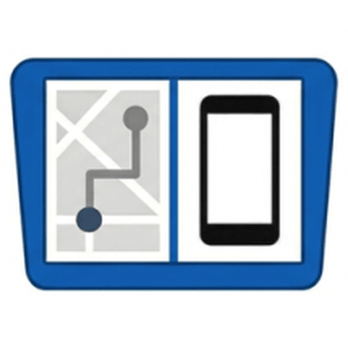
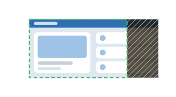

# 設定說明

這一頁照 app 設定頁的順序，說明每個設定的用途、什麼時候該開，以及摘要裡沒寫的限制。還沒開始用的話，先看[如何使用](/docs/zh-TW/how-to-use/)。

<aside class="sp-aside" aria-label="ScreenOnAuto 設定頁">

這是 app 的設定頁。點任一列就會跳到它的說明；開關可以切換，但只在這個頁面上，不會改到你的手機。

</aside>

## 主頁 {#main}

### 狀態面板 {#mirror}

設定頁最上方的深色面板。第一行顯示 Android Auto 有沒有連上，連上時附上偵測到的車機畫面尺寸。下面是目前的狀態和 開始鏡像／<svg viewBox="0 0 12 12" aria-hidden="true"><rect width="12" height="12" rx="2"/></svg>停止鏡像 按鈕。按下**開始鏡像**後，手機會跳出 Android 的螢幕擷取權限對話框，點**立即開始**才會真正開始。

有權限還沒授予時，面板底部會出現琥珀色的提示，點一下就捲到[權限](#category_permissions)。

### 自動開始鏡像 {#auto_start_mirror}

開啟後，從車機就能開始鏡像，流程如下（標「手動」的是你要做的，其他步驟會自動完成）：

1. 手動 在車機上點 ScreenOnAuto 的任一個入口（ 或 ）。
2. 手機休眠中的話，螢幕會自己亮起。
3. 手機上打開 ScreenOnAuto 的設定畫面，並自動按下 開始鏡像。
4. 手動 Android 跳出螢幕擷取權限對話框，點**立即開始**允許。手機有設 PIN、圖形或指紋鎖時，要先解鎖才會看到對話框。
5. 開始鏡像，手機畫面出現在車機上。

> **💡 小技巧**
> - **不想每次都按允許**：[用 ADB 授予鏡像權限](/docs/zh-TW/grant-mirror-permission-via-adb/)一次，就不會再跳出對話框，省掉第 4 步（手機解鎖之前，車機上顯示的是鎖定畫面）。
> - **不想讓設定畫面跑出來**：開啟進階的[在背景開始鏡像](#silent_car_start)，第 3 步就不會打開 ScreenOnAuto 的設定畫面，而是直接跳出權限對話框。兩個一起用的話，你只需要做第 1 步，手機上什麼都不會出現。

關閉時，第 3 步變成手動：在車機上點入口只會顯示「在手機上開始鏡像」的等待畫面，要你自己在手機上打開 ScreenOnAuto 並按 開始鏡像，接著一樣是第 4 步。

### 防止進入休眠 {#keep_awake}

鏡像期間不讓手機螢幕休眠。鏡像的內容就是手機螢幕，螢幕一關，車機上的畫面也會停住。它只負責「不休眠」，不會把亮度拉高，所以可以跟[自動調暗螢幕](#auto_dim)一起開：螢幕保持亮著，閒置時再調到最暗。

### 斷線時停止 {#stop_on_disconnect}

Android Auto 斷線時自動停止鏡像（預設開啟）。關閉的話，下車後鏡像會繼續在背景執行，直到你自己停止。

### 自動調暗螢幕 {#auto_dim}

鏡像期間，手機一段時間沒人碰就把亮度降到最低，省電也比較不刺眼。只會調暗手機的背光，車機上的畫面亮度不受影響。碰一下手機就恢復亮度。

- 需要[顯示於其他應用程式上方](#overlay_access)權限。
- 從車機上操作（[觸控轉發](#accessibility_access)）不算碰手機，不會讓手機亮回來。
- 手機停在鎖定畫面時不會調暗；解鎖或碰一下之後才開始計時。
- 連上 Shizuku 或 Root 時，可以改成直接關閉手機螢幕：見[關閉手機螢幕](#root_screen_off)。

### 調暗延遲 {#auto_dim_delay}

閒置多久後調暗：15、30（預設）、60 或 120 秒。要先開啟[自動調暗螢幕](#auto_dim)。

### 自動啟動應用程式 {#auto_launch_package}

鏡像和 Android Auto 都連上時，自動在手機上打開一個 app，例如地圖或音樂播放器。清單最上面的**預設主畫面**會開啟你目前使用的桌面，換了桌面 app 也不用重新設定。

### 只鏡像這個應用程式 {#single_app_mirror}

只把上面選的[自動啟動 app](#auto_launch_package) 送到車機，而不是整個手機畫面。你在手機上切到其他 app 時，車機畫面會變成空白，切回來就恢復，適合不想讓乘客或通知內容出現在車機上的情況。

這一列只在 **Android 15 以上**、而且已經[用 ADB 授予鏡像權限](/docs/zh-TW/grant-mirror-permission-via-adb/)後才會出現。沒有選自動啟動 app 時會變灰。

**什麼時候需要它：**

- **沒有用 ADB 授權時用不到它**。Android 14 起，每次開始鏡像跳出的擷取權限對話框，本來就可以選「分享整個螢幕」或「分享單一應用程式」，在對話框裡挑 app 就能只鏡像那個 app。Android 13 以下的對話框沒有這個選項，只能鏡像整個螢幕。
- **用 ADB 授權之後就需要它**。授權後不會再跳出對話框，也就沒地方選 app，鏡像一律是整個螢幕。想在免按允許的同時只鏡像一個 app，就要靠這個開關：它搭配上面的[自動啟動應用程式](#auto_launch_package)，只把那個 app 送到車機。
- 進階的[只分享整個螢幕](#full_screen_share_only)會把對話框裡的「分享單一應用程式」拿掉；這個開關生效時，它不會干擾。

### 子頁面 {#subpages}

**畫面按鈕**、**進階**、**特權功能**三列會打開各自的子頁面，下面分章說明：[畫面按鈕](#screen_buttons)、[進階](#advanced)、[特權功能](#root_features)。

### 權限 {#category_permissions}

每一列點下去會打開對應的系統設定頁，右邊的標籤顯示目前有沒有授予。

#### 通知存取權 {#notification_access}

讓「ScreenOnAuto 媒體控制器」 接手手機上正在播放的內容。這樣**方向盤上的多媒體按鈕**和 Android Auto 的媒體畫面，就能控制**本身不支援 Android Auto 的播放 app**，例如 YouTube：上一個／下一個、播放／暫停都能用。

- 只用來讀取「正在播放什麼」（媒體工作階段），不會讀取你的通知內容。
- 本身就支援 Android Auto 的音樂 app（例如 YouTube Music、Spotify）會直接連到 Android Auto，不經過這裡。
- 沒有授予時，按鍵只會送給系統認定正在播放的那個 app；手機上同時開著好幾個播放器時，可能會控制到錯的那一個。
- 較舊的 Android Auto 會在 app 清單裡多列一個「ScreenOnAuto 媒體控制器」入口；新版沒有這個入口是正常的，媒體控制照樣能用。

#### 顯示於其他應用程式上方 {#overlay_access}

[自動調暗螢幕](#auto_dim)、鎖定方向（[連線時鎖定方向](#force_landscape)和車機上的[鎖定方向按鈕](#map_action_force_landscape)）和[夜間調暗](#night_dim)都需要它。

#### 修改系統設定 {#write_settings_access}

只在 **Android 16 以上**出現。手機處於平板模式（畫面最短邊 600dp 以上，例如摺疊機的內螢幕，或用[手機顯示密度](#phone_density)調低之後）時，Android 16 會忽略 app 要求的螢幕方向，鎖定方向就要改用系統的旋轉鎖定，這需要這個權限。鏡像結束後會恢復你原本的自動旋轉設定。

#### 觸控轉發 {#accessibility_access}

讓你在車機螢幕上點、滑、捏合縮放時，動作會轉送到手機上，透過 Android 的無障礙服務完成。兩種鏡像能用的手勢相同：點一下、捲動（滑動列表）、快滑和捏合縮放。

有 Shizuku 或 Root 時，可以改用[真實觸控注入](#root_touch_injection)：車機上的觸控會以真實的手指動作送到手機，操作起來就像直接在操作手機一樣。**長按**、**按住拖曳**（例如移動桌面圖示）和**多指手勢**這些無障礙服務做不到的操作也都能用，只是要在「ScreenOnAuto (Legacy)」鏡像才有效。

### 關於 {#about}

版本號（點一下可以複製）、GitHub、贊助連結、隱私權政策、使用條款和第三方授權。

## 畫面按鈕 {#screen_buttons}

所有會出現在車機畫面上的按鈕，都在這一頁設定。

### 快捷啟動 {#category_shortcuts}

最多 4 個 app 捷徑，顯示在車機畫面上，點一下就在手機上打開該 app，畫面也就出現在車機上。

- 點一列選 app，右邊的開關決定要不要在車機上顯示。也可以選**預設主畫面**，在車機上放一顆回桌面的按鈕。
- **長按**已設定的捷徑，可以改車機上顯示的文字（最多 30 個字）。清空的話，「ScreenOnAuto (Legacy)」鏡像只顯示 app 圖示。
- 捷徑出現在鏡像畫面的**上方**，靠左還是靠右，兩種鏡像不同：
  - 「ScreenOnAuto」鏡像：用的是 Android Auto 的地圖畫面範本，捷徑是 Android Auto 自己畫的文字按鈕（不能顯示圖示），位置也由 Android Auto 決定，app 無法設定。可能會跟著 Android Auto 的駕駛座位置設定換到另一邊，但不保證。
  - 「ScreenOnAuto (Legacy)」鏡像：捷徑是 app 自己畫的帶圖示按鈕，預設在**右上方**，可以用[按鈕靠左對齊](#legacy_buttons_left)改到左上方，距離也能用[按鈕與快捷啟動的距離](#legacy_gaps)調整。
- 捷徑不會一直留在畫面上：「ScreenOnAuto (Legacy)」鏡像閒置 5 秒後，捷徑會和[功能按鈕](#category_control_buttons)一起隱藏，碰一下車機畫面就會再出現；「ScreenOnAuto」鏡像則由 Android Auto 決定何時隱藏。

### 功能按鈕 {#category_control_buttons}

鏡像畫面上的圓形按鈕，兩種鏡像都最多同時開 4 個。

- 位置，兩種鏡像不同：
  - 「ScreenOnAuto」鏡像：是 Android Auto 地圖畫面範本裡的按鈕列，由 Android Auto 自己畫，出現在**右下方或左下方**。靠哪一邊由 Android Auto 決定，app 無法設定；和[快捷啟動](#category_shortcuts)一樣，可能會跟著駕駛座位置設定換邊，但不保證。
  - 「ScreenOnAuto (Legacy)」鏡像：app 自己畫的一排按鈕，預設在**右下方**，可以用[按鈕靠左對齊](#legacy_buttons_left)改到左下方，距離也能用[按鈕與快捷啟動的距離](#legacy_gaps)調整。
- 自動隱藏：「ScreenOnAuto (Legacy)」鏡像閒置 5 秒後，功能按鈕會和捷徑一起隱藏，碰一下車機畫面就會再出現；「ScreenOnAuto」鏡像由 Android Auto 決定何時隱藏。

#### 鎖定方向按鈕 {#map_action_force_landscape}

開關鎖定方向，不改變設定裡的[連線時鎖定方向](#force_landscape)；下次連線時還是照設定來。預設開啟。

#### 自動調暗按鈕 {#map_action_auto_dim}

開關[自動調暗螢幕](#auto_dim)，跟設定裡的開關是同一個。手機螢幕被[關閉](#root_screen_off)時，用它最快能讓螢幕亮回來。

#### 夜間調暗按鈕 {#map_action_night_dim}

臨時開關[夜間調暗](#night_dim)，例如進隧道時。效果維持到車機下次切換日夜模式為止；[調暗時機](#night_dim_trigger)設為「一律」時，維持到 Android Auto 斷線。調暗程度用的是[強度](#night_dim_strength)。

#### 返回、主畫面、最近使用的應用程式按鈕 {#map_action_nav}

等同手機的三個導覽鍵，不管手機用手勢還是按鈕導覽都能用。連上 Shizuku 或 Root 時直接送出真的按鍵；否則需要開啟[觸控轉發](#accessibility_access)。

### 按鈕位置 {#category_button_placement}

這一區只影響 「ScreenOnAuto (Legacy)」鏡像。「ScreenOnAuto」鏡像的按鈕是 Android Auto 自己畫的，位置不能改。

#### 按鈕靠左對齊 {#legacy_buttons_left}

把[功能按鈕](#category_control_buttons)和[快捷啟動](#category_shortcuts)都移到左邊，適合右駕車，或右邊被車機自己的按鈕擋住的情況。

#### 避開手機導覽列 {#legacy_buttons_dodge_nav}

手機的導覽列出現在鏡像裡時，把按鈕移開，免得兩組按鈕疊在一起。需要 Android 11 以上（更舊的手機看不到這一列）。開啟後，下面四個距離會變灰，兩種擺法只能擇一。

#### 按鈕與快捷啟動的距離 {#legacy_gaps}

四個距離（單位 dp，0–400，預設 16）：功能按鈕與側邊、與底部的距離，以及快捷啟動與側邊、與頂邊的距離。車機自己的按鈕蓋住 ScreenOnAuto 的按鈕時，用它把按鈕往內移。數字太大放不下時，按鈕會自動縮回畫面內，不會跑出去。

## 進階 {#advanced}

### 螢幕方向 {#category_orientation}

#### 連線時鎖定方向 {#force_landscape}

連上 Android Auto 時，把手機鎖在一個方向，鏡像就不會因為手機轉動而翻來翻去，橫式時也能填滿寬的車機畫面。它只在連線的那一刻作用一次；之後用車機上的[鎖定方向按鈕](#map_action_force_landscape)解除或再鎖。需要[顯示於其他應用程式上方](#overlay_access)權限。

#### 方向 {#force_orientation_mode}

鎖成哪個方向：**橫式**（預設）、**直式**，或**依車機畫面自動偵測**：依照鏡像在車機上實際可用的區域，比較寬就橫式，比較高就直式。分割畫面改變形狀時也會跟著換。

#### 反向橫式 {#force_landscape_reverse}

橫式時把手機轉成另一個方向，例如手機支架讓手機上下顛倒時。直式時這一列會變灰。

### 畫面調整 {#category_display_adjust}

#### 自繪鏡像 {#self_draw}

由 app 自己把手機畫面畫到車機上，不交給系統縮放。好處是分割畫面時不會變形，下面的寬度／高度調整也不論在連線前或連線中設定都有一樣的效果。稍微比較耗電。

切換後要**下次開始鏡像**才生效（不是即時切換，這是刻意的）。

#### 影像延遲 {#video_delay}

畫面比聲音快時（例如 Android 車機上用接收 app 播放 Android Auto，聲音會延遲），把畫面往後延 0–2000 毫秒，讓它對上聲音。需要先開[自繪鏡像](#self_draw)，改了立即生效。

- 延遲需要暫存畫面，會多用記憶體與 GPU。如果影音不同步本來就是因為手機或車機資源不足，開了可能更糟。
- 觸控仍然作用在手機**當下**的畫面，不是延遲後看到的畫面。

#### 固定鏡像尺寸 {#nav_fixed_size}

只適用「ScreenOnAuto」鏡像。車機切成分割畫面時，不重新調整鏡像尺寸，所以不會變形，但鏡像的一部分可能被切掉。最好在連線前設定。

#### 按鈕出現時不移動鏡像 {#nav_ignore_strip}

只適用「ScreenOnAuto」鏡像（預設開啟）。Android Auto 的按鈕列會自己出現又隱藏，每次都會讓可用區域變小一點。開啟時，按鈕出現不會讓鏡像跟著縮放跳動；分割畫面等真正的版面變化仍會調整。開啟[固定鏡像尺寸](#nav_fixed_size)時這一列會變灰。

#### 調整鏡像寬度、調整鏡像高度 {#vd_gap}

車機給鏡像的可用區域（下圖的綠色虛線框），長寬比通常跟手機畫面不一樣。手機畫面會等比例縮放、放進這個區域，比例對不上的那一邊就會留下黑邊：手機畫面比區域**寬**（例如分割畫面讓區域變窄）時，黑邊在**上下**；比區域**窄**時，黑邊在**左右**。

這兩個設定把放鏡像的框加大或縮小，單位是像素。**負值**把框撐大：畫面跟著放大、黑邊變少，代價是有一部分畫面會超出可用區域、被切掉（圖中的斜線部分）。

<figure><figcaption>上下有黑邊</figcaption></figure>
<figure><figcaption><b>寬度</b>設為負值：上下黑邊消失，右邊超出去</figcaption></figure>
<figure><figcaption>左右有黑邊</figcaption></figure>
<figure><figcaption><b>高度</b>設為負值：左右黑邊消失，下緣超出去</figcaption></figure>

- **上下黑邊 → 把「寬度」調成負值。** 框變寬，畫面也跟著放大、變高，填掉上下黑邊。
- **左右黑邊 → 把「高度」調成負值。** 框變高，畫面也跟著放大、變寬，填掉左右黑邊。
- 鏡像是對齊可用區域的**左上角**，所以超出去的部分都在**右邊**（調寬度時）或**下面**（調高度時），不是兩邊平均分攤。被切掉的地方如果剛好有按鈕，就點不到了，所以數值只要調到黑邊剛好消失就好。
- **正值**的作用相反：把框縮小，用在車機把畫面邊緣切掉的情況，讓被切掉的邊縮回畫面內（會多出一點黑邊）。
- 開了[自繪鏡像](#self_draw)時效果最準確。沒開的話，請在**連線中**調整：連線前就設好的負值，在「ScreenOnAuto」鏡像可能會讓畫面被壓扁，而不是放大。

點文字輸入數值（存入非 0 的數字會自動打開開關），點分隔線右邊的開關可以暫時關閉、保留數值，方便前後對照。

> **💡 想完美解決黑邊**
>
> 有 Shizuku 或 Root 的話，開啟[讓手機畫面比例對齊車機](#root_display_override)。它直接把手機畫面改成跟可用區域一樣的長寬比，鏡像剛好填滿，沒有黑邊、也不會切掉任何東西。開啟時，這兩個調整會暫停作用。

<figure><figcaption>讓手機畫面比例對齊車機：剛好填滿</figcaption></figure>

### 夜間調暗 {#category_night_dim}

#### 調暗車機畫面 {#night_dim}

晚上自動調暗車機上的鏡像，避免手機 app 的亮白畫面在夜間太刺眼。

- 「ScreenOnAuto (Legacy)」鏡像，或開了[自繪鏡像](#self_draw)時，只調暗車機上的畫面。
- 「ScreenOnAuto」鏡像沒開自繪鏡像時，是在手機畫面上加一層暗色，所以**手機螢幕也會一起變暗**。這需要[顯示於其他應用程式上方](#overlay_access)權限。
- 想臨時取消或開啟，用車機上的[夜間調暗按鈕](#map_action_night_dim)。

#### 調暗時機 {#night_dim_trigger}

**跟隨車機**（預設）：車機切換到夜間模式時調暗，白天恢復。**一律**：連線期間一直調暗。

#### 強度 {#night_dim_strength}

調暗的程度，10%–80%（預設 50%）。[夜間調暗按鈕](#map_action_night_dim)也用這個值。

### 從車機啟動 {#category_car_start}

#### 在背景開始鏡像 {#silent_car_start}

從車機[自動開始鏡像](#auto_start_mirror)時，不把 ScreenOnAuto 的設定頁帶到手機前景，也不留在最近使用的應用程式裡。權限對話框還是會出現。

> **💡 小技巧**
>
> 再搭配[用 ADB 授予鏡像權限](/docs/zh-TW/grant-mirror-permission-via-adb/)，連權限對話框也不會出現：在車機上點入口後，手機上什麼都不會跳出來，鏡像直接開始，完全不用碰手機。手機解鎖之前，車機上顯示的是鎖定畫面。

#### 只分享整個螢幕 {#full_screen_share_only}

Android 14 起，擷取權限對話框會先問要「分享單一應用程式」還是「分享整個螢幕」，每次都得展開選單。開啟後對話框只提供整個螢幕。只在 Android 14 以上出現。如果你是靠對話框選 app 來只鏡像單一 app（沒有用 ADB 授權時的做法），就不要開啟它；用 ADB 授權時則改用[只鏡像這個應用程式](#single_app_mirror)。

如果開了還是看到兩個選項：Android 16 的開發人員選項裡有一個相容性設定（`OVERRIDE_DISABLE_MEDIA_PROJECTION_SINGLE_APP_OPTION`）會把選項加回來，請先確認它沒被開啟。

## 特權功能 {#root_features}

這一頁的功能需要 [Shizuku](https://shizuku.rikka.app/) 或 Root：它們會改動一般 app 碰不到的系統設定。每一項在鏡像結束後都會還原手機原本的設定。

### 連線 {#root_status}

頂端的方框顯示目前有沒有連上 Shizuku 或 Root，旁邊的按鈕用來**授予存取權**、**連線**或**中斷連線**。連線斷掉後（例如 Shizuku 重新啟動），會自動重新連上。

用 ADB 啟動的 Shizuku，在手機用 USB 接上或拔離車機時都會被關掉：USB 連線會讓手機切換配件模式，這會重啟 ADB，Shizuku 也跟著停止。無線偵錯走的是同一個 ADB，所以一樣沒用。root 與無線 Android Auto 連線不受影響。

重新啟動 Shizuku 即可，ScreenOnAuto 會自行重新連上。想連這一步都省掉，建議改用 [Shizuku-Next](https://github.com/rushiranpise/Shizuku-Next)（接續 Shizuku 開發的分支；Shizuku 本身自 2025 年 5 月起就沒有更新），並開啟它的 watchdog 與 TCP 模式：ADB 重啟後，watchdog 會透過 TCP 模式在幾秒內重新啟動服務，ScreenOnAuto 隨後自動重新連上。TCP 模式每次開機後要用電腦或無線偵錯開啟一次；開啟期間同一個網路上的裝置可以嘗試連線（手機會跳出授權提示）。

### 偵測不到 Root？ {#root_force}

如果 Root 管理器被隱藏或改了名稱，app 就偵測不到 Root，連線框也不會提供 Root 選項。點這一列會直接向 su 要求權限。只在偵測不到 Root、而且還沒連線時出現。

### 功能 {#category_root_features}

#### 關閉手機螢幕 {#root_screen_off}

[自動調暗螢幕](#auto_dim)觸發時，不只調暗，而是直接關掉手機的背光。需要先開自動調暗螢幕。

這只是把手機的螢幕關掉，**手機並沒有進入休眠**：app 和系統都繼續運作，車機上的鏡像也照常顯示，從車機上操作手機也一樣有效。不過觸控螢幕會跟著螢幕一起關閉，所以**直接碰手機螢幕不會有反應**，也不會讓螢幕亮起來。

要讓螢幕亮回來：點車機上的[自動調暗按鈕](#map_action_auto_dim)、停止鏡像或拔掉 Android Auto，或者按**兩下**電源鍵（第一下是讓系統進入休眠）。

#### 真實觸控注入 {#root_touch_injection}

把車機上的觸控以真實的手指動作送到手機，長按、拖曳和多指手勢都能用，也不需要開啟[觸控轉發](#accessibility_access)的無障礙服務。完整效果只在「ScreenOnAuto (Legacy)」鏡像：「ScreenOnAuto」鏡像從 Android Auto 只收得到點一下、捲動、快滑和捏合，這是 Android Auto 的限制。

#### 虛擬觸控螢幕 {#root_virtual_touch}

改用一個虛擬的觸控螢幕裝置送出觸控，讓直接讀取觸控螢幕的手勢 app（例如 GMD Gestures）也收得到。需要先開[真實觸控注入](#root_touch_injection)。

#### 手機深色模式跟隨車機日夜 {#root_follow_car_night}

鏡像期間，手機的淺色／深色主題跟著 Android Auto 的日夜模式切換，鏡像結束後還原手機原本的設定。需要 Android 10 以上。

#### 從 Android Auto 讀取日夜模式 {#root_car_night_from_aa}

開啟上一項後才出現，只用於「ScreenOnAuto」鏡像。有些手機（例如部分 Samsung 機型）回報給 app 的日夜模式不正確，手機就不會跟著車機切換；開啟後改為直接讀取 Android Auto 本身的日夜狀態。手機有正常跟著切換的話不用開。

#### 鏡像時的字型大小 {#root_mirror_font_scale}

鏡像期間改用另一個字型大小，例如讓車機上的字大一點，鏡像結束後恢復。選項就是手機設定裡的那幾級。

#### 鏡像時的導覽模式 {#root_mirror_nav_mode}

鏡像期間切換成手勢、雙按鈕或三按鈕導覽，結束後恢復（Android 10 以上）。例如直式車機分割畫面時，改用手勢導覽可以多出一些空間。手機不支援的選項會標示無法使用。

#### 鏡像時的桌面 {#root_mirror_home}

鏡像期間把手機的預設桌面換成另一個啟動器，結束後換回原本的。適合想在車上用一個專為車機排列的桌面，或者原本的桌面在[畫面形狀](#category_root_display)改變後會打亂圖示排列的手機（例如部分小米 HyperOS 機型）。

### 畫面形狀 {#category_root_display}

#### 讓手機畫面比例對齊車機 {#root_display_override}

鏡像期間把手機畫面改成跟車機一樣的長寬比，鏡像就能填滿車機、沒有黑邊，也不會在分割畫面時變形。改變是即時的，不用重新連線。

<figure><figcaption>開啟前：手機比例跟車機不同，車機上左右有黑邊</figcaption></figure>
<figure><figcaption>開啟後：手機畫面改成車機的比例，車機上剛好填滿</figcaption></figure>
<figure><figcaption>開啟前：車機區域比較窄（例如分割畫面），上下有黑邊</figcaption></figure>
<figure><figcaption>開啟後：手機畫面改成車機的比例，車機上剛好填滿</figcaption></figure>
<figure><figcaption>開啟前：直式大螢幕車機，手機直放，車機上左右有黑邊</figcaption></figure>
<figure><figcaption>開啟後：手機畫面改成車機的直式比例，車機上剛好填滿</figcaption></figure>

車機上的黑邊在左右（第一組）或上下（第二組）都適用，直式的大螢幕車機也一樣（第三組；手機會直放，[方向](#force_orientation_mode)設為「依車機畫面自動偵測」時會自動鎖成直式）。手機的實體螢幕比例並沒有改變，所以開啟後，**手機自己的螢幕上**會反過來出現黑邊（車機原本左右有黑邊時，手機在上下；原本上下有黑邊時，手機在左右），這是正常的；車機上的鏡像則剛好填滿。

- 這個改動是系統層級的，**重新開機後也會保留**，直到還原為止。正常情況下停止鏡像或斷線時會自動還原。
- 手機畫面處於被改過的狀態時，這一區最上方會出現琥珀色提示和**還原**按鈕。
- 萬一手機畫面卡在錯的形狀而且打不開 app，可以用電腦執行 `adb shell wm size reset` 和 `adb shell wm density reset`。

#### 在主畫面加入還原捷徑 {#root_display_shortcut}

在桌面放一個「還原畫面」捷徑，不開 app 也能一鍵把手機畫面恢復原狀。

#### 實際會套用的尺寸 {#root_display_derived}

依照車機的尺寸算出手機畫面會被改成多少，以及系統實際接受的值。還沒量到車機尺寸時，會等下次在 Android Auto 上打開鏡像時自動量測。

#### 車機畫面尺寸 {#car_size}

兩種鏡像各一組（車機給兩種鏡像的區域大小不同）。預設是自動偵測的值，前面標「自動」。只有偵測值不對時才需要改：寬和高在同一個對話框裡，留空就用偵測值（160–8192）。

#### 手機顯示密度 {#phone_density}

選填，兩種鏡像各一個（72–640 dpi）。數字越大，車機上的文字和按鈕越大；越小，一次能顯示越多內容。調得太小、讓手機最短邊超過 600dp 時，多數 app 和系統會改用平板版型（兩欄、側邊導覽），對話框會即時告訴你會不會變成平板版型。留空就不變更。

